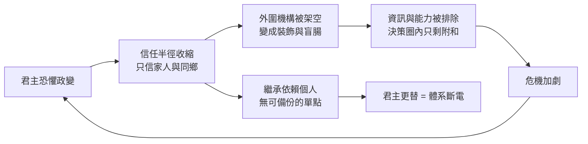

# 04.3 繼承危機：個人化權力與體系斷裂

## 一、案發現場：兩個相差一千五百年的同型崩潰

歷史懸案偵查中，最令人不安的發現是「隔代重演」——兩個相隔千年的案例，驗屍報告幾乎可以互相抄襲。

**標本A：西羅馬帝國。** 公元235年至284年，羅馬帝國在五十年間換了約二十位皇帝，平均在位不足三年，絕大多數死於暗殺或內戰——史稱三世紀危機。此後西羅馬再未真正恢復：皇帝的合法性依賴軍隊擁立，軍隊日益蠻族化（日耳曼傭兵成為主力，軍團統帥本人常是蠻族將領），最後一位有實力的統帥埃提烏斯被皇帝親手殺死（454年），次年皇帝本人又被埃提烏斯的舊部刺殺。476年，日耳曼僱傭軍首領奧多亞克廢黜末帝羅慕路斯·奧古斯都路斯——連廢黜的形式都懶得做得隆重，僅把帝國徽記送往君士坦丁堡，表示「西部不再需要皇帝了」（見 [../../世界史/國家滅亡史/0476-西羅馬帝國.md](../../世界史/國家滅亡史/0476-西羅馬帝國.md)）。

**標本B：薩達姆的伊拉克。** 2003年，美軍進入巴格達，這個曾擁有百萬大軍、秘密警察遍佈全國、以鐵腕著稱的政權，在數週內蒸發——不是被擊敗，而是**溶解**。軍隊不作戰，黨組織不留名，整個安全體系像沙塔遇潮一樣垮塌。事後還原發現：這個體系的一切組件——革命指揮委員會、復興黨、共和國衛隊、特種共和國衛隊——都不是治理機構，而是薩達姆個人權力的同心圓防護層。決策半徑收縮到他的家族與提克里特同鄉：軍隊實權交給表兄弟（如祕密警察頭子、後來叛逃的卡邁勒家族），情報機構由異母兄弟掌管，核心軍費流向對薩達姆個人忠誠的部隊。**體系的一切設計目標是防止政變，而非防禦外敵；當外敵真的到來，體系沒有任何一個為戰爭而設計的器官可用。**（見 [../../世界史/國家滅亡史/2003-伊拉克薩達姆政權.md](../../世界史/國家滅亡史/2003-伊拉克薩達姆政權.md)）

兩個標本相隔一千七百餘年、技術與意識形態天差地別，卻共享同一條病理：**當權力被個人化到極致，國家機器退化為君主的私人防具；而私人防具有一個致命的設計缺陷——它的運轉依賴君主本人的存在，君主的每一次更替都是體系的一次斷電。** 本節要論證的命題由此而來：**個人化權力使繼承成為體系的單點故障（single point of failure）。**

## 二、繼承為何是單點故障：從委託—代理的角度

繼承危機的學理位置在第4章的架構中非常精確：它是**委託—代理失靈在最高層的爆發**。第4.1節處理的是官僚層的代理問題（代理人偷竊委託人的利益），本節處理的是更根本的問題：**委託人本身沒有任期制度時，整個委託—代理契約在換約時刻失效。**

正常運轉的權力體系有一個常被忽視的功能：繼承規則是整個體系的「時鐘脈衝」。無論是世襲、選舉還是任期制，明確的繼承規則使權力移交成為例行程序，使所有代理人（官僚、軍隊、稅吏）的效忠對象從「某人」轉換為「某個職位」。個人化權力體系摧毀的正是這個轉換器：效忠對象是活人而非職位，於是：

$$
\text{體系存續} = \text{君主在世} \land \text{君主清醒} \land \text{繼承人被容忍}
$$

三個條件中任何一個失效，等式右側為假，體系斷電。用工程語言說，這是把整個國家的可用性（availability）串聯在三個最脆弱的組件之後——**串聯系統的可靠性等於最弱組件的可靠性，而繼承恰恰是無法冗餘備份的組件。**

個人化還帶來一個自我強化的副作用：**信任半徑的收縮螺旋。** 君主因恐懼政變而只信任身邊最親近的人 → 核心圈之外的一切機構被剝奪實權、變成裝飾 → 真實的資訊與能力被排除在決策圈外 → 決策品質下降、危機加劇 → 君主更加恐懼、半徑進一步收縮。薩達姆晚年的統治是最完整的演示：1995年兩個女婿叛逃（後被誘回處決）之後，他的信任名單上只剩兒子烏代與庫賽和提克里特血親；到2003年，這個縮到極小的核心圈既無法為他提供真實戰場資訊（沒有人敢報告壞消息），也無法在他被擊潰後維持體系（體系從來只為他一人運轉）。

## 三、四具標本：繼承斷裂的四種死法

### 3.1 西羅馬：繼承混亂 → 軍隊私有化 → 蠻族接管

三世紀危機的教訓迫使戴克里先嘗試用「四帝共治」為繼承建立冗餘設計，但這個設計在首次交接就崩潰——因為它仍然依賴四位共治者的個人協作，而非不依賴任何個人的規則。此後西羅馬的政治史是一部「禁衛軍拍賣會」的歷史：軍隊擁立皇帝，蠻族將領成為帝國的實際統治者（如裡西默爾先後操縱廢立數位皇帝），皇帝本人淪為傀儡。

這裡隱藏著繼承危機的第二重後果：**當中央的合法性頻繁斷電，帝國的代理人（各行省貴族、蠻族軍團）開始與中央脫鉤，轉而在地方上自行建立效忠結構。** 西羅馬的滅亡因此不是蠻族入侵的結果，而是繼承混亂使帝國的代理網絡逐步私有化、地方化，最後奧多亞克式的「末代接管」只是對既有事實的蓋章確認。羅馬不是被殺死的；它的中樞神經早已斷線，476年只是拔掉了維生插頭。

### 3.2 西夏：個人化依附體系在征服浪潮中的斷裂

西夏為本節提供了一個中型標本：一個夾在遼、金、蒙古之間的小型帝國，其存續高度依賴統治集團（党項貴族）內部的個人化效忠網絡與對強鄰的靈活依附（見 [../../世界史/國家滅亡史/1227-西夏.md](../../世界史/國家滅亡史/1227-西夏.md)）。這種體系在常態下的效率頗高——決策鏈短、動員快——但在蒙古的滅國級打擊面前暴露了個人化體系的通病：**當君主與核心貴族層被斬首，整個動員體系隨之瓦解，沒有可獨立運轉的國家機器留下。** 1227年，中興府陷落之前，西夏已在連年抵抗中耗盡了那個以家族紐帶為骨架的體系；成吉思汗之死與西夏之亡幾乎同時，歷史以一種殘酷的巧合完成了對「個人化體系」的註腳：**依賴個人的國家，與個人一同死亡。**

### 3.3 薩達姆：信任半徑收縮到家人之後

第6.1節已勾畫薩達姆體系的結構，此處補上它的最後一課：**個人化體系不僅在崩潰時脆弱，在存續時就已經在持續輸出劣化決策。** 1990年入侵科威特的決策，是在核心圈無人敢於反對的氛圍中做出的——據戰後披露，連薩達姆本人在會議上聽到的美軍意志評估都是迎合性的誤報。兩伊戰爭八年、海灣戰爭慘敗、十年制裁，這三記重擊中任何一記都足以讓非個人化體系調整路線；而個人化體系的調整方式只有一種：清洗內圈、再清洗內圈，半徑越洗越小，決策品質越洗越差。2003年的溶解不是突發事故，而是**二十餘年信任收縮螺旋的終點站**。

### 3.4 2021年阿富汗加尼共和國：繼承危機的現代變體——依附型虛擬國家

加尼領導的阿富汗共和國是本節最新、也最具當代警示意義的標本（見 [../../世界史/國家滅亡史/2021-阿富汗共和國.md](../../世界史/國家滅亡史/2021-阿富汗共和國.md)）。它表面上具備現代國家的全套器官：選舉產生的總統、三十萬軍警、外國援助撐起的財政、社交媒體時代的官僚體系。但驗屍報告揭示了兩個「假」：

**資訊是假的。** 軍隊指揮層長年虛報兵額以領取薪餉（「幽靈士兵」），地方實情被層層加工後上達喀布爾；美國的監督者依賴同一套造假體系撰寫進度報告。到2021年，美國與喀布爾雙方對「三十萬大軍」的信心都建立在虛構的會計資料上——這正是本書第一章「資訊迴路潰敗」的教科書案例。

**財政是假的。** 國家預算的四分之三以上來自外援，本地稅收從未支撐過國家機器——這是一個**虛擬國家**：其「存在」不是本地社會契約的產物，而是外部輸血維持的投影。2021年美國決定撤離，等於拔掉維生設備；投影以旬為單位消失：城市不戰而降，軍隊成建制解散，總統在塔利班進城前數小時出逃。

繼承危機在此呈現現代變體：加尼體系的「單點」不在血緣繼承，而在**外國意志**——當撤離決定（單點決策）做出，整個依附體系瞬間失去存續前提。塔利班接管後的第一件事，是收繳美制裝備、重新分配權力給以家族與教派網絡為骨架的個人化結構——歷史用最快的速度回到了它的老路。

## 四、四案的共同驗屍結論：國家機器的「防腐性」測試

把四具標本放回全書公式 $\text{衰敗}=\text{資訊迴路潰敗}\times\text{財政失靈}\times\text{制度僵化}$ ，繼承危機的位置可以精確標定：**個人化權力是制度僵化的終極形態——它把整個制度收縮為一個人的生理壽命與心理狀態。**

一個可供讀者自用的思想實驗由此誕生，可稱為「國家機器防腐測試」：

> **假設最高權力者明天突然消失，體系中有多少機構能不經重啟地繼續運轉一個月？**

- 通過測試的體系：權力依附職位，繼承是例行程序，機器為體系而造。
- 不通過測試的體系：權力依附個人，繼承是斷電時刻，機器為個人防護而造。

四具標本全部不通過測試，並各自展示了斷電的不同死法：西羅馬——反覆斷電造成代理網絡永久私有化；西夏——斬首即滅亡；薩達姆——半徑收縮螺旋以溶解收場；加尼——依附型單點撤除，投影瞬間熄滅。**防腐測試不及格的國家不需要等到外敵入侵：它的每一次繼承，都是一次內建的滅亡彩排。**

## 五、本節要點

1. 個人化權力使繼承成為體系的單點故障：效忠對象是活人而非職位時，君主更替等於體系斷電，且此組件無法冗餘備份。
2. 個人化伴隨「信任半徑收縮螺旋」：恐懼→收縮→外圍機構被架空→資訊與能力被排除→危機加劇→更恐懼；薩達姆政權是二十餘年螺旋的完整記錄。
3. 繼承混亂的次生災害比一次斷電更深：西羅馬案顯示，中央合法性的反覆失效會驅動代理網絡私有化與地方化——帝國之亡是既有事實的蓋章確認。
4. 依附型虛擬國家的單點從血緣轉移到外部意志：2021年阿富汗的資訊（幽靈士兵）與財政（外援依存）皆是投影，投影在單點撤除時以旬為單位熄滅。
5. 「防腐測試」（最高權力者突然消失後體系可運轉多久）是判斷國家制度健壯度的快速檢驗；個人化權力是制度僵化的終極形態，也是全書公式中三乘數同時惡化的放大器。

## 六、延伸對照

- [../../世界史/國家滅亡史/0476-西羅馬帝國.md](../../世界史/國家滅亡史/0476-西羅馬帝國.md)：三世紀危機、軍隊擁立與蠻族化軍團的完整記錄。
- [../../世界史/國家滅亡史/1227-西夏.md](../../世界史/國家滅亡史/1227-西夏.md)：中小型個人化依附體系在滅國級打擊下的斷裂。
- [../../世界史/國家滅亡史/2003-伊拉克薩達姆政權.md](../../世界史/國家滅亡史/2003-伊拉克薩達姆政權.md)：信任半徑收縮與體系溶解的當代標本。
- [../../世界史/國家滅亡史/2021-阿富汗共和國.md](../../世界史/國家滅亡史/2021-阿富汗共和國.md)：依附型虛擬國家——資訊與財政雙假的最快崩潰記錄。
- [../../世界史/國家滅亡史/1453-拜占庭帝國.md](../../世界史/國家滅亡史/1453-拜占庭帝國.md)：宮廷政治與繼承鬥爭的另一個千年案例（見第4.1節）。
- [../../世界史/世界發展史/1868-明治維新.md](../../世界史/世界發展史/1868-明治維新.md)：對照——「萬世一系」的象徵性繼承規則反而為改革提供了不依賴個人的正統性錨點。
