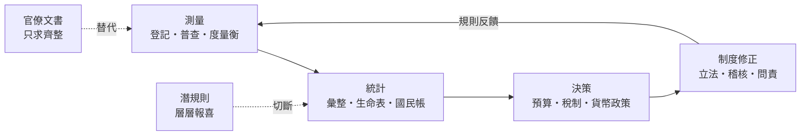
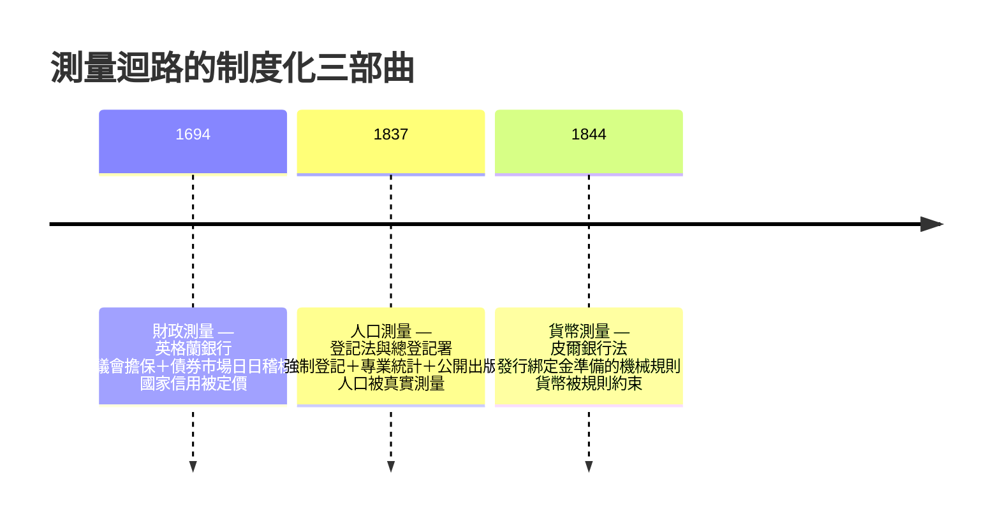

# 05.1 測量迴路的發明：從戶籍統計到現代財政國家

## 一、案發現場：1837年，國家第一次「看得見」每一個人

每一樁歷史懸案都始於現場的細節。本章第一個現場，是1837年的英格蘭——一個看似平淡無奇的年份，卻在檔案裡留下了一條决定性的線索：**《登記法》（Registration Act）生效，全英格蘭與威爾斯的每一樁出生、死亡、婚姻，都必須向國家設立的登記體系報備，並由一個全新的中央機構——總登記署（General Register Office）——逐年彙整成統計。**

這條線索的重量，需要放回語境才能掂出來。在此之前的幾百年裡，國家「知道」自己的人口，靠的是兩種粗糙工具：教區的洗禮紀錄（受洗不等於出生，異教徒與非國教徒不在其列），以及每隔若干年一次的鬆散人口普查（英國自1801年起每十年一次，但只數人頭，不問生死）。而更早的王朝——包括本書反覆驗屍的明朝（見 [../../世界史/國家滅亡史/1644-明朝.md](../../世界史/國家滅亡史/1644-明朝.md)）——連這個水準也達不到：戶籍數字是里甲層層上報的政治文書，目的不是「知道真實」，而是「完成任務」。洪武年間精心編制的黃冊，到了弘治、嘉靖年間已淪為抄襲舊冊的例行公事——**地方官要的不是準確，是齊整。**

1837年的英國做了一件完全不同的事：它把「國家認識自己」變成了一套**常設的、強制的、可覆核的測量系統**。出生登記讓國家知道每年新增多少納稅人與兵員；死亡登記讓它知道疾病、瘟疫與工業化的代價；此後人口普查逐步追加了職業、住所、教育等欄位。更重要的是，這些數字不是收進檔案館就完事——它們被彙整、被出版、被國會辯論、被報紙引用、被統計學家（如威廉·法爾）用來計算死亡率與生命表。**數字離開了官僚的抽屜，進入了公共的迴路。**

懸案在此成形：為什麼是英國？為什麼是此時？以及——最關鍵的——這套測量系統與四十年後英格蘭銀行體系的成型、一百年間英國霸權的建立，之間是不是同一條線索的三個斷面？

## 二、偵查原理：國家能力的第一公理是「測量」

本書的核心論旨是：**國家衰敗 = 資訊迴路潰敗 × 財政失靈 × 制度僵化的複合收斂**；而資訊迴路潰敗的常規死因，是吳思所謂的「潛規則」——層層代理人在真實與奏報之間做了手腳，皇帝收到的數字與現實脫鉤，決策因此建立在幻影之上。黃仁宇總結明朝的病根，正是「無法在數目字上管理」：不是缺錢、不是缺人，是**缺一套讓真實數字能夠流動到決策層的管道**。

金觀濤把這條管道拆成四段：**測量 → 統計 → 決策 → 制度修正**。四段中任何一段斷裂，迴路就變成單行道——上層不斷下達指令，下層不斷回報喜訊，現實在兩者之間無人過問。我們在前面各章驗過的屍體，無論是西班牙的破產螺旋（見 [../../世界史/國家滅亡史/1557-西班牙破產.md](../../世界史/國家滅亡史/1557-西班牙破產.md)）還是魏瑪的惡性通膨（見 [../../世界史/國家滅亡史/1933-魏瑪共和國.md](../../世界史/國家滅亡史/1933-魏瑪共和國.md)），解剖報告的第一欄都寫著同一個死因：**測量失真，迴路斷頭。**

韋伯為這條管道給出了社會學的表述：現代國家的本質是「理性官僚制」，而理性官僚制的精神原型不是衙門，是**複式簿記**——每一筆交易記兩次、帳目內部互為印證、任何造假都會留下對不上的裂縫。複式簿記的偉大之處不在記帳，而在**內建稽核**：它把「說謊」的成本從零提高到必然露餡。本章要講的故事，就是英國把這種簿記邏輯從商行的帳房，逐步推廣到人口、財政與貨幣三個領域的過程。

虛線所標記的兩個斷點，就是本書前四章反覆驗屍的部位。本章的任務是證明：英國沒有發明「統治」，它發明的是**把虛線變成實線的一整套裝置**。

## 三、第一部曲：1837年登記法——讓「人」變成可稽核的數字

現代財政國家的原料是人：納稅的人、當兵的人、被救濟的人。原料不合規格，後端的一切都白搭。1837年登記體系的關鍵設計有三層：

**第一層：強制與罰則。** 出生、死亡不在規定期限內登記，處以罰金。這看似小事，卻是測量史上的分水嶺——在此之前，報告人口是地方的自選動作；在此之後，它是**法定義務**，且不報告本身會產生成本。對比明朝黃冊的教訓：當上報失真沒有任何成本、而齊整上報有獎勵時，測量系統必然退化成抄襲系統。

**第二層：專職與專業。** 總登記署不是衙門裡的兼差科房，而是一個有首長（總登記官）、有固定預算、有職業文官的機構。韋伯式官僚制的三要素——專職、科層、文書檔案——在此齊備。更值得注意的是1850年代的深化：法爾在署內建立起「生命統計」的常規分析，把原始登記加工成死亡率、平均壽命、疫病分布的系統知識，直接餵給公共衛生立法（1848年《公共衛生法》先於此，但霍亂防治的每一輪修法背後都是死亡登記的證據）。**測量—統計—決策—修正**的迴路，第一次以國家規模閉合運轉。

**第三層：公開。** 登記數據的年度報告是公開出版的。這是最容易被忽略、卻最致命的一層設計：公開把數字置於議員、報館、學者、乃至外國觀察者的複核之下。一個只在內部流轉的數字可以被遮蔽、被美化；一個公開的數字，任何篡改都會在下一個引用它的人手裡暴露。**公開性是測量的防腐劑**——這一點將成為下一節（議會與公開財政）的主旋律。

驗屍對照組就在眼前：明朝的黃冊有機構（戶部）、有格式（四柱結冊）、有週期（十年大造），規格上與總登記署相差不遠；它輸掉的是強制報告的誘因設計與數字的公開稽核。**測量系統的成敗不在於有沒有表格，而在於表格的數字有沒有人必須對它負責。**

## 四、第二部曲：1694年英格蘭銀行——讓「債」變成可交易的信用

時間倒回一百四十年。1694年，英格蘭銀行以一樁奇怪的生意開張：一群倫敦商人貸款一百二十萬英鎊給政府，年息八厘，交換條件是取得銀行特許狀與部分發鈔權。這樁「政府向私人借錢」的生意，在當時的歐洲並不新鮮——新鮮的是它**活得下來，而且越滾越大**（見 [../../世界史/世界發展史/1694-英格蘭銀行.md](../../世界史/世界發展史/1694-英格蘭銀行.md)）。

同時代被驗過的屍體提供了殘酷的對照：西班牙王室在1557年第四次賴帳（見 [../../世界史/國家滅亡史/1557-西班牙破產.md](../../世界史/國家滅亡史/1557-西班牙破產.md)），此後還要再破產好幾次；法國的國王以強制借款、亂發紙幣聞名，路易十五時代約翰·勞的體系崩潰令「紙幣」一詞在法國信譽掃地一個世紀。同樣的君主，同樣的戰爭開支，為何英國的國債成了搶手資產，而別國的國債成了燙手毒藥？

本書的答案是：**英格蘭銀行把君主的口頭承諾，轉換成一套可測量、可稽核、可轉讓的信用裝置。** 其中的迴路設計有三個組件：

1. **議會擔保替代君主擔保。** 國債的償付以議會立法設立的專項稅收為擔保——還錢的不是「國王的善意」，而是「議會通過的法案」。而議會裡坐著的，正是國債的最大債權人。**債權人自己立法監督債務的償還**，這是信用問題史上最漂亮的一次制度設計：違約的誘因被結構性地拆除了。
2. **可轉讓的票據市場。** 國債成為能在倫敦證券交易所自由買賣的證券，價格每日可見。這意味著國家的信用狀況被**連續報價**——一場敗仗、一次財政醜聞，立刻反映在金邊債券的價格上。市場成了全天候運轉的稽核官：**國家第一次被自己的債券價格日日問責。**
3. **複式簿記的銀行化。** 英格蘭銀行的帳本把每一筆國債的發行、付息、贖回記入規範的帳目，存款與貼現同樣以可對帳的票據流轉。政府的財政數字，從此必須通過一個私人金融機構的會計檢驗。

這三個組件合起來，就是黃仁宇所說「數目字上管理」在財政領域的完成：**統治者與被統治者之間的關係，被翻譯成可以在帳面上核對、在市場上定價的數目字。** 英國此後在歷次大戰中動員的財政資源遠超法國——不是因為英國更富，而是因為英國的迴路能以更低利息借到更多的錢。十八世紀英國公債利率長期低於法國兩至三個百分點；兩國國力在百年間此消彼長，這兩三個百分點就是分水嶺。

## 五、第三部曲：1844年皮爾銀行法——讓「貨幣」本身接受規則約束

第三個現場是1844年。此時的英國已經是財政強國，卻在半個世紀裡反覆被金融恐慌折磨：1825、1837、1839年，銀行倒閉、鈔票擠兌接連上演。偵查的問題是：一個已經完成議會財政的國家，為何還會週期性失血？

結案報告寫在《1844年銀行特許法》——俗稱皮爾銀行法——裡（見 [../../世界史/工業革命史/1844-皮爾銀行法.md](../../世界史/工業革命史/1844-皮爾銀行法.md)）。其核心是一個近乎數學的規則：**英格蘭銀行的發鈔業務與商業銀行業務分離；發行部所發的每一張鈔票，必須以百分之百的金幣或金條為準備（僅保留一小額以國債為擔保的固定信用發行額度）。** 貨幣數量從此被一條機械規則鎖定：金準備減少，鈔票發行必須等額收縮；金準備增加，發行才能等額擴張。首相皮爾的邏輯直白得近乎粗暴——不要相信發鈔者的節制，**要設計一個讓不節制物理上不可能的機器。**

用本書的語言說：皮爾法案把「測量迴路」推進到了貨幣本身。黃金存量是無法偽造的測量值，鈔票發行量被機械地綁定在這個測量值上——**貨幣不再依賴任何人的誠實，而依賴一條公開的、任何人都能核對的兌換規則。** 潛規則在這裡被物理法則替換：黃金的秤不會收賄。

皮爾法案在十九世紀後半演化出意想不到的副產品：因為鈔票發行受硬規則約束，市場對英鎊的信任從「相信英格蘭銀行的善意」升級為「相信一套規則」——而規則是可以被全世界抄襲的。英鎊由此成為全球貿易的計價與儲備貨幣，倫敦成為世界金融中心。**一國貨幣的國際信用，等於其測量迴路的國際可信度。** 這條定律將在1944年的布列頓森林會議上被再次援引（下一節），也將在2020年代被反覆測試。

## 六、三部曲的合奏：測量迴路如何變成制度

把三個現場並排，一條完整的施工路線浮現：

三部曲的共同結構，值得用一條公式凝結。任何國家的迴路強度，取決於三個因子的連乘：

$$
\text{測量迴路強度}=\underbrace{\text{測量的真實性}}_{\text{1837：登記與稽核}}\times\underbrace{\text{回饋的即時性}}_{\text{1694：市場定價}}\times\underbrace{\text{規則的可執行性}}_{\text{1844：金準備約束}}
$$

明朝的黃冊第一項歸零；西班牙的國債第二項歸零（沒有市場替它每日算帳，國王的違約成本只在下一次借錢時才浮現）；約翰·勞體系與此後無數濫發紙幣的政權第三項歸零。**英國的獨特之處，不是任何一項特別出眾，而是三項在同一段時間裡被一一補齊、彼此強化。**

還有一個容易被忽略的收尾：這三部曲合起來，恰好定義了「現代財政國家」。此前的王朝國家，財政是君主的私帳——收入靠特許與賣官，支出看戰場與寵臣，數字是政治的粉底。此後的財政國家，財政是一套**公開的、以可稽核數字運作的公共帳目**：人口決定稅基，稅基支撐國債，國債受市場稽核，貨幣受規則約束。黃仁宇把這一躍稱為從「以官僚體制管理農業帝國」到「以數目字管理商業社會」的質變；韋伯則稱之為理性化的最後一環。本書只想補一句：**這一躍從來不是道德覺悟的結果，而是把「說謊變貴」的裝置一件一件焊上迴路的結果。**

## 小結

本章驗明了測量迴路的來源：1837年讓人被真實測量，1694年讓國家信用被市場測量，1844年讓貨幣被規則測量。三個現場合起來證明一件事——**現代國家的誕生，就是測量迴路的誕生；而測量迴路的本質，是讓真實數字的流動成本低於謊言的流動成本。** 下一節處理一個更吊詭的問題：迴路建好之後，國家仍會衰敗——蘇格蘭破產了，明治日本瀕臨破產，1944年的世界剛剛走出大蕭條。它們為何衰而不亡？

## 本節要點

- 1837年《登記法》與總登記署，使人口首次成為強制登記、專業彙整、公開出版的國家數據；對照明朝黃冊，成敗的分野在「數字有沒有人必須對其負責」。
- 1694年英格蘭銀行以「議會擔保＋債券市場日日定價」取代君主口頭信用，違約誘因被結構性拆除；英法財政能力的分水嶺就是這兩三個百分點的利率差。
- 1844年皮爾銀行法以金準備的機械規則約束發鈔，用「物理法則」取代「發鈔者的善意」，英鎊的國際信用即是測量迴路的國際可信度。
- 三部曲的結構相同：**提高說謊成本，降低真實數字的流動成本**。這是黃仁宇「數目字上管理」與韋伯「理性化」的施工細節。

## 延伸對照

- [../../世界史/工業革命史/1837-戶籍統計與現代國家.md](../../世界史/工業革命史/1837-戶籍統計與現代國家.md)——登記體系與現代國家的同步誕生
- [../../世界史/世界發展史/1694-英格蘭銀行.md](../../世界史/世界發展史/1694-英格蘭銀行.md)——國債信用化的工程細節
- [../../世界史/工業革命史/1844-皮爾銀行法.md](../../世界史/工業革命史/1844-皮爾銀行法.md)——貨幣規則化及其後果
- [../../世界史/國家滅亡史/1644-明朝.md](../../世界史/國家滅亡史/1644-明朝.md)——測量失真的完整屍檢
- [../../世界史/國家滅亡史/1557-西班牙破產.md](../../世界史/國家滅亡史/1557-西班牙破產.md)——缺乏回饋稽核的信用結局
