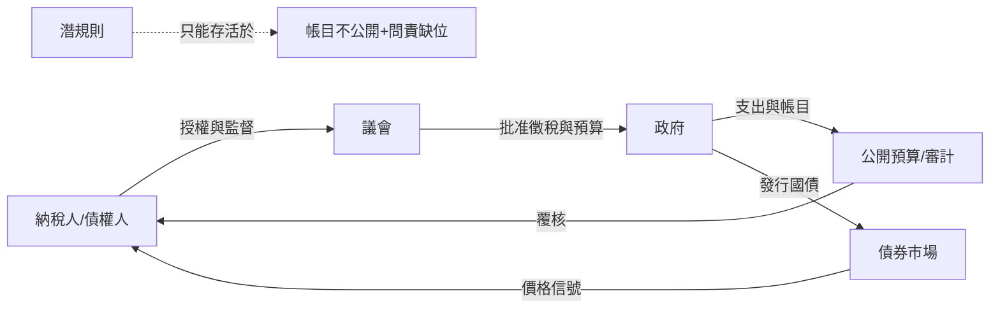

# 05.2 為何有的國家衰而不亡：議會、公開財政與破產制度

## 一、案發現場：三場破產，三種結局

本章的三個現場，開場都是破產——或者瀕臨破產。

**現場一：1707年的蘇格蘭。** 這個王國在1690年代經歷了「七年災荒」，再加上達連計畫（Darien scheme）的殖民豪賭慘敗，全國四分之一到一半的流動資本沉在中美洲的沼澤裡，蘇格蘭王國財政與信用雙雙見底（見 [../../世界史/國家滅亡史/1707-蘇格蘭王國.md](../../世界史/國家滅亡史/1707-蘇格蘭王國.md)）。按照本書前四章的劇本，一個財政失靈、資訊閉塞、制度僵化的弱國，下一步應該是被吞併、被瓜分、或者在內亂中解體。蘇格蘭卻做了一件史無前例的事：**主動投票廢除自己的國家**。1707年《聯合法案》讓蘇格蘭議會投票通過與英格蘭合併——用主權換取進入英格蘭市場與財政體系的門票。

**現場二：1868年的明治日本。** 江戶幕府的財政早已破產：大名與武士的債務是大阪商人手中的呆帳，幕府鑄幣成色一降再降，等於悄悄違約。新生的明治政府接手的不是一個國家，是一堆互相矛盾的封建帳本。它的救法同樣驚人：**地租改正**——廢除按年成估算、層層上下其手的實物貢租，改為按地價課徵固定貨幣稅；同時**承擔並清理各藩債務**，把大名變成華族、把藩債變成政府公債（見 [../../世界史/世界發展史/1868-明治維新.md](../../世界史/世界發展史/1868-明治維新.md)）。

**現場三：1944年的布列頓森林。** 此時的世界剛剛走出大蕭條與大戰——兩次大戰之間的貨幣戰、競爭性貶值與賠款死結（魏瑪的屍檢是其中最慘烈的一段，見 [../../世界史/國家滅亡史/1933-魏瑪共和國.md](../../世界史/國家滅亡史/1933-魏瑪共和國.md)），證明了「國際金融無迴路」的代價：每個國家各自貶值、各自封鎖，誰也修復不了誰。44個國家的代表在美國新罕布夏州的旅館裡，做了一件超出任何單一國家能力的事：**為整個國際體系設計一個測量與紀律迴路**——美元錨定黃金，各國貨幣錨定美元，匯率變動需經國際同意，並設立國際貨幣基金（IMF）作為體系的監測與救助機構（見 [../../世界史/世界發展史/1944-布列頓森林.md](../../世界史/世界發展史/1944-布列頓森林.md)）。

懸案的問法是：破產是本書全書的常規死因——西班牙破產七次而一路下沉，明朝財政枯竭而亡於內外夾擊。**為何這三個破產者，卻各自完成了自我修復？** 它們之間有沒有一條共同的線索？

## 二、偵查原理：「衰」與「亡」的區別，就是迴路還在不在

先把概念切乾淨。本書所謂「衰敗」，是迴路效能的下降：數字失真、財政透支、制度僵化。所謂「滅亡」，是迴路的不可逆斷裂：真實資訊再也進不了決策層，決策層的錯誤再也無法被修正，系統沿著錯誤一路加速到底（明朝的最後三十年是教科書式的加速，見 [../../世界史/國家滅亡史/1644-明朝.md](../../世界史/國家滅亡史/1644-明朝.md)）。

由此可以推出一條檢驗定理：**判斷一個衰敗中的國家會不會亡，不要看它的GDP曲線，要看它的回饋通道是否仍然開放——異議還能不能被聽見、錯誤還能不能被承認、承認之後還能不能改。** 通道在，衰敗只是波動；通道斷了，衰敗就是自由落體。

而通道靠什麼保持開放？本章的三個現場給出同一個答案的三種變奏：**把「回饋」從君主的個人美德，變成一套任何人都可以走進去的制度通道。** 議會是通道，公開預算是通道，破產法也是通道——後者聽起來不像通道，實際上是整個體系裡最誠實的一條：它承認「錯了」這個事實，並為「承認錯誤」規定了法律程序。

## 三、現場一重審：蘇格蘭——用合併自救的破產國

蘇格蘭案例的偵查價值在於它反轉了「亡國」的常識。1707年的合併，形式上就是亡國：國號取消、議會解散、倫敦接管外交與財政。但用本書的迴路語言重審，這是一次**絕境中的迴路置換**：

- 蘇格蘭自己的迴路已經鎖死：財政破產，內部派系傾軋，達連計畫的災難證明了「資訊閉塞＋全國豪賭」的組合有多致命——一個對巴拿馬氣候、西班牙反應、英格蘭敵意幾乎一無所知的計畫，因為舉國無人能夠、也無人敢於喊停，把全國資本一鍋端走。
- 合併置換的是兩條迴路：**市場迴路**（蘇格蘭獲得英格蘭殖民地與本土的完整市場准入，格拉斯哥的菸草貿易隨即起飛，並在數十年後孕育出亞當·斯密與詹姆斯·瓦特）與**財政迴路**（蘇格蘭獲得對英國國債體系的准入，「相等份額」補償款部分用於償付達連債權人——破產的損失被制度化地分攤與了結，而不是無限期拖延）。

比較組就在隔壁：英格蘭對愛爾蘭是征服與殖民，愛爾蘭的迴路始終被壓制；蘇格蘭則是以談判身份進入合併，保留了法律（蘇格蘭法）與教會的獨立，更重要的是保留了**進入體系而非被體系收割的位置**。同樣在英國陰影之下，十八世紀的蘇格蘭成為啟蒙重鎮與工業先鋒，愛爾蘭則在大饑荒中損失四分之一人口。**亡國未必亡，關鍵在合併之後迴路是接入還是被切斷。**

還有一層更深的制度意義：蘇格蘭議會投票通過自己的解散——這意味著「國家」這個工具本身被承認是可更換的。**當統治機器壞到無法修復時，允許更換機器而不是與機器同歸於盡，這是破產制度的主權版本。**

## 四、現場二重審：明治維新——地租改正與藩債處理的迴路工程

明治政府的財政工程，是後發國家重建測量迴路的完整施工記錄。分兩段看。

**第一段：地租改正（1873–1881）。** 江戶時代的稅制是本書「潛規則」理論的活標本：年貢按收成估算，而估算的每一個環節——檢地帳的田畝數、石高的評定、豐凶的裁量——都是村吏、代官、藩府之間層層博弈的結果。真實收穫量是誰也說不清的謎；藩的財政與農民的負擔都建立在失真的數字上。地租改正的做法是一次性的「迴路重置」：全國土地清丈、評定地價、**以地價的固定百分比課徵貨幣稅**。這一步同時完成了三件事：測量被一次做實（清丈）、稅基從可操縱的「收成估計」變成難以操縱的「地價」、納稅從實物變成貨幣（從而把農村強制接入商品經濟與全國市場）。木戶孝允說這是「萬世不拔之基」，從迴路角度看不誇張：**國家第一次擁有了真實、穩定、可預測的收入流量——這正是發行國債、創辦銀行的前提。**

**第二段：藩債處理。** 明治政府沒有賴掉舊體制的債，而是把各藩與幕府的債務整理為政府公債，分期償付。這一步的成本極高（公債總額一度超過政府年度支出數倍），但迴路收益同樣極高：**新政府的信用從第一天起就被「兌現舊帳」的行為標定。** 對比組依然是明朝——崇禎皇帝在加稅與省餉之間反覆橫跳，連向官員勸捐都收不回錢，因為所有人都知道朝廷的帳不可信。明治政府反向操作：先用誠實償債購買信用，再用信用發行國債辦鐵路、辦產業。

串起這兩段，明治的財政路線圖恰好是把上一節的三部曲在一個後發國家身上壓縮重演：**先測實（清丈地價，對應1837）、再立信（償清舊債、創設國債，對應1694）、後定規（此後的銀行制度與紙幣整頓，對應1844）。** 差別只在於英國花了150年，日本用30年——因為後發者看得見整套圖紙。這也再次印證本書的一條定律：**制度可以加速移植，但迴路必須在自家土壤上通電測試**——地租改正引發的1877年西南戰爭，就是通電測試失敗部分的代價。

## 五、現場三重審：布列頓森林——把迴路設計升級到國際層級

前兩個現場都是單一國家的自救；第三個現場把尺度和難度同時放大：**當衰敗的是整個國際體系本身，誰來當那個「修正制度」的節點？**

兩戰之間的教訓被懷特與凱因斯寫進了設計書。他們面對的核心問題，用本書語言表述就是：金本位曾經是全世界的測量迴路（對應1844年的精神），但它是**一台只懲罰赤字國、不約束盈餘國的殘缺迴路**——赤字國被迫緊縮、通縮、失業，而盈餘國（如1920年代末的美國、法國）吸走黃金卻不回注需求，全球流動性被單向抽乾，蕭條在世界各地接力。迴路的單向性使它從紀律工具退化為絞肉機。

布列頓森林的修補，本質是給國際迴路加上三個此前不存在的元件：

1. **可調整的錨。** 美元與黃金掛鉤，各國貨幣與美元掛鉤——測量基準保住了；但匯率在「根本性失衡」時可以經批准調整——承認任何測量系統都會失準，**把「修正」寫進了制度本身**，而不是等危機以通膨或蕭條的形式強行修正。
2. **對稱的監督。** IMF的職責不只是救助赤字國，還包括監督盈餘國（條文裡「稀缺貨幣條款」甚至授權對盈餘國採取措施——雖然此後幾乎從未執行，但原則上承認了：**迴路堵在上游也是堵**）。
3. **國際的稽核。** 各國須向IMF定期申報匯率與國際收支，接受其查帳。國家的宏觀帳本，第一次被置於一個超國家機構的複式簿記之下。

用一句話概括這個設計的野心：**把英格蘭銀行模式放大到地球。** 黃金是金準備，IMF是稽核部門，美元是儲備資產，各國財政部是各分行。而它的興衰同樣驗證本書定律：1971年美國單方面關閉黃金兌換窗口，體系崩解——不是因為設計不好，而是因為**當體系中最大的參與者獲得了豁免自己遵守規則的能力，規則就死了**。迴路的壽命，等於最強節點自我約束的壽命。

## 六、合併結案：回饋通道的制度化——議會與公開財政

三個現場各自結案，但共同的線索還沒有明確指認。把它寫出來：

**這三場自救，都不是「出了個明君」，而是各自把一條原本依賴人情與運氣的回饋通道，改造成依賴程序與公開的制度。** 蘇格蘭的通道是合併談判與議會表決——國家命運第一次以計票而非刀劍決定；明治的通道是清丈地冊與公債償付表——負擔與信用第一次以查得到的帳目呈現；布列頓森林的通道是IMF的申報與審查——國家的匯率與收支第一次要向同行報帳。

而所有這些通道的母體，是英國自光榮革命以來逐步定型的組合：**議會控制徵稅＋預算公開＋帳目審計。** 這個組合的偵查學意義在於，它把「統治者說謊」的成本結構整個改寫了：

- 國王想要錢，必須先向議會交出**支出去向**——收入與支出從私帳變成公共文件；
- 議員代表納稅人，而納稅人就是債權人——**說謊對象與收帳對象重合**，帳目造假會在第一時間觸發政治與金融的雙重懲罰；
- 十九世紀中葉以後，英國的年度預算案成為國會辯論與媒體逐項評論的公共文本，格萊斯頓時代更把「財政上的精確與節儉」變成政治聲譽的來源。

圖中虛線框是關鍵：**潛規則並不是被消滅的，而是失去了生存空間。** 吳思對潛規則的定義是「真實在檯面下運行的規矩」，它的能量來自不透明；一旦帳目公開、問責有門，潛規則就從「體制」降格為「風險」——依然存在，但每次出場都要付代價。這就是「衰而不亡」的國家與「衰而即亡」的國家的分界線：**前者允許體制內的反對，後者把所有異見都逼成潛規則或叛亂。**

## 小結

本章以三個破產現場驗明「衰而不亡」的機理：蘇格蘭以合併置換鎖死的迴路，明治以清丈與償債重建測量與信用，布列頓森林把迴路設計升級到國際層級並在制度裡內建「修正」程序。三者的共同點是**回饋通道的制度化**：議會、公開財政、審計與破產程序，把「承認錯誤」從政治自殺變成法律程序。衰敗是所有國家的常態；**能不能亡而復起，取決於有沒有一條錯誤走得進去、修正走得出來的通道。** 下一節收束全書，給出總公式與當代啟示。

## 本節要點

- 判斷衰敗國家會不會亡，不看GDP而看回饋通道：異議能否被聽見、錯誤能否被承認、承認之後能否被修正。
- 1707年蘇格蘭以議會投票完成「主權破產重組」，用合併換取市場與財政迴路的接入；亡國未必亡，關鍵在合併後迴路是接入還是被收割。
- 明治維新以地租改正（測量重置）＋藩債償付（信用購買）壓縮重演了英國三部曲；制度可加速移植，但迴路須在本地通電測試，西南戰爭就是測試代價。
- 布列頓森林把英格蘭銀行模式放大到國際層級，並首度把「可修正」寫進制度；體系死於最大參與者的自我豁免——迴路壽命等於最強節點的自我約束壽命。
- 潛規則不會被消滅，只會失去生存空間；議會＋公開預算＋審計把「說謊」從無成本變成高風險。

## 延伸對照

- [../../世界史/國家滅亡史/1707-蘇格蘭王國.md](../../世界史/國家滅亡史/1707-蘇格蘭王國.md)——破產國家的合併自救
- [../../世界史/世界發展史/1868-明治維新.md](../../世界史/世界發展史/1868-明治維新.md)——地租改正與藩債處理
- [../../世界史/世界發展史/1944-布列頓森林.md](../../世界史/世界發展史/1944-布列頓森林.md)——國際層級的迴路設計
- [../../世界史/國家滅亡史/1933-魏瑪共和國.md](../../世界史/國家滅亡史/1933-魏瑪共和國.md)——無迴路國際秩序的代價
- [../../世界史/國家滅亡史/1991-蘇聯解體.md](../../世界史/國家滅亡史/1991-蘇聯解體.md)——回饋通道全面關閉的對照組
- [../../世界史/國家滅亡史/README.md](../../世界史/國家滅亡史/README.md)——滅亡案例總索引
