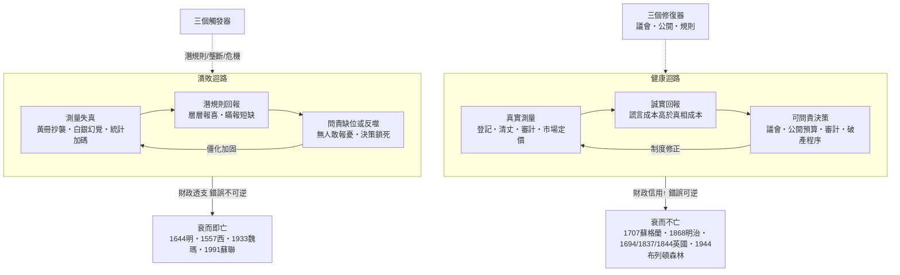

# 05.3 結論：數目字管理 = 真實測量 × 誠實回報 × 可問責制度

## 一、結案陳詞前的最後清點：全書驗過的屍體

九章偵查走到終點，先清點證物。本書解剖過的衰亡案例，死因報告各不相同，但病理切片疊在一起，顯影出同一張圖：

- **明朝（1644）**：測量系統被潛規則蛀空——黃冊變抄冊、稅收實收不足名義三成、軍餉層層漏損；皇帝收到的天下，是一份早就失真的抄本。迴路斷在第一段。（見 [../../世界史/國家滅亡史/1644-明朝.md](../../世界史/國家滅亡史/1644-明朝.md)）
- **西班牙（1557起）**：美洲白銀的洪流掩蓋了財政的真實測量，王室以未來收入反覆抵押、反覆違約；沒有議會稽核、沒有債券市場約束，違約成本只延遲、不消除。迴路斷在回饋與問責。（見 [../../世界史/國家滅亡史/1557-西班牙破產.md](../../世界史/國家滅亡史/1557-西班牙破產.md)）
- **魏瑪德國（1933）**：賠款、惡性通膨與政治暴力把財政與貨幣的測量基準砸碎，社會在失真的數字中失去共识，制度僵局讓緊急命令成為常態——最後迴路被獨裁整個拆除。（見 [../../世界史/國家滅亡史/1933-魏瑪共和國.md](../../世界史/國家滅亡史/1933-魏瑪共和國.md)）
- **蘇聯（1991）**：計畫體制把全國變成一台報喜不報憂的迴路——產量數字層層加碼、短缺被隱瞞、真實經濟只能在地下的二手經濟裡運轉；當戈巴契夫試圖公開性（glasnost）重建回饋時，累積的失真已大到系統承受不起。迴路不是斷了，是被焊死了。（見 [../../世界史/國家滅亡史/1991-蘇聯解體.md](../../世界史/國家滅亡史/1991-蘇聯解體.md)）

與之對照的倖存者——1694年後的英國、1837年後的統計國家、1844年後的規則貨幣、1707年合併自救的蘇格蘭、1868年重接迴路的日本、1944年重設國際迴路的布列頓森林——共同點也不是不衰敗，而是**衰敗發生時，測量、回報、問責三段仍然相通，錯誤進得去、修正出得來**。

現在可以把全書的答案寫成一行公式：

$$
\text{數目字管理}=\underbrace{\text{真實測量}}_{\text{看得見}}\times\underbrace{\text{誠實回報}}_{\text{說得真}}\times\underbrace{\text{可問責制度}}_{\text{改得動}}
$$

## 二、乘法不是加法：為什麼任一項歸零，全盤歸零

這行公式裡最重要的符號不是加號，是乘號。**三個變數是連乘的，不是連加的**——這是全書最需要被牢記的一個數學表述：

- **加法邏輯**（多數改革的隱含假設）：三件事各做一點，總分就會提高。缺測量就上大數據，缺監督就派巡視組，總能補分。
- **乘法邏輯**（歷史的實際運算）：任何一項為零，積為零。測量再精密，回報層說謊，決策收到的仍是幻影；回報再誠實，沒有問責制度，誠實只是找出替罪羊的證據；制度再問責，測量本身失真，問責問的是假帳。

用各章的屍體覆核這個乘法：明朝不缺制度（有都察院、有京察、有廷杖），亡於測量與回報雙雙失真——**制度在給假數字問責**；蘇聯不缺測量技術（它的統計機構與電腦化規模空前），亡於回報誘因全系統性反向——**謊報是理性選擇**；晚期羅馬與諸多王朝不缺訊息（邊境奏報絡繹於途），亡於沒有任何機制能讓壞消息撤換決策者——**回報得再真，也改不動**。

再補一條同樣重要的推論：**三個變數不是各自獨立的，它們互相餵養，也互相拆台。** 真實測量讓誠實回報有底可對（帳目互證，謊言露餡成本高）；誠實回報讓問責有的放矢（處罰指向真兇而非信使）；可問責制度反過來保護測量者（統計官不必為数字丟命，才敢報真數）。反之，任何一項崩壞都會拖垮另兩項：測量失真會讓誠實者被冤枉、說謊者被提拔，於是回報加速腐化；回報腐化讓問責淪為清洗工具，於是制度反噬測量。**迴路潰敗是三段互相傳染的複合收斂——這正是本書書名的由來。**

## 三、全書總結：一張因果圖

把第1至第5章的偵查結果收進一張圖，作為全書的結案卷宗：

圖的讀法：左右兩個環是同一台機器的兩種狀態，區別只在三個接點。**把「測量→回報」接點上的謊言成本調高、把「回報→決策」接點對真實訊息打開、把「決策→修正」接點裝上制度化的扳手，左環就變成右環。** 全部歷史案例，都可以定位為某一個接點的斷裂或修復。

## 四、三重機制總表：健康與潰敗的鏡像

| 三重機制 | 健康狀態（衰而不亡） | 潰敗狀態（衰而即亡） | 歷史樣本 |
|---|---|---|---|
| **真實測量** | 1837登記法・明治地租改正・IMF申報・審計制度；數字公開可覆核 | 黃冊抄襲・石高失真・蘇聯統計加碼・西班牙收入依賴白銀幻覺 | 明朝亡於此；英國與日本重立於此 |
| **誠實回報** | 複式簿記互證・債券市場日日定價・公開出版使篡改即時暴露 | 潛規則層層報喜・報憂者受罰・真實經濟轉入地下 | 蘇聯亡於此；英格蘭銀行體系立於此 |
| **可問責制度** | 議會控制錢袋・公開預算・審計・破產程序・可調整的匯率錨 | 問責淪為清洗・緊急命令常態化・最強節點自我豁免 | 魏瑪亡於此；布列頓森林立於此、亦死於此（1971） |

表的第三列藏著全書最冷的一條觀察：**健康的樣本裡也有死亡（布列頓森林），潰敗的樣本裡也有重生（明治日本）。** 三重機制不是血統，是狀態——沒有國家永久健康，也沒有國家註定潰敗；決定命運的不是此刻的衰敗，而是衰敗發生時迴路的通電狀態。

## 五、當代啟示（一）：數位監控能否取代誠實回報？——不能

把結案卷宗翻到當代頁。第一個必答的問題：既然大數據、感測器與人臉識別讓國家的測量能力達到1837年登記官做夢也不敢想的精度，**監控技術能否直接替代三重機制中的「誠實回報」與「可問責制度」？**

答案是否定的，而且這本書的整個偵查都指向這個否定。理由有三層：

**第一層：測量解決「看得見」，不解決「報得真」。** 監控系統收集的是原始訊號，而訊號進入決策前必須經過層層彙整與詮釋——這正是吳思的潛規則棲息的地帶。蘇聯的統計系統不缺原始數據，缺的是讓基層敢報真相的誘因；把鏡頭裝到每一條街，並不改變「報憂者倒霉」的激勵結構。**攝影機測得到人流，測不到官員簡報裡刪掉的那一行。**

**第二層：測量精度越高，造假的精度也越高。** 這是韋伯複式簿記原理的當代反面：好的帳目內建互證，壞的系統內建美化。當上報數字直接決定考核與烏紗，被測量的對象就獲得了針對測量器的優化動機——大躍進的畝產衛星是用尺量出來的，AI時代的衛星可以是用演算法算出來的。**測量越強，只要謊報誘因不變，失真就從「瞞報」升級為「精準的表演」。**

**第三層：監控把回饋通道變成單向道。** 本書反覆證明，迴路的關鍵不是上層看見下層，而是下層的真實（尤其是壞消息與異議）能修正上層。監控恰恰是逆向的：它讓上層看見一切，卻讓下層的不滿更難被表達——異議被測量、被預判、被提前處置。第5.2節的檢驗定理在此重新生效：**判斷體系的健康，看錯誤走不走得進決策層。一個看見一切卻聽不進任何東西的系統，是測量的巨人、迴路的殘疾。**

## 六、當代啟示（二）：AI時代的潛規則新形態

第二個必答的問題：AI會讓「數目字管理」更接近還是更遙遠？本書的判斷是：**AI同時放大迴路的兩個方向，而放大的速度取決於三重機制的強弱。**

- **放大健康面**：AI可以做的，正是1837年總登記署做的事的極速版——把原始測量（交易、物流、健康、能耗）自動彙整為統計，使「帳目互證」的成本趨近於零；異常偵測讓帳目造假的裂縫更容易被機器發現；公開數據讓全民成為潛在稽核官。
- **放大潰敗面**：AI也讓謊言的製造成本趨近於零——合成的證據、量身定制的報表、以及最微妙的一種：**模型本身的潛規則化**。當決策層依賴模型輸出，而模型的訓練數據來自層層上報的數字，模型就會把歷史上的謊報學成「常態」，並以高度的權威性把失真回灌給決策——**潛規則獲得了一個不會臉紅、不知疲倦、且被視為客觀的執行層。**
- **最危險的新形態**：過去的潛規則是「人在帳上做手腳」，人還在迴路裡，還會露餡；AI時代的潛規則是「手腳做進了系統的規格裡」——指標怎麼定、特徵怎麼選、異常怎麼定義，每一個技術選擇都是一次沒有法庭可上訴的制度裁決。**當測量器本身變成黑箱，連「對帳」的錨都沒有了。**

因此本書對AI時代的三重機制給出修正版：

$$
\text{數目字管理}_{\text{AI時代}}=\underbrace{\text{真實測量}}_{\text{測量器本身須可稽核（含模型）}}\times\underbrace{\text{誠實回報}}_{\text{誘因設計重於鏡頭密度}}\times\underbrace{\text{可問責制度}}_{\text{演算法須可解釋、可挑戰、可更換}}
$$

十九世紀的答案——公開、互證、規則約束——一項也沒有過時，只是對象從帳本擴展到了模型。1844年皮爾法案的精神在當代的譯文是：**不要相信系統的節制，要設計讓不節制暴露出來的稽核機制。**

## 七、終章陳詞

全書的偵查可以收進最後三句話。

**第一句：國家衰敗不是單一死因，是三段迴路的複合收斂。** 測量失真、回報失實、問責失靈，三者互相傳染、互相加固；歷史上的滅亡案例，無論王朝、帝國還是超級大國，驗屍報告上都能找到至少一段已經斷裂、另兩段正在感染。

**第二句：現代國家的發明，本質是迴路修復裝置的發明。** 登記法、英格蘭銀行、皮爾法案、議會預算、審計與破產程序——這些看似枯燥的制度，共同的工程目標只有一個：**讓說謊比說真話更貴，讓壞消息比好消息更快上達，讓承認錯誤比掩蓋錯誤更安全。** 黃仁宇稱之為數目字上的管理，韋伯稱之為理性化，金觀濤稱之為治理迴路；本書補上吳思的下半句——它們真正管住的，是潛規則。

**第三句：技術決定測量的上限，制度決定迴路的下限。** 從黃冊到衛星到AI，測量工具進步了四百年，而衰亡的死因清單幾乎沒有更新——因為殺死國家的從來不是儀器的精度，而是迴路的通電狀態。**一個國家可以窮、可以敗、甚至可以亡一次（如蘇格蘭）；只要真實的數字仍然流動、誠實的回報仍然安全、錯誤的制度仍然可以被替換，它就衰而不亡。** 反之，測量再精密、算力再強大，只要報憂者仍在受罰、帳目仍在黑箱、最強的節點仍在豁免自己，衰落就會沿著那條無人報警的隧道，一路到底。

這，就是全書的答案。

## 本節要點

- 全書總公式為連乘而非連加：**數目字管理 = 真實測量 × 誠實回報 × 可問責制度**；任一項歸零，積為零，且三項互相傳染——這是「複合收斂」的數學表述。
- 明、西、魏瑪、蘇聯四具屍體各對應一段迴路的斷裂：制度在替假數字問責、謊報成為理性選擇、壞消息無法更換決策者。
- 健康與潰敗是狀態而非血統：布列頓森林死於最強節點的自我豁免，明治日本生於瀕死者的迴路重接。
- 數位監控不能取代誠實回報：測量解決「看得見」不解決「報得真」；精度越高、表演越精；單向監控恰恰封閉了迴路最關鍵的回饋方向。
- AI時代的潛規則新形態是「做進系統規格裡的手腳」——測量器與模型本身必須納入可稽核、可解釋、可更換的問責範圍。

## 延伸對照

- [../../世界史/國家滅亡史/README.md](../../世界史/國家滅亡史/README.md)——全書滅亡案例總索引
- [../../世界史/國家滅亡史/1644-明朝.md](../../世界史/國家滅亡史/1644-明朝.md)——測量與回報雙斷裂的屍檢
- [../../世界史/國家滅亡史/1991-蘇聯解體.md](../../世界史/國家滅亡史/1991-蘇聯解體.md)——迴路被焊死的現代樣本
- [../../世界史/國家滅亡史/1933-魏瑪共和國.md](../../世界史/國家滅亡史/1933-魏瑪共和國.md)——測量基準崩毀與制度僵局
- [../../世界史/國家滅亡史/1557-西班牙破產.md](../../世界史/國家滅亡史/1557-西班牙破產.md)——問責缺位的信用結局
- [../../世界史/世界發展史/1944-布列頓森林.md](../../世界史/世界發展史/1944-布列頓森林.md)——迴路設計的巔峰與其死亡
- [../../世界史/工業革命史/1837-戶籍統計與現代國家.md](../../世界史/工業革命史/1837-戶籍統計與現代國家.md)——測量國家的起點
