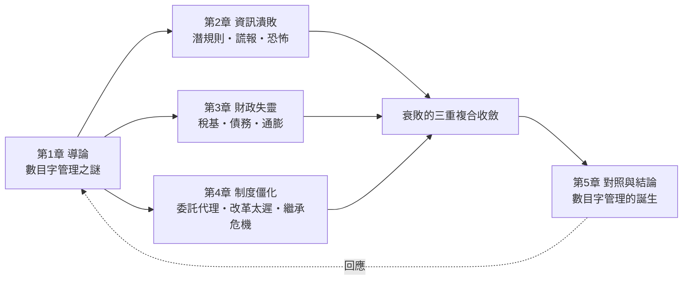
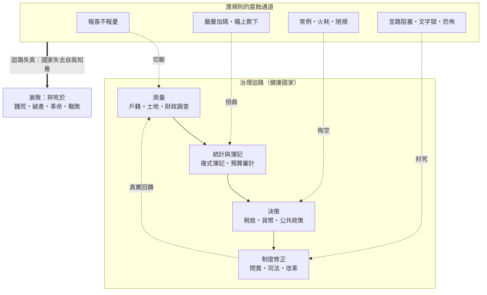

# 國家為何衰敗

> Why States Fail and Fall
> ——數目字管理、潛規則與資訊迴路的潰敗

黃仁宇反覆申說一個論斷：**現代國家的分野，在於能否「在數目字上管理」（mathematically manageable）**——即以真實、連續、可稽核的財政、戶籍、產權與貨幣數據來治理，而非依賴道德說教與人事關係。韋伯則指出，資本主義與現代官僚制共同的精神基礎是**複式簿記式的理性化**：每一筆資源都有帳可查，權力受紀錄約束。

那麼，為何古代帝國做不到？吳思的《潛規則》給出了微觀答案：**官場的隱蔽規則——報喜不報憂、層層加碼、瞞上欺下、用潛規則分配利益——會系統性地腐蝕數據的真相**。上層看到的「數目字」，是下層依據自身利益加工過的數目字。用金觀濤的循環結構語言來說（見探案庫 [科技發展史](../../科技史/科技發展史/README.md)）：**國家治理同樣需要一個「測量→統計→決策→制度修正」的自我完成迴路；潛規則切斷了迴路中最關鍵的「回饋通道」，於是國家對自己的病情失去知覺，直到猝死**。

**本書核心論旨**：國家衰敗 = 「資訊迴路潰敗（潛規則切斷真實回饋）× 財政失靈（稅基侵蝕、債務與通膨）× 制度僵化（委託—代理失靈、改革太遲）」的複合收斂。反過來，凡是能建立「真實數字＋可問責制度」的國家，即使衰敗也能自我修復。

## 目錄

* 第1章-導論：數目字管理之謎
    * [1.1-黃仁宇的斷言：為何國家必須在數目字上管理](../../世界史/工業革命史/1837-戶籍統計與現代國家.md)（含：從洪武型財政到現代財政國家的分水嶺）
    * [1.2-韋伯與複式簿記：理性化如何約束權力](../../世界史/世界發展史/1494-複式簿記與理性化.md)、[1494-複式簿記](../../世界史/工業革命史/1494-複式簿記.md)
    * [1.3-本書框架：金觀濤式治理迴路與吳思潛規則的腐蝕通道](../../科技史/科技發展史/README.md)（測量→統計→決策→修正的迴路；潛規則如何切斷回饋）
* 第2章-機制一：資訊潰敗——潛規則與真相的死亡
    * [2.1-明朝的猝死：潛規則如何掏空帝國的帳簿](../../世界史/國家滅亡史/1644-明朝.md)（吳思案例：常例、火耗、報喜不報憂；黃仁宇《萬曆十五年》對照）
    * [2.2-謊報的代價：饑荒、統計造假與三十年的沉默](../../世界史/國家滅亡史/1932-烏克蘭大饑荒.md)、[1943-孟加拉大饑荒](../../世界史/國家滅亡史/1943-孟加拉大饑荒.md)、[1949-中華民國大陸](../../世界史/國家滅亡史/1949-中華民國大陸.md)
    * [2.3-恐怖的資訊閉環：當沒有人敢說真話](../../世界史/國家滅亡史/1991-蘇聯解體.md)、[1990-東德](../../世界史/國家滅亡史/1990-東德.md)、[1979-紅色高棉](../../世界史/國家滅亡史/1979-紅色高棉.md)
* 第3章-機制二：財政失靈——稅基、債務與貨幣
    * [3.1-急政與攤派：為何帝國總在最後一分鐘加稅](../../世界史/國家滅亡史/0207-秦朝.md)、[0618-隋朝](../../世界史/國家滅亡史/0618-隋朝.md)、[0907-唐朝](../../世界史/國家滅亡史/0907-唐朝.md)
    * [3.2-債務之牆：從西班牙破產到希臘危機](../../世界史/國家滅亡史/1557-西班牙破產.md)、[1789-法國波旁王朝](../../世界史/國家滅亡史/1789-法國波旁王朝.md)、[1983-阿根廷債務與惡性通膨](../../世界史/國家滅亡史/1983-阿根廷債務與惡性通膨.md)、[2009-希臘債務危機](../../世界史/國家滅亡史/2009-希臘債務危機.md)
    * [3.3-印鈔的終點：惡性通膨與政權合法性](../../世界史/國家滅亡史/1933-魏瑪共和國.md)、[1279-南宋](../../世界史/國家滅亡史/1279-南宋.md)、[1912-清朝](../../世界史/國家滅亡史/1912-清朝.md)
* 第4章-機制三：制度僵化——委託、代理與改革太遲
    * [4.1-官僚自我服務：宮廷政治與組織的癌變](../../世界史/國家滅亡史/1453-拜占庭帝國.md)、[1922-鄂圖曼帝國](../../世界史/國家滅亡史/1922-鄂圖曼帝國.md)、[1868-江戶幕府](../../世界史/國家滅亡史/1868-江戶幕府.md)
    * [4.2-改革太遲：當結構問題被拖成生存問題](../../世界史/國家滅亡史/1795-波蘭立陶宛.md)、[1918-奧匈帝國](../../世界史/國家滅亡史/1918-奧匈帝國.md)、[1912-清朝](../../世界史/國家滅亡史/1912-清朝.md)
    * [4.3-繼承危機：個人化權力與體系斷裂](../../世界史/國家滅亡史/0476-西羅馬帝國.md)、[1227-西夏](../../世界史/國家滅亡史/1227-西夏.md)、[2003-伊拉克薩達姆政權](../../世界史/國家滅亡史/2003-伊拉克薩達姆政權.md)、[2021-阿富汗共和國](../../世界史/國家滅亡史/2021-阿富汗共和國.md)
* 第5章-對照與結論：數目字管理的誕生
    * [5.1-測量迴路的發明：從戶籍統計到現代財政國家](../../世界史/工業革命史/1837-戶籍統計與現代國家.md)、[1694-英格蘭銀行](../../世界史/世界發展史/1694-英格蘭銀行.md)、[1844-皮爾銀行法](../../世界史/工業革命史/1844-皮爾銀行法.md)
    * [5.2-為何有的國家衰而不亡：議會、公開財政與破產制度](../../世界史/國家滅亡史/1707-蘇格蘭王國.md)、[1868-明治維新](../../世界史/世界發展史/1868-明治維新.md)、[1944-布列頓森林](../../世界史/世界發展史/1944-布列頓森林.md)
    * [5.3-結論：數目字管理 = 真實測量 × 誠實回報 × 可問責制度](../../世界史/國家滅亡史/README.md)（全書因果總結與當代啟示）

## 全書因果結構

## 核心分析框架：治理迴路與潛規則的腐蝕通道

借金觀濤「理論—實驗—技術」循環結構的語法，國家治理可視為一個四環迴路；吳思的潛規則正是腐蝕「回饋」通道的隱蔽制度。

### 三重機制的「缺哪一環」總表

| 機制 | 健康狀態 | 潰敗狀態 | 代表案例（本探案庫） |
| --- | --- | --- | --- |
| 資訊迴路 | 真實測量＋誠實回報 | 潛規則、謊報、恐怖閉環 | 明朝1644、蘇聯1991 |
| 財政迴路 | 稅基清晰＋債務可持續＋貨幣受約束 | 急政攤派、債務之牆、印鈔合法性崩潰 | 西班牙1557、魏瑪1933 |
| 制度迴路 | 問責＋可修憲改革＋繼承規則 | 官僚自我服務、改革太遲、繼承內戰 | 波蘭1795、羅馬476 |

### 黃仁宇 × 吳思 × 金觀濤 × 韋伯：四把鑰匙的分工

| 學者 | 核心概念 | 回答的問題 | 本書位置 |
| --- | --- | --- | --- |
| 黃仁宇 | 數目字上管理 | 現代國家與傳統帝國的分野是什麼？ | 第1章定義、第5章結論 |
| 韋伯 | 複式簿記與理性官僚制 | 什麼技術讓數目字管理成為可能？ | 1.2、5.1 |
| 吳思 | 潛規則 | 為何帝國的數字總是假的？ | 第2章主軸 |
| 金觀濤 | 循環結構（理論—實驗—技術⇄測量—統計—制度） | 為何迴路一旦中斷就無法自癒？ | 1.3框架、貫穿全書 |

## 引用說明

本書直接引用探案庫兩處史料：

- `歷史探案/世界史/國家滅亡史/`——76 個國家滅亡個案（主體史料）
- `歷史探案/世界史/世界發展史`、`工業革命史`、`商業貿易史`、`歐亞交界史` 與 `歷史探案/科技史/科技發展史/`——制度與科技對照案例

連結為相對路徑 `../../世界史/...` 與 `../../科技史/...`。
