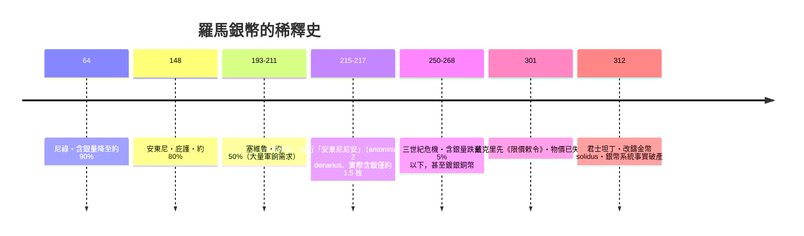

# 第一篇 第一章 第一節：尼祿與銀幣稀釋——「印鈔」最古老的形式

> 公元 64 年，羅馬大火。同一年前後，皇帝**尼祿（Nero, 54–68 年在位）**做了一件影響此後兩百年的事：**降低銀幣（denarius）的重量與含銀量**。銀幣含銀量從奧古斯都時代約 98% 上下，在其後兩百多年間被一代代皇帝不斷稀釋——到 3 世紀中葉，僅剩 5% 以下，甚至接近零。這是「國家破產」最古老的形式：**不是還不出錢，而是把錢越鑄越薄。**

## 一、前因：帝國的財政結構

羅馬帝國沒有國債市場、沒有央行，它的財政收入主要靠三件事：

1. **行省稅**（直接稅與間接稅）；
2. **戰利品與擴張紅利**——奧古斯都時代征服埃及後，皇室金庫一次進帳巨額金銀；
3. **鑄幣權**——皇帝壟斷鑄幣，銀幣（denarius）、金幣（aureus）由帝國鑄造廠發行。

問題在於支出：軍餉、官僚、公共工程、賑濟（免費穀物）持續膨脹，而帝國在公元 1 世紀後**不再有新的大規模征服收入**（萊茵河、多瑙河、幼發拉底河的邊界大致固定）。錢越花越多，收入卻成長有限。

## 二、尼祿的「金融工程」（64 年）

尼祿的貨幣改革（通常繫於公元 64 年）：

| 項目 | 改動 |
|---|---|
| denarius 重量 | 從約 3.9 克降到約 3.4 克（學界估計略有出入） |
| denarius 含銀量 | 降至約 90% 上下（摻入銅） |
| aureus | 每磅鑄造數量增加（單枚變輕） |

這是**財政赤字的貨幣化**：用含銀量下降來「多鑄」貨幣支付軍餉與工程。短期內皇帝拿到更多購買力，代價則由全帝國慢慢償還——物價開始緩慢爬升。

## 三、加速螺旋：從尼祿到塞維魯王朝

尼祿之後，這成為每個王朝的標準操作：

- **卡拉卡拉的安東尼尼安**（215 年）是教科書級的「劣幣設計」：標示價值兩倍、材料不足兩倍——帝國直接把「鑄幣稅」印在幣面上。
- 軍隊是關鍵變數：3 世紀皇帝平均在位極短、靠軍餉買忠誠，**軍隊要現金 → 鑄幣稀釋 → 物價上升 → 要更多現金**，螺旋形成。

## 四、後果：古羅馬的「通貨膨脹稅」

現代經濟史學界（以 20 世紀學者對錢幣含銀量的系統計量為基礎，如對羅馬鑄幣化驗的長期研究）確認了物價的上升：埃及莎草紙文書留下的市場物價記錄顯示，**1 世紀到 3 世紀末，以銀幣計的物價上漲了數十倍**。帝國的回應有三：

1. **稅收取實物化**：3 世紀末起，直接稅大量改以實物徵收（穀物、衣物、勞役）——國家對貨幣失去信心。
2. **戴克里先《限價敕令》（301 年）**：對上千種商品設最高價格，違者重罰——以失敗告終（黑市與短缺），是史上著名的價格管制失敗案例。
3. **金本位的「分家」**：君士坦丁發行穩定的金幣 solidus，此後金幣（富人與軍隊用）與崩壞的銅銀幣（窮人用）雙軌運行——**貨幣階層化**。

## 五、啟示

- **「破產」不必經過違約**：羅馬從未公開「還不出錢」，它選擇讓每一枚錢幣的承諾縮水——這正是 20 世紀「通貨膨脹稅」的古代原型（將在 6 章威瑪、2 章元朝重演）。
- **劣幣驅逐良幣**的古典案例：含銀量高的舊幣被熔化、私藏、外流，市場上流通的只剩新鑄劣幣（葛氏定律 Gresham's Law 的現實版）。
- **制度韌性的極限**：帝國靠實物稅與金幣又活了兩百年，但 4–5 世紀西部的軍費危機與稅基萎縮，使「經濟根源」成為西羅馬崩潰（476 年）解釋中不可缺席的一環。

---

*下一節：紙的發明讓「超發」變得更容易——參見 [2.1 北宋交子](02.1-北宋交子.md)*