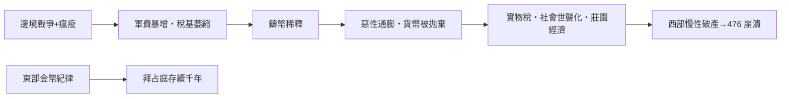

# 第一篇 第一章 第二節：三世紀危機——當貨幣被所有人拋棄

> 公元 235–284 年，羅馬陷入「**三世紀危機**」：50 年間約有數十人稱帝（學界常見統計：被承認的皇帝約 20 餘位、內戰與篡位者更多），邊境被日耳曼與波斯兩面突破，瘟疫流行（251–266 年的普萊西阿瘟疫），而帝國的銀幣系統——支撐軍餉與貿易五百年——**徹底崩潰**。

## 一、前因：三重壓力疊加

### 1. 軍事與政治

- 235 年，皇帝亞歷山大·塞維魯被部下殺害，軍隊擁立馬克西米努斯——「**士兵皇帝時代**」開始。
- 邊境戰事不斷（哥德人渡多瑙河、薩珊波斯東侵），軍費與賞賜成為無底洞。
- 皇帝的合法性來自軍餉，**財政即政權**。

### 2. 瘟疫與人口

塞浦路斯瘟疫（251 年起）重創勞動力與稅基——課稅對象（人、田、牲畜）縮水，支出（軍隊）不減反增。

### 3. 貨幣崩壞（承接 1.1）

- 250 年代，denarius 的含銀量跌破 5%；260 年代，安東尼尼安已是鍍銀銅幣。
- 民眾與軍隊都學會了：**只認含銀量，不認面值**——面值體系瓦解，交易回歸按重量計金屬。

## 二、惡性通膨的社會後果

考古與文書證據顯示的圖景：

- **物價飛漲**：以帝國貨幣計的物價在半世紀內上漲一到兩個數量級（埃及文書是主要證據）。
- **貿易貨幣化倒退**：遠程貿易部分回到以物易物與實物計價；軍餉改以實物加現金混合發放。
- **社會層級固化**：國家為保證稅收與勞務，把各行業**世襲化**（造幣工、船運商、士兵之子繼承父業）——自由勞動被套進制度枷鎖。
- **大地產抬頭**：自給自足的大莊園（villa）比依賴貨幣市場的城市更有韌性——**封建化的經濟種子**在此播下。

## 三、戴克里先的重建（284 年起）

戴克里先（Diocletian, 284–305）結束內戰，推行整套「重啟」：

| 改革 | 內容 | 結果 |
|---|---|---|
| 四帝共治 | 帝國分東西、各有正副皇帝 | 管理效率提升，也埋下分裂 |
| 幣制改革 | 鑄高含銀新銀幣、重整金幣 | 短期有效，銀幣很快再度貶值 |
| 《限價敕令》（301） | 對千餘種商品與工資設上限 | 黑市橫行、嚴刑無效，數年後名存實亡 |
| 稅收取實物 | 人頭地合併課徵（capitatio-iugatio） | 國家運作不再依賴幣值 |

**301 年《限價敕令》**的序言是經典文獻：戴克里先怒斥投機者「囤積居奇、一人之貪婪令全人類挨餓」——然後設置最高價格。結局教科書化：**價格管制的三劇本（短缺、黑市、劣質化）全部上演**。這是國家破產後的「制度補丁」第一次大規模失敗的書面記錄。

## 四、後果：西羅馬的慢性破產

- 貨幣系統的崩壞使**西部帝國的財政彈性**大減：西部鑄幣廠產能與稅基較弱，4 世紀起越來越依賴實物與贈禮收買蠻族。
- 406 年萊茵河防線崩潰、476 年西羅馬末帝被廢——經濟史家（如 20 世紀以來對羅馬晚期經濟的研究）普遍把**貨幣與財政的長期敗壞**列為西羅馬崩潰的核心原因之一。
- 東部（拜占庭）則以君士坦丁的**金幣 solidus**（312 年起）維持了七百年的幣值穩定——同一帝國的兩半，因為**財政紀律**不同而命運分岔。

## 五、啟示

1. **國家可以「軟破產」**：不必宣布違約，只要讓貨幣失去承諾——納稅人與債權人的損失以通膨形式隱形收取。
2. **價格管制不能代替財政修復**：戴克里先的教訓在 1971 年美國工資物價管制、2021–2022 年多國干預中反覆可見。
3. **硬通貨是帝國的脊柱**：solidus 的成功預告了其後一千五百年「金本位」的政治學——誰能守住幣值，誰就守得住權力（將在 3.1 西班牙的悖論中再現：金銀最多者反而破產）。

---

*第二章：紙的發明——世界最早的紙幣實驗——參見 [2.1 北宋交子](02.1-北宋交子.md)*