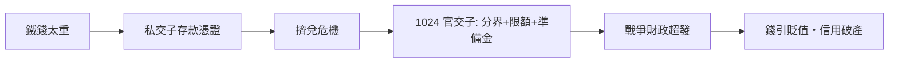

# 第一篇 第二章 第一節：北宋交子——世界最早的紙幣與超發危機

> 公元 1024 年，北宋。益州（成都）官方設「**益州交子務**」，發行官方**交子**——世界上最早的政府紙幣。從四川商人手中私營的存款憑證，到國家貨幣，再到 11 世紀末的嚴重超發：**紙幣從誕生第一個世紀，就完成了「發明—繁榮—通膨—貶值」的完整循環。**

## 一、前因：四川的三個特殊條件

紙幣誕生在四川，不是偶然：

1. **鐵錢太重**：宋廷在四川行用**鐵錢**（防止銅錢流入西夏方向）。大鐵錢千文重約 25 斤，買一匹布要扛兩萬文——**交易成本高到荒謬**。
2. **商業繁榮**：宋代商品經濟（茶、絲、鹽、蜀錦）發達，大額交易頻繁。
3. **印刷技術成熟**：雕版印刷自唐入宋已普遍，防偽技術（特殊紙張、花紋、印押、密記）可以規模化。

## 二、私營階段：十六富商的「存款憑證」（10 世紀末–1023）

- 成都商人發行**私交子**：存鐵錢於鋪戶，換取可轉讓的紙券，異地憑券取錢——本質是**匯票＋本票**。
- 私營的弱點很快爆發：個別鋪戶挪用準備金、無力兌現、偽造橫行，**擠兌與糾紛**頻發。
- 官方介入：1023–1024 年設「益州交子務」，收歸官營——**金融危機促成國有化**。

## 三、官營的制度設計（1024–1070s）

早期官交子的規則相當先進：

| 制度 | 內容 |
|---|---|
| 準備金 | 每一界發行有一定比例的「本錢」（鐵錢）準備 |
| 分界發行 | **兩年一界**，屆期以新換舊、限量收兌——用「到期回收」控制流通量 |
| 限額 | 每界發行額有明定上限 |
| 專用紙與防偽 | 楮紙、花押、官印 |

在「分界＋限額」的紀律下，交子運行數十年，成為四川貿易的穩定媒介——**世界上第一次證明：沒有金屬重量的紙，也能當錢。**

## 四、超發的滑坡

軍事財政打破紀律（典型的國家破產劇本）：

1. **對西夏戰爭（1040s）**：陝西軍費浩大，政府開始在無準備下增發交子支援軍費。
2. **界與界的清算漏洞**：舊界未足額收兌即發新界，流通量實質倍增。
3. **1105 年改行「錢引」**：交子改稱錢引，發行額一路膨脹；準備金制度名存實亡。
4. **南宋會子（1160 起）**：繼續同劇本——初期紀律良好，中後期為軍費大規模發行，物價倍數上漲、紙幣大幅貶值，南宋末年幾乎信用破產。

宋代官員對「鈔法」的認識已非常現代：時人（如「錢引」時期的官員討論）已指出**「不蓄本錢，立而不行」**——沒有準備金的紙鈔站不住。這是中央銀行紀律思想的古代版本。

## 五、啟示

- **紙幣是「信任技術」**：中國比歐洲（1661 年瑞典紙幣）早六百多年發明政府紙幣，靠的是印刷、官僚與準備金紀律三件套。
- **戰爭是貨幣紀律的頭號殺手**：四川的鐵錢因戰爭需要而生，交子的紀律也因戰爭而死——與 6 章威瑪、9 章蘇聯同構。
- **「分界回收」是古代的貨幣政策**：以到期換新控制流通量，類似今日債券到期回收流動性——制度發明能力早於理論數百年。

---

*下一節：元朝的純紙幣帝國——參見 [2.2 至元寶鈔](02.2-至元寶鈔.md)*