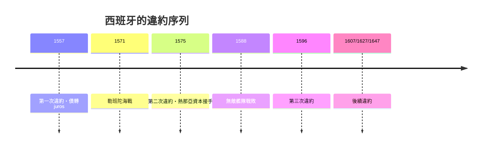

# 第一篇 第三章 第二節：腓力二世的三次違約——史上第一個「反覆破產」的霸權

> 1557、1575、1596 年，西班牙國王**腓力二世**三次宣布**停止支付王室債務**（suspension of payments，史家稱之為違約／破產）。白銀帝國為何一破再破？答案是：**他用未來的錢，打永遠打不完的仗。**

## 一、前因：信貸帝國的運轉方式

16 世紀的西班牙王室沒有中央銀行，打仗靠一套**短期高息借貸**系統：

| 角色 | 功能 |
|---|---|
| 熱那亞銀行家（1570 年代起取代德意志富格爾家族） | 提供短期借款（asientos），以美洲白銀船隊為抵押 |
| 富格爾家族（Fugger） | 前期主要債權人（查理五世時代） |
| 安特衛普交易所 | 轉融資與債券市場 |
| 塞維亞的貿易體系 | 白銀收入來源（casa de contratación 統制） |

**asiento（短期借貸契約）**利率高、期限短（數月至一兩年），以「明年船隊到港的白銀」償還。只要白銀準時、戰爭結束，遊戲可以玩下去。

## 二、三次違約的解剖

### 1557 年（第一次）

- 與法國戰爭、尼德蘭開支使現金流斷裂；
- 腓力二世宣布**暫停支付**，把短期高息債務**轉換為長期低息的「juros」（年金債券）**——強迫債權人「債轉長債」。
- **這是最早的主權債務重組之一**：不否認債務，但改變期限與利率。

### 1575 年（第二次）

- 地中海對鄂圖曼戰事（1571 年勒班陀海戰前後）與荷蘭叛亂軍費暴增；
- 白銀船隊因風暴與海盜延誤，現金流再次斷裂；
- 與債權人銀行家集團重新議價——違約成為**與債權人討價還價的工具**。

### 1596 年（第三次）

- 對英格蘭（無敵艦隊 1588 戰敗後的續戰）與法國內戰干預的開支；
- 第三次暫停支付——此時王室歲入的大部分已被預先抵押。

## 三、違約為什麼沒有毀掉西班牙的信用？

一個讓現代讀者驚訝的事實（經濟史學家 Mauricio Drelichman 與 Hans-Joachim Voth 的計量研究《Lending to the Borrower from Hell》以此為題）：**違約後，銀行家仍然繼續借錢給腓力。**原因：

1. **違約是「技術性暫停」**：暫停的是短期高息借款，juros（長期年金）通常繼續支付——違約是重新議價，不是賴帳。
2. **抵押品仍然誘人**：美洲白銀收入的未來流，是全歐洲最可靠的「未來現金流」。
3. **壟斷關係**：銀行家集團長期經營這門生意，退出等於讓給對手；且部分債務以年金、稅收讓與等資產擔保。

## 四、後果

- **利息負擔結構化**：到 1598 年腓力二世去世時，王室歲入的大半已預先「抵押」給未來——帝國的財政自由度趨零。
- **熱那亞世紀**：1575 年後熱那亞銀行家取代德意志資本，成為歐洲金融要角（直到被阿姆斯特丹取代）。
- **1607、1627、1647 年的繼續違約**：腓力三世、四世時代違約仍不斷——**帝國的衰落與金融的破產同步**。
- **教訓成型**：荷蘭聯省共和國與後來的英國走向另一條路——**議會監督＋長期低息國債＋央行**（見 4.2、5.1），證明「可靠的財政制度」比「金銀儲量」更決定國力。

---

*第四章：法蘭西的金融豪賭——參見 [4.1 約翰·勞](04.1-約翰勞與密西西比泡沫.md)*