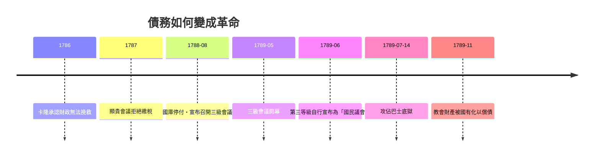

# 第二篇 第四章 第二節：三級會議與大革命——債務壓垮的舊制度

> 1789 年 5 月 5 日，凡爾賽。路易十六被迫召開 175 年未曾舉行的**三級會議**（教士、貴族、平民三個等級的代表大會）——目的是解決一個問題：**法國王室破產了**。三個月後，攻佔巴士底獄。法國大革命的直接導火線，是一份資產負債表。

## 一、前因：舊制度的財政死結

### 1. 結構性赤字

- **18 世紀的連續戰爭**：奧地利王位繼承戰爭（1740s）、七年戰爭（1756–63，失去加拿大與印度）、援助美國獨立戰爭（1778–83，報復英國）——每次戰後債務跳升一級。
- **免稅特權**：教士與貴族擁有龐大地產卻幾乎免於直接稅；稅負由第三等級（農民、市民）承擔——**稅基畸形**（承接 3.1 西班牙的同一病）。
- **包稅與宮廷開支**：包稅人制度效率低且聲名狼藉；凡爾賽宮廷與年金貴族開支龐大。

### 2. 借貸成本與「美國連鎖反應」

- 1780 年代，法國以短期高息（部分貸款利率高達 7–10%）為美國獨立戰爭融資，債務在戰後達到歲入的約五倍以上量級；
- **利息吞掉歲入約一半**——1788 年，償債與宮廷支出後，正常稅收幾乎無法維持國家運轉；
- 諷刺的是：美國獨立的成功（見 5.1 漢密爾頓的信用重建）反襯出法國的無力——**同一場戰爭，債主破產、債務人新生**。

## 二、改革的四次失敗

| 財政總監 | 方案 | 結局 |
|---|---|---|
| 杜爾哥（Turgot, 1774–76） | 削減宮廷開支、廢除行會限制、對所有土地課稅 | 貴族與王后反對，1776 年去職 |
| 內克爾（Necker, 1777–81） | 以借貸支撐美國戰爭、公布王室財政報告（轟動一時） | 戰後發表假平衡報告去職 |
| 卡隆（Calonne, 1783–87） | 再借貸；最終承認破產，1787 召開「顯貴會議」要求特權階級繳稅 | 顯貴拒絕，卡隆被逐 |
| 洛梅尼·德·布里安（Loménie de Brienne, 1787–88） | 繼續推動土地稅；巴黎高等法院（parlement）拒絕註冊新稅 | 1788 年財政實質破產，被迫同意召開三級會議 |

關鍵的憲政糾紛：**巴黎高等法院**主張新稅須由「三級會議」（全國代表）批准——高等法院以「捍衛傳統憲法」之名，把財政危機轉化為**政治代表權危機**。

## 三、1789：從查帳到革命

- 三級會議的表決方式之爭（按等級或按人頭）迅速升級為**主權之爭**；第三等級網球場宣誓（6 月 20 日），宣布不自訂憲法不解散。
- 革命政權的第一個財政動作：**沒收教會財產**（1789 年 11 月），發行以土地為擔保的「**指券（assignats）**」——結果重演約翰·勞劇本：指券超發、數年內大幅貶值（法國人對紙的第二次幻滅）。
- **同時代的美國對照**：1789 年聯邦政府成立時，漢密爾頓把「破產的邦聯債務」重組為可信的長期國債（5.1）——**同一年，兩個前宗主與殖民地的財政命運徹底分岔**。

## 四、啟示

1. **稅制的公平是財政的根**：舊制度不是「太窮」而是「收不到」——免稅特權使國家借錢度日，最後以整個制度償付。
2. **危機窗口極短**：1787–89 只用了兩年，財政問題就變成憲政問題、再變成革命——債務危機從不孤獨，它總是政治危機的偽裝。
3. **「誰有權批准新稅」是現代國家的核心問題**：英國 1688 年的答案（議會）造就了低息國債；法國 1789 年的答案（國民議會）則從廢墟中開始。

---

*第五章：新大陸的債務誕生——參見 [5.1 漢密爾頓](05.1-漢密爾頓的債務重組.md)*