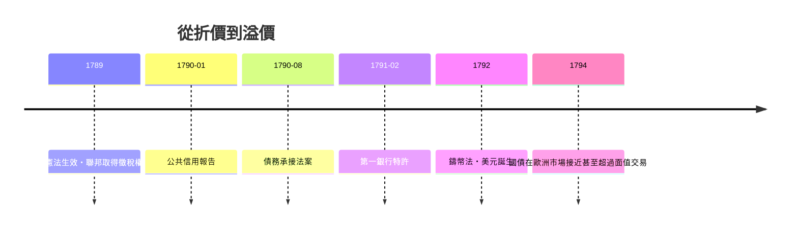

# 第二篇 第五章 第一節：漢密爾頓的債務重組——把破產轉化為信用

> 1790 年 1 月，紐約。新任財政部長**亞歷山大·漢密爾頓**向國會提交《公共信用報告》（Report on the Public Credit）。他面前是一個瀕臨破產的新國家：**邦聯時期的戰債違約、州債懸而未決、貨幣混亂、債券以面值兩三折在市場賤賣**。四年後，美國國債成為歐洲市場上的搶手資產。這是主權債務史上最經典的「**從違約到信用**」案例。

## 一、前因：革命債務的爛攤子

獨立戰爭（1775–1783）的融資是一場災難：

1. **大陸會議無徵稅權**：靠印鈔（大陸幣 Continental dollars）與借貸——大陸幣超發至 1781 年幾乎歸零，留下諺語「**不值一個大陸幣（not worth a Continental）**」。
2. **外債**：向法國、西班牙、荷蘭（以及荷蘭銀行家 Willink 等）借款支撐戰爭。
3. **州債**：各州自行發債、發鈔，部分州（如 1780 年代初的某些州）已停止付息。
4. **國內債券打折流通**：士兵與供應商拿到的公債憑證在市場上以兩三折出售，流入投機者手中。

1783 年《巴黎條約》獨立了，但 1783–1789 的邦聯體制**無稅、無軍、無信用**——1786 年謝斯起義（馬薩諸塞農民抗稅）暴露國家機器的脆弱（同見《法律設計者的故事》4.2）。

## 二、漢密爾頓的三步棋

### 1. 《公共信用報告》（1790 年 1 月）：承認全部債務

核心主張：**聯邦政府按面值全額承接**（funding at par）：

- 聯邦外債（欠法、西、荷）全額承認——**對外信用是外交與貿易的命脈**；
- 聯邦內債全額承認——違約與折價收購會永久毀掉借貸能力；
- **聯邦承擔各州戰爭債務**（假設約 2,100 萬美元）——把州的信用統一為國家信用。

爭議巨大：投機者已低價收購債券，按面值償付讓他們暴利（麥迪遜主張「區分原始持有人與投機者」的差別償付，未獲支持）。漢密爾頓的回答是原則性的：**信用不能有例外**。

### 2. 《第一銀行》（1791）：中央銀行

仿英格蘭銀行設立**美國第一銀行**（20 年特許）：政府持股兩成、發行統一紙幣、管理政府存款、為國債提供流動性市場——**「債務資產化」的樞紐**。

### 3. 《鑄幣報告》（1791）與《製造業報告》（1791）

統一鑄幣制度（1792 年《鑄幣法》，美元誕生、實行金銀複本位），並規劃以關稅與消費稅（**威士忌稅**，1791）作為償債的**專門收入流**——國債第一次有了「抵押的現金流」。

## 三、政治交易：晚餐桌上的和解

「聯邦承接州債」最初在國會卡關。1790 年 6 月，漢密爾頓、傑斐遜、麥迪遜在一場著名的**晚餐交易**中達成妥協：**南方同意債務承接，換取新首都定於波多馬克河畔（華盛頓特區）**。這場交易說明：主權債務重組從來不只是財政技術，而是**政治資本的交換**。

## 四、效果：信用的奇蹟

- 美國國債價格在數年內從兩三折升至接近面值——**違約預期被徹底清除**；
- 漢密爾頓的名言（出自 1790 年報告）：「**如果國家的債務不過度膨脹，它將是國家的恩賜（a national blessing）**」——國債不是負擔，而是**把分散的私人儲蓄與國家命運綁定的金融 glue**；
- 1794 年的威士忌起義被聯邦軍隊鎮壓——新政府用行動證明**徵稅權是真的**，信用之根在於執行力。

## 五、啟示

1. **重組的關鍵不是減記，而是可信的支付承諾**：漢密爾頓沒有賴帳（對照元朝變鈔 2.2、法國削減債務 4.1），他建立了「收入—償付—監督」的閉環。
2. **國債市場＝治理技術**：債券價格成為國家治理品質的即時評分（後世稱「債券市場的民主」），倒逼財政紀律。
3. **明確的成功模板**：此後兩百年，新興國家重建信用幾乎都複製這套「承認全部債務＋專門收入流＋央行＋市場監督」四件套。

---

*下一節：拉美獨立戰爭後的第一場違約風暴——參見 [5.2 拉美違約潮](05.2-拉美違約潮.md)*