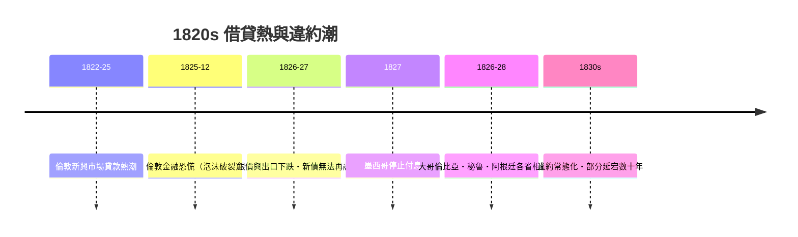

# 第二篇 第五章 第二節：1830 年代——拉丁美洲的第一波違約風暴

> 1820 年代，倫敦金融城向剛獨立的拉丁美洲各國放出了數千萬英鎊的政府貸款。不到十年——**1827 年起，墨西哥、大哥倫比亞、秘魯、智利、阿根廷（聯邦各省）等相繼停止付息**。這是新興市場主權借貸的第一次系統性違約潮，也確立了此後兩百年反覆出現的劇本：**獨立→融資狂熱→大宗商品下跌→違約→外國干預。**

## 一、前因：獨立戰爭與「借錢建國」

- 1810–1825 年，西班牙美洲殖民地相繼獨立（墨西哥 1821、巴西 1822、玻利維亞 1825）。
- 新國家繼承戰爭破壞、殖民政權的債務爭議與空白的財政機器。
- 同時，**倫敦正值 1822–1825 年的貸款熱潮**：拿破崙戰爭後英國資本過剩、利率極低，投資人瘋搶高收益外國債——**希臘獨立債、拉丁美洲債、俄奧債**同場競技。
- 經紀人（如著名的 **B. A. Goldschmidt** 等）承銷新國家貸款：墨西哥 1824 年借 320 萬英鎊、大哥倫比亞與秘魯各約 470 萬／120 萬英鎊級別（實際到手金額因折扣與承銷費大打折扣——**發行折扣 5–10 折不等，到手可能不足六成**）。

## 二、結構問題：錢花到哪去了

這些貸款的用途與償還能力嚴重脫節：

1. **軍費與內戰**：獨立未完成即陷入保守派／自由派內鬥，貸款主要付軍餉與購艦。
2. **財政機器薄弱**：關稅是唯一可靠收入，內地稅收混亂；無穩定的償債專款（對照漢密爾頓的專門收入流，5.1）。
3. **大宗商品依賴**：銀（墨西哥）、鳥糞（秘魯，稍後）、皮革與羊毛（阿根廷）——**出口單一、價格波動大**。
4. **政治風險**：總統更迭頻繁，債務償付意願隨政權搖擺。

## 三、崩塌：1825 危機與違約潮

- 1825 年 12 月倫敦的金融恐慌（投機泡沫破裂）切斷了再融資管道——**新興市場違約的標準觸發器**：不是本國突然更窮，而是**外部資金閘門關閉**；
- 1827–1828 年間，大部分拉美借款國停付；**墨西哥的違約延宕至 1880 年代才整頓**；阿根廷等部分債務延續數十年；
- 秘魯靠**鳥糞出口**（1840s–1870s 的「鳥糞繁榮」）一度恢復付息，1870 年代又因過度借貸再度違約——**單一商品繁榮無法支撐國家信用**的教訓再次驗證。

## 四、外國干預的時代

違約引發了 19 世紀特有的後果——**砲艦與討債**：

- **1861–62 年英西法三國武裝干涉墨西哥**（討債藉口之一），隨後法國扶植馬克西米連傀儡帝國（1862–67）——**債務糾紛升級為占領**；
- **1902 年英德義艦隊封鎖委內瑞拉**討債，促成 1907 年**海牙《德拉戈主義》相關討論**與 1907 年 Porter 公約精神：**不得以武力討債**——主權債務從「武力執行」轉向「制度執行」（IMF 時代的前奏，見 8 章前的脈絡）；
- 羅斯福推論（1904）宣稱美國有權介入加勒比海「失常」國家的財政——海地、多明尼加隨後被美國接管海關數十年——**債務保護主義的帝國版本**。

## 五、啟示

1. **新興市場違約潮的核心是「資本閘門」**：1825、1873、1890（Baring 危機）、1982、2008——每次全球金融寬鬆後的緊縮，都是邊陲國家的審判日。
2. **折扣發行埋下違約種子**：承銷折扣與佣金使「名義債務」遠大於「實際到手」——償還壓力先天過高（這一機制在 1970s 石油美元貸款中重演，見 8.1）。
3. **從砲艦到制度**：19 世紀用軍艦討債，20 世紀用 IMF——**強制的形式變了，債權人的組織化一直在升級**。

---

*第六章：威瑪的狂飆通膨——參見 [6.1 賠款與印鈔](06.1-威瑪賠款與印鈔.md)*