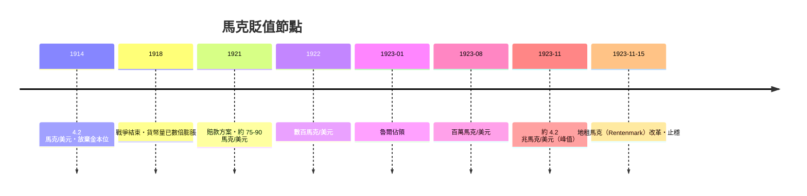

# 第三篇 第六章 第一節：威瑪賠款與印鈔——1 美元兌 4.2 兆馬克

> 1923 年 11 月，柏林。**1 美元兌換約 4.2 兆（4.2 萬億）馬克**。德國馬克——開戰時約 4.2 馬克兌 1 美元——在九年間貶值一萬億倍。史上最著名的惡性通膨（hyperinflation），是三種力量共謀的結果：**戰爭債務、賠款的政治僵局、以及選擇印鈔的決策**。

## 一、前因：戰爭怎麼付帳

### 1. 德國一戰的融資結構

- 德國決策層預期**戰勝後讓敵國付帳**（類似 1871 年法國付給德國的 50 億法郎賠款），因此國內**故意不加重課稅**；
- 融資主要靠**短期戰爭公債**與**央行（帝國銀行）購買國債＝印鈔**——開戰即放棄金本位（馬克停止兌換黃金）；
- 結果：到 1918 年，流通貨幣量已膨脹為戰前的數倍，物價已上漲約一倍以上——**惡性通膨的前半段在戰時就開始了**。

### 2. 《凡爾賽條約》（1919）與賠款

- 1921 年倫敦賠款方案定額：**1,320 億金馬克**（名目總額；經後續協商實際要求約 500 億）；
- 德國政府以「無力支付」為國策：賠款僵局既是財政問題，更是**推翻條約的政治工具**；
- 1923 年 1 月，法比聯軍**佔領魯爾**（因德國拖欠實物賠償：煤、木材）——德國政府宣布「**消極抵抗**」：魯爾工人罷工，**政府印鈔支付罷工者的工資**。

## 二、印鈔的失控曲線

價格以**天為單位翻倍**（1923 年 10 月物價在半月內翻倍數次）：

- 工資**每天發兩次**，中午的錢下午就要花掉；
- 麵包價格以「百萬」「億」計——經典照片：市民**用洗衣籃、推車裝鈔票**買日用品；鈔票比煤便宜，有人燒鈔取暖；
- 儲蓄歸零：靠存款生活的中產（教師、公務員、領年金者）一夕赤貧；**實物資產持有者**（地主、廠商、外幣持有者）反而無恙。

## 三、誰在決定印鈔？

關鍵的制度事實：**帝國銀行（Reichsbank）行長魯道夫·哈文斯坦（Rudolf Havenstein）堅持印鈔是「被動的」**——他認為通膨是外生災難（封鎖、賠款），央行只能配合需求供應鈔票；財政部也依賴印鈔彌補赤字（稅收取實物化的努力太慢，稅法改革落後於物價數月——**通膨稅成為政府實際的主要收入**）。

經濟學的診斷（後世由 Cagan 的惡性通膨研究與 Sargent 的《大通膨的結束》確立）：**惡性通膨本質是財政赤字的貨幣化**——只要財政不平衡的來源（賠款、罷工津貼）持續，印鈔就不會停。

## 四、止穩：1923 年 11 月的兩件事

1. **政治解決**：1923 年 8 月施特雷澤曼（Stresemann）任總理（後任外長）；9 月**結束消極抵抗**；美國主導的**道威斯計畫（Dawes Plan, 1924）**重整賠款（降低年度額度、國際貸款、抵押收入來源）——**惡性通膨的藥方首先是政治**。
2. **貨幣改革**：1923 年 11 月 15 日發行**地租馬克（Rentenmark）**：以全國土地與工商資產為「擔保」（象徵意義大於實質），由新設的地租銀行發行，**無限期拒絕再為政府赤字融資**（新任帝國銀行總裁沙赫特 Schacht 上任後停止為國庫墊款）；1 地租馬克＝1 兆紙馬克。

**沙赫特的鐵律——央行拒絕為財政印鈔——與政治妥協同時到位，通膨在數週內止住**（Sargent 的著名結論：惡性通膨的結束是「急速的制度變革」，不是漸進收縮）。

---

*下一節：中產階級的毀滅與政治後果——參見 [6.2 惡性通膨的政治代價](06.2-惡性通膨的政治代價.md)*