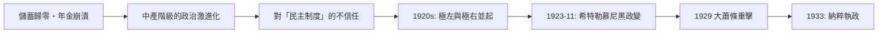

# 第三篇 第六章 第二節：惡性通膨的政治代價——中產階級之死與納粹的土壤

> 經濟史上有過許多惡性通膨（見本書 1.2 羅馬、2.2 元朝），但**只有威瑪德國的惡性通膨被普遍認為直接改寫了 20 世紀的政治史**。本節追蹤：帳面上的貨幣災難，如何變成階級仇恨、政治極化，最終變成集中營的前奏。

## 一、誰失去了什麼：通膨的階級會計

| 群體 | 持有資產 | 結果 |
|---|---|---|
| 儲蓄型中產 | 銀行存款、戰時公債、人壽保險 | **幾乎歸零**——馬克負債被通膨「洗掉」，債權人被消滅 |
| 領年金者 | 固定年金 | 餓死的邊緣（教師、寡婦、退役軍官的傳統群體） |
| 債務人（地主、大企業） | 實質債務 | **債務被通膨蒸發**——大工業家實質受益 |
| 外幣與實物持有者 | 美元、黃金、土地、商品 | 保值甚至獲利（投機客、「通膨暴發戶」） |
| 工人 | 工資 | 短期實質工資劇烈波動，最終實質工資大跌 |

政治後果的種子在此：**受損最大的是「遵守規則的人」**——他們曾相信契約、儲蓄與國家；**受益的是「破壞規則的人」**。這種顛覆被納粹宣傳精準轉譯為「**11 月罪犯**」（簽訂停戰與和約者）與「**通膨暴發戶**」（暗指猶太人與投機者）的仇恨敘事——**事實層面：猶太人與全體德國人同受通膨之害；宣傳層面：仇恨需要替罪羊**。

## 二、政治連鎖反應

- **1923 年 11 月 8–9 日**：希特勒與魯登道夫在慕尼黑發動「**啤酒館政變**」——正是通膨峰值的那一週。政變失敗，但審判使希特勒成為全國名人（服刑期間口述《我的奮鬥》）。
- **1924–1928 的黃金二十年代**：地租馬克穩定、道威斯貸款流入，威瑪相對繁榮，納粹得票率跌至 2.6%（1928）——**通膨的政治毒性被繁榮壓制**。
- **1929 年華爾街崩盤→1930–32 大蕭條**：失業率衝上 30% 左右，布呂寧內閣以緊縮因應（通縮式緊縮），威瑪民主失去中間選民——**1932 年 7 月納粹成為第一大黨（37.3%）**。

歷史學的共識：**單一通膨不必然產生納粹；但「通膨（1923）＋大蕭條（1930s）」的連續打擊，使德國中產對「資本主義民主」的信任歸零**——他們在 1932 年寧可選擇「讓國家強大」的承諾。

## 三、制度的補丁：戰後世界的記憶

威瑪的教訓寫進了 1945 年後的制度設計：

1. **德國聯邦銀行（1957）與歐洲央行（1998）的憲法式獨立性**：**價格穩定為首要目標、政府不得向央行透支**——德國人的「通膨恐懼」成為歐元體系的 DNA（這也是 2010 年代歐債危機中德國立場的歷史根源，見 11.2）。
2. **指數化與社會保障**：年金指數化、工資自動調整條款普及——**保護「規則遵守者」**不再靠名目穩定。
3. **央行獨立成為全球準則**：1980–90 年代學術研究（央行獨立性與通膨的跨國實證）與 1990 年代新西蘭模式（通膨目標制）把威瑪教訓制度化（見 10.2 阿根廷的對照）。

## 四、一個常見的誤讀

值得澄清的史實：**「印鈔 → 惡性通膨 → 希特勒」不是簡單直線**。

- 1923–1929 年威瑪相對穩定繁榮，希特勒幾乎被遺忘；
- 真正把納粹送上執政的是**大蕭條＋反民主政治精英的合謀**（1933 年 1 月興登堡任命希特勒為總理，是保守派「用他控制他」的算計）；
- 但**惡性通膨摧毀了民主的中層地基**——沒有 1923，1933 的土壤不會如此鬆軟。

---

*第七章：1931 年，奧地利一家銀行點燃全球違約潮——參見 [7.1 Creditanstalt](07.1-Creditanstalt與連鎖反應.md)*