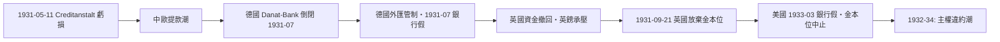

# 第三篇 第七章 第一節：1931 年 Creditanstalt——一家銀行如何引爆歐洲債務連鎖

> 1931 年 5 月 11 日，維也納。奧地利最大的銀行**奧地利信貸銀行（Creditanstalt）**宣布鉅額虧損（1.4 億先令）——全球大蕭條從股市崩潰轉入**銀行危機與主權債務危機**的轉折點。

## 一、前因：戰後金融的三層脆弱

### 1. 奧地利的「小帝國」

- 奧匈帝國解體（1918）後，奧地利只剩六百多萬人口，卻繼承了**帝國級的巨型銀行**——Creditanstalt 規模相對於國家經濟大到「不能倒」；
- 1929 年，在政府安排下，Creditanstalt 併吞了另一家問題銀行 Boden-Credit-Anstalt——**把壞資產放進保險箱**（購併掩蓋不良）。

### 2. 德奧關稅同盟的火花

- 1931 年 3 月，德奧宣布籌組**關稅同盟**——法國視之為違反和約精神的「合併」前奏，**法國資本自中歐抽逃**；
- 資本外逃直接打擊依賴短期外資的中歐銀行系統。

### 3. 蕭條中的呆帳

- 1929 年起的全球蕭條使工業貸款大面積壞帳；
- 1930 年德國 Nordwolle 紡織集團倒閉已重創達姆施塔特國家銀行（Danat-Bank）——中歐銀行體系繃緊。

## 二、連鎖反應的地圖

- **維也納→柏林**：德國儲戶恐慌，Danat-Bank 於 7 月倒閉，德國宣布**銀行假**與外匯管制；
- **柏林→倫敦**：英國銀行持有的中歐債權凍結、資金回流英鎊；9 月 21 日，英國**放棄金本位**——戰後貨幣秩序的核心支柱斷裂；
- **倫敦→全球**：英鎊貶值使金本位國家出口受壓，日本（1931 年 12 月）、美國（1933）相繼離開金本位——**全球貨幣秩序瓦解**。

## 三、主權違約潮（1931–1934）

| 債務類型 | 事件 |
|---|---|
| 德國賠款與政府間債 | 1931 年 6 月《胡佛暫緩令》（一年暫停一切政府間債務）；1932 年《洛桑會議》實質終結賠款 |
| 德國（楊格貸款等） | 1933–34 年違約（納粹上台後拒付） |
| 中南美與東歐債 | 1930–31 年起玻利維亞（1931）、巴西、智利、哥倫比亞、匈牙利、希臘、土耳其等大規模停付——**1930 年代違約的主權債數量創當時紀錄** |
| 英鎊資產 | 英國未違約，但 1931 年英鎊貶值使外國（含法荷央行）持有的英鎊資產實質縮水——「以貨幣貶值稀釋債權」的軟違約 |

## 四、制度後果

1. **資本管制合法化**：德國 1931 年的外匯管制思路延續到戰後——**跨境資本自由不是常態而是例外**，這一認知塑造了 1944 年布列敦森林體系的設計（凱恩斯的資本管制思想）。
2. **貨幣集團化**：英鎊區、黃金集團、德國的清算協定——**貿易以集團與雙邊結算**，全球貿易 1929–1933 年萎縮約三分之二；經濟民族主義與法西斯經濟相互餵養。
3. **銀行危機→債務危機→政治極化的三段論**：德國 1931 年的銀行倒閉與 1932 年選舉直線相連（承接 6.2 的分析）——**金融崩潰的政治時鐘以月為單位計時**。

---

*下一節：從胡佛暫緩令到洛桑會議——參見 [7.2 違約潮與貿易崩潰](07.2-違約潮與貿易崩潰.md)*