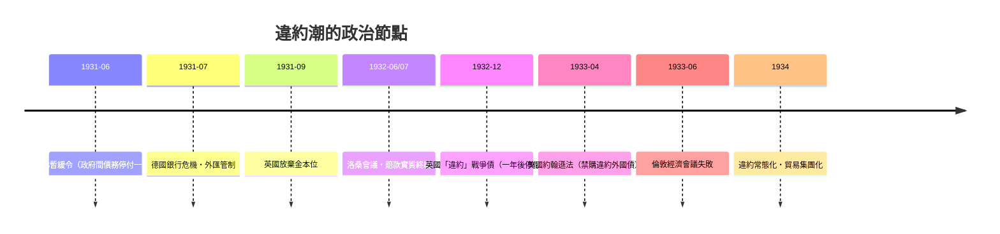

# 第三篇 第七章 第二節：違約潮與貿易崩潰——從胡佛暫緩令到洛桑會議

> 1931–1934 年間，全球主權債務體系以驚人的速度崩解：賠款被取消、戰債被違約、數十個國家停付外債、貿易額暴跌。本節拆解這場「違約潮」的政治談判史——以及它如何為 1944 年的布列敦森林埋下伏筆。

## 一、債務結構：三層互相咬合的鏈條

一戰後的國際債務不是簡單的「欠錢」，而是**三層環環相扣的支付流**：

1. **德國→協約國**：賠款（1921 倫敦方案 1,320 億金馬克名目）；
2. **協約國→美國**：戰爭債（英欠美約 47 億美元、法約 40 億美元等）；
3. **民間跨境貸款**：美國資本 1920 年代大量輸出（含 1924 道威斯貸款、1929 楊格貸款）。

**德國的錢付給英法，英法用來還美國，美國再以私人貸款流回德國**——凱恩斯與法國財官都看出的迴圈：**只要美國資本停止輸出，整座塔就塌**。1929 年華爾街崩盤正是閘門關閉。

## 二、談判的時間線

- **胡佛暫緩令（1931 年 6 月）**：把「賠款＋戰爭債＋民間債」全部凍結一年——**第一次承認債務是一個系統**，而非一個個獨立帳戶。
- **洛桑會議（1932）**：英法為爭取德國留在金本位陣營，實質同意**終結賠款**（德國付象徵性結清款）；但美國國會拒絕相應減免戰爭債。
- **英國停付戰爭債（1932 年底）**：法國、英國相繼拖欠美國戰爭債——**債權人美國反而成為被違約的一方**。債務鏈的崩塌順序無人能預測，這是主權債務的第一課。
- **約翰遜法（1933）**：美國立法禁止國民購買已違約國家的債券——**以市場封鎖代替武力**（承接 5.2 的「從砲艦到制度」）。

## 三、貿易崩潰與以鄰為壑

違約潮與貿易戰同時進行：

| 政策 | 案例 | 效果 |
|---|---|---|
| 關稅 | 美国《斯姆特-霍利關稅法》（1930） | 各國報復性加稅，世界貿易萎縮約三分之二（1929–33） |
| 貨幣貶值 | 1931 英鎊、1933 美元（金價從 20.67→35 美元） | 貶值競賽＝「以鄰為壑」（beggar-thy-neighbor） |
| 集團結算 | 德國清算協定（1934 起）、英鎊區 | 多邊貿易退回雙邊記帳貿易 |

**1933 年倫敦經濟會議**的失敗極具象徵性：羅斯福拒絕穩定匯率的協議（他要求先顧國內復甦），會議瓦解——**國際協調的時代暫停了 11 年**，直到布列敦森林。

## 四、後果：三條通往 1944 的線

1. **學理線**：凱恩斯在 1930 年代完成《通論》（1936），診斷「緊縮競賽」的自毀性——直接成為 1944 年布列敦森林設計的理論藍圖（IMF 的「流動性互助」與世界銀行的「重建」）。
2. **制度線**：戰間期違約潮證明**主權債務需要一個「債權人俱樂部＋紓困條件」的常設機制**——1944 年 IMF 的貸款條件化（conditionality）由此而生。
3. **政治線**：經濟民族主義→法西斯擴張→大戰——「**經濟崩潰的政治時鐘**」第二次被驗證（第一次是 1923 德國）。

## 五、啟示

- **主權違約會傳染**：1931 年的傳染路徑是「銀行→貨幣→主權」三級跳——1997 亞洲、2010 歐洲重演。
- **減免必須同時處理整條債務鏈**：只救一環（如胡佛一年緩衝）無法止住結構性崩塌。
- **違約潮的終局是秩序重建**：1930 年代的混亂直接生產了戰後 70 年的金融穩定架構——**災難是制度之母**。

---

*第四篇：1982 年，墨西哥的一通電話——參見 [8.1 墨西哥違約](08.1-墨西哥違約.md)*