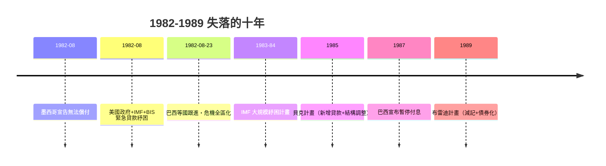

# 第四篇 第八章 第一節：1982 年墨西哥違約——「失落的十年」開始

> 1982 年 8 月 12 日（週五）深夜，墨西哥財政部長**赫蘇斯·席爾瓦·埃爾索格（Jesús Silva Herzog）**飛往華盛頓，告訴 IMF 與美國財政部：**墨西哥無法在 8 月償還到期外債本息。**現代主權債務史上最大的危機——拉美「失落的十年」——由此開始。

## 一、前因：石油美元的完美風暴

### 1. 借貸的黃金年代（1974–1981）

- **1973–74 與 1979 兩次石油危機**：油價暴漲使產油國坐擁鉅額美元盈餘，存入倫敦與紐約銀行——**石油美元回流（petrodollar recycling）**；
- 銀行急需把錢貸出去：對發展中國家的貸款 1970 年代以年均 20% 以上的速度膨脹；
- **浮動利率貸款（LIBOR＋加碼）**成為標準——銀行把利率風險**轉嫁給借款國**；
- 墨西哥 1977 年後發現巨大油田，**「石油擔保下的舉債」**使外債從 1976 年約 200 億美元升至 1982 年約 800 億美元以上。

### 2. 政策失誤

- 以石油收入為擔保大規模公共支出；比索 1976、1982 兩次大貶值；
- 匯率高估、資本外逃（富人換美元存邁阿密）——**外匯存底枯竭**。

### 3. 觸發器：美國利率

- 1979 年 8 月，Fed 主席**保羅·沃克（Paul Volcker）**為壓制通膨實施極端緊縮，**美國利率升至 20% 上下（1981）**；
- 浮動利率貸款的利息支付暴漲——**借款國的償債負擔在兩年內翻倍**；
- 同時美元走強＋初級商品價格下跌——**出口收入與利息支出反向剪刀**。

## 二、違約與緊急紓困

- **為什麼要救**：花旗銀行董事長華特·瑞斯頓（Walter Wriston）的名言「**國家不會破產**」正是 1970s 銀行放款邏輯；但 1982 年的算術是——拉美外債相當於美國九大貨幣中心銀行資本的一倍以上，**單一違約即銀行體系危機**；
- 紓困的實質：**IMF 與美國財政部出面，讓墨西哥「繼續付息」**——銀行沒有減記，損失被推遲（1982–89 的紓困主要是**新貸款付舊利息**）。

## 三、「失落的十年」的代價

- 拉美人均 GDP 在 1980s **停滯甚至倒退**；阿根廷、巴西、秘魯先後陷入惡性通膨（見 10.1）；
- **公共支出削減**（教育、衛生）——「失去的一代人」的社會代價；
- **資本反向流動**：1982–89 年，發展中國家每年向債權國**淨輸出**資金。

## 四、結局：布雷迪計畫（1989）

美國財長**尼古拉斯·布雷迪（Nicholas Brady）**承認現實：**部分減記不可避免**。方案核心：

1. 銀行把舊貸款**折價換成可交易的布雷迪債券**（本金與部分利息由美國國債擔保）；
2. IMF 與世界銀行提供擔保資金；
3. 換債折扣通常三至五成。

**布雷迪計畫把「銀行貸款」變成「債券市場」**——主權債從此成為可交易、可定價、可對沖的資產類別；違約談判的主體從十幾家銀行，變成數千名分散的債券持有人（為 10 章「禿鷹基金」時代鋪路）。

---

*下一節：IMF 的藥方與華盛頓共識——參見 [8.2 IMF 與華盛頓共識](08.2-IMF與華盛頓共識.md)*