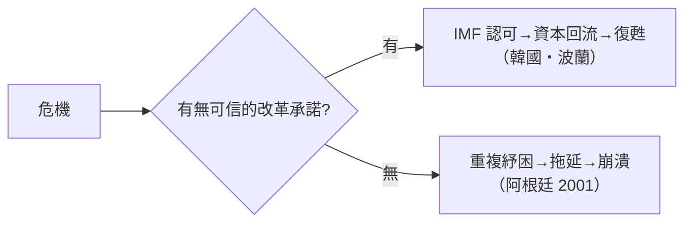

# 第四篇 第八章 第二節：IMF 與華盛頓共識——紓困的代價

> 「IMF 來了」在 1980 年代的拉丁美洲，是政治自殺的同義詞。本節拆解紓困的運作方式——**貸款換改革**——以及它引爆的一場持續至今的意識形態戰爭。

## 一、IMF 的運作：條件式貸款

國際貨幣基金組織（IMF, 1944 布列敦森林創設）的設計初衷是管理**匯率與短期收支失衡**。但 1982 年後，它成為**主權債務危機的准司法機構**：

| 程序 | 內容 |
|---|---|
| 談判 | 借款國與 IMF 團隊談判「計畫書」 |
| 條件（conditionality） | 財政緊縮、貨幣貶值、私有化、貿易自由化、取消補貼 |
| 批准 | IMF 理事會通過後放款，分期撥付 |
| 檢視 | 每季檢視達標與否，未達標即停撥 |

**關鍵機制：IMF 的「認可」是其他債權人的通行證**——商業銀行與巴黎俱樂部（官方債權人集團，1956 年成立）只在「有 IMF 計畫」時繼續貸款。**IMF 事實上是債權人集團的執行官。**

## 二、華盛頓共識（1989）

約翰·威廉森（John Williamson）1989 年總結美國財政部、IMF、世界銀行共識政策的十條清單（他本人後來抗議此清單被極端化）：

1. 財政紀律（控制赤字）
2. 公共支出重定向（補貼→教育衛生）
3. 稅制改革（擴大稅基、降低邊際稅率）
4. 利率市場化（實質正利率）
5. 競爭性匯率
6. 貿易自由化
7. 外資直接投資自由化
8. 國有企業私有化
9. 放鬆管制
10. 財產權保障

**核心邏輯**：危機是「國家過度干預」的結果，藥方是**市場化＋緊縮**。

## 三、爭議：三個經典批評

### 1. 緊縮的自我挫敗

- 在衰退中強行削赤，產出萎縮→稅基萎縮→赤字反而難降（「**緊縮螺旋**」）；
- 1980s 拉美、1990s 非洲的調整期，社會支出與投資被壓縮——「失落的十年」成為專有名詞。

### 2. 順週期的「嚴父」

- IMF 在繁榮期幾乎不約束借貸（1970s 對墨西哥的放任），危機後才施重手——**懲罰的是倒下的，不是犯錯的**；
- 經濟學家（如 Stiglitz《全球化及其不滿》2002）批評其「教條主義」與「一刀切」。

### 3. 民主的問責缺口

- 條件由 IMF 與財政技術官僚閉門談定，**議會與選民被跳過**；
- 2000s 起的改革：条件逐步「擁有制」（ownership）、社會支出保護條款、以及 2010 年代 IMF 對資本管制的態度軟化（承認其在特定危機下的正當性）。

## 四、成功與失敗的分岔

並非所有 IMF 藥方都失敗——**執行與政治條件決定成敗**：

| 案例 | 結果 |
|---|---|
| 墨西哥（1982 後） | 十年調整痛苦，1990s 重返市場，1994 又爆發龍舌蘭危機 |
| 東亞（1997–98） | 韓國泰國印尼接受計畫；「資本帳自由化過快」被列為病因之一；韓國 V 型復甦、印尼政治崩盤 |
| 阿根廷（1998–2001） | IMF 持續支持貨幣發行局與緊縮，**2001 總崩潰**（見 10.1）——IMF 最具爭議的案例之一 |
| 波蘭（1990s） | 激進轉型＋IMF 支持，十年後加入歐盟——制度整合的加分項 |

## 五、啟示

1. **紓困的本質是「誰吸收損失」**：1982–89 的答案是納稅人與借款國；1989 布雷迪計畫終於讓銀行分擔——**制度只在損失分配達成新政治平衡時才前進**。
2. **華盛頓共識的遺產是雙面的**：它確實促成了 1990s 全球通膨下降與貿易擴張；也留下了緊縮創傷與對 IMF 的永久警惕（見 11.2 希臘、12.1 斯里蘭卡對 IMF 談判的民意）。
3. **IMF 的演化**：2020 年 COVID 疫情中，IMF 對 90 多國緊急放款、暫時放寬條件——**「災難時少開條件」成為新常識**。

---

*第九章：紅色巨人的崩塌——參見 [9.1 蘇聯解體](09.1-蘇聯解體.md)*