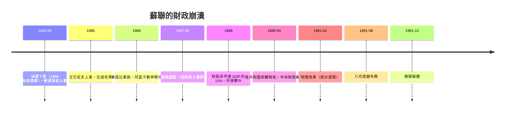

# 第四篇 第九章 第一節：蘇聯解體——計畫經濟的終局破產

> 1991 年 12 月 26 日，蘇聯正式解體。與本書其他章節不同：蘇聯沒有美元國債違約，沒有擠兌銀行，沒有 IMF 談判——它的「破產」是**整個經濟計算系統的失效**：物價由計畫規定、貨幣只是計帳單位、短缺成為常態。當這個系統崩潰時，一個超級大國在兩年內變成一個「破產的國家聯邦」。

## 一、前因：計畫經濟的財政邏輯

蘇聯的「國家財政」與市場國家根本不同：

| 項目 | 蘇聯模式 |
|---|---|
| 物價 | 國家計畫定價（長期不變→隱形通膨以「短缺」形式存在） |
| 貨幣 | 計帳工具；現金（盧布）與非現金（企業帳戶）**嚴格分離** |
| 「赤字」 | 以貨幣超發與商品短缺隱藏——**壓抑型通膨（repressed inflation）** |
| 對外 | 專營外貿；能源（石油、天然氣）出口換取硬通貨 |

**經濟學的經典診斷**（哈耶克 1945 的知識問題、科爾奈《短缺經濟學》1980）：計畫者無法獲得真實價格訊號，短缺與浪費同時存在——**系統性的資源錯配**。

## 二、崩潰的鏈條（1982–1991）

1. **石油依賴**：1970s 油價繁榮掩蓋了效率問題（與 3.1 西班牙的白銀同構：**資源紅利替代改革**）；1986 年油價腰斬，硬通貨收入銳減。
2. **改革順序錯誤**：戈巴契夫先政治開放（公開性），經濟改革（重建）反覆搖擺；**反酗酒運動**使酒類專賣收入（財政大項）暴跌——財政雪上加霜。
3. **中央財政瓦解**：1989–91 年，波羅的海與各共和國宣布「**主權至上**」，停止向莫斯科上繳——**聯邦沒有錢，就沒有軍隊與秩序**。
4. **消費品空架**：1990–91 年，物價凍結＋貨幣超發＝貨架全空、配給回歸（糖、菸、肥皂排隊）——**壓抑型通膨轉為公開短缺**。

## 三、解體後的「破產繼承」

蘇聯解體留下的是**債務與制度的雙重破產**：

- **外債**：約 650–700 億美元（主要欠德國等西方銀行與政府）；俄羅斯 1991–92 年接手蘇聯債務（「零號方案」等安排），直到 2000 年代才清償完畢——**1998 年俄羅斯違約前的漫長還債史**（見 9.2）。
- **盧布區崩潰**：15 個新國家共用盧布、各自印鈔——1992–94 年**前蘇聯地區通膨率動輒四位数至四位数上限**（塔吉克、土庫曼等超過千倍，烏克蘭 1993 年約 10,000% 級別）；各國最終被迫發行本國貨幣。
- **俄羅斯的休克療法（1992 起）**：蓋達爾政府一次性放開物價＋快速私有化——1992 年俄羅斯通膨約 2,500%；1994–95「貸款換股份」私有化造就寡頭——**崩潰的財富再分配**。

## 四、啟示

1. **「破產」可以沒有債券**：蘇聯證明一個國家可以因**內部計算系統失效**而破產——貨幣、價格、財政的崩壞不必等外部債主敲門。
2. **資源紅利是改革的麻醉劑**：石油收入讓蘇聯錯過 1970–80 年代的改革窗口（與 3.1 西班牙白銀、2.2 明朝白銀流入同一原理）。
3. **中央財政是聯邦的命脈**：莫斯科失去稅收上繳的那一刻，政治解體只是時間問題——**財政聯邦主義不只是經濟問題**。

---

*下一節：1998 年俄羅斯違約與 LTCM——參見 [9.2 俄羅斯盧布危機](09.2-俄羅斯盧布危機.md)*