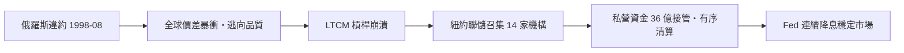

# 第四篇 第九章 第二節：1998 年俄羅斯違約與 LTCM——「太大而不能倒」的神話破滅

> 1998 年 8 月 17 日，莫斯科。俄羅斯政府宣布：**盧布貶值（放寬匯率走廊）＋國內國債（GKO）違約＋商業銀行外債暫停償付**。這是冷戰後第一次主要新興市場對**本幣債務**違約——震波兩週後擊沉了華爾街最聰明的對沖基金 **LTCM**。

## 一、前因：高收益幻覺（1995–1998）

俄羅斯 1990 年代的處境：改革動盪、稅收薄弱、寡頭經濟、1995 年起靠 IMF 貸款維持。

- **GKO（短期盧布國債）收益率高達 30–100% 以上**——外國投資人蜂擁而入（「天上掉下來的收益率」）；
- 1995 年設立**匯率走廊**（盧布兌美元區間管理），俄羅斯央行以有限外匯存底守匯率——**「高收益＋穩定匯率」的完美組合**，直到它不是；
- 1997–98：**亞洲金融危機**（泰銖 7 月崩潰→韓國、印尼）＋**油價跌至約 10 美元／桶**（俄羅斯出口支柱）＋政治癱瘓（葉爾欽頻換總理）。

## 二、違約的三件套（1998-08-17）

1. **匯率走廊放寬**（盧布實質貶值，數月內兌美元跌至約 3 倍）；
2. **GKO 違約**：約 400 億美元規模的盧布國債重組（展期＋減息）——**本幣債也可以違約**（打破「印鈔就永遠付得出」的假設：俄羅斯選擇不印鈔惡性通膨，而選擇技術性違約）；
3. **銀行外債凍結 90 天**。

俄羅斯股市與債市崩潰，全球新興市場利差暴衝——**「俄羅斯拯救計畫」（1998 年 7 月 IMF＋世銀約 226 億美元）三週後即告失效**。

## 三、LTCM：數學天才的沉船

**長期資本管理公司（Long-Term Capital Management）**：1994 年由所羅門兄弟債券交易傳奇**約翰·梅里韋瑟（John Meriwether）**創立，合夥人含兩位諾貝爾經濟學獎得主（**邁倫·斯科爾斯 Myron Scholes、羅伯特·默頓 Robert Merton**，1997 年獲獎）。

- **策略**：全球市場的「收斂交易」（convergence trades）——押注價差回歸歷史均值，以**超過 25 倍的槓桿**放大微小利潤；
- 1995–96 年年報酬率約 40%；1998 年 8 月，**俄羅斯違約引發全球「逃向品質」**：所有價差同時擴大（理論上不相關的部位同時虧損）；
- LTCM 資本從 47 億美元蒸發至數億美元，負債逾 1,000 億美元，**衍生工具名目曝險逾兆美元**——賤賣部位將引發全市場連環崩跌。

### 紐約聯儲的「救市」

1998 年 9 月 23 日，紐約聯邦準備銀行總裁**威廉·麥克唐納（William McDonough）**召集 14 家銀行／券商在聯儲大樓內協商——**不是用公款救助**，而是**私營銀行出資 36 億美元接管 90% 權益**，有序清算。LTCM 合夥人幾乎血本無歸；銀行則在後續市場回穩中收回投資。

## 四、後果：三個制度變化

1. **槓桿與衍生品的監管辯論**：國會聽證（Greenspan 承認監管盲區）；「**太大而不能倒**」從銀行延伸到對沖基金——直接預示 2008 年（見《會計的故事》10 章脈絡）。
2. **新興市場的教訓**：**本幣債也可能違約**；匯率走廊＋高收益外資的組合被標記為死亡配方（與 1994 墨西哥、1997 泰國同構）——「**三元悖論**」（固定匯率、資本自由流動、獨立貨幣政策不可兼得）成為危機後的主流教科書內容。
3. **俄羅斯的轉向**：1998 後盧布貶值反而刺激進口替代，油價 1999 年回升，普丁時代以「償清外債＋主權基金」重建信用——**資源國家的信用修復路徑**（再次印證 9.1 的資源依賴邏輯）。

---

*第五篇：阿根廷的違約循環——參見 [10.1 阿根廷 2001](10.1-阿根廷2001.md)*