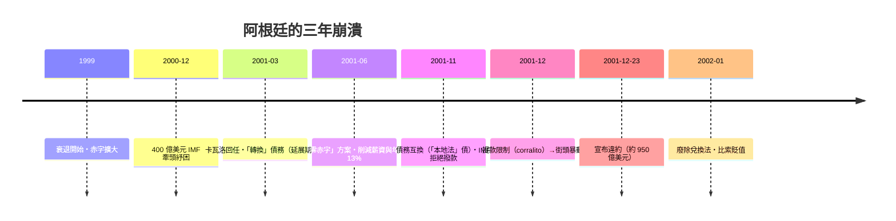

# 第五篇 第十章 第一節：阿根廷 2001——950 億美元違約、五位總統與街頭

> 2001 年 12 月，布宜諾斯艾利斯。阿根廷宣布**史上最大規模主權違約**（約 950 億美元）；兩週內總統像走馬燈一樣更換（12 月 20–30 日間實際出現**五位總統**）；街頭出現「**敲鍋遊行（cacerolazo）**」與搶掠，三十餘人死亡。從 IMF 的明星學生到全面崩潰，阿根廷用十年時間完成了教科書級的反面教材。

## 一、前因：貨幣發行局的美麗與脆弱（1991–1998）

### 1. 可兌換法（Convertibility Law, 1991）

梅內姆政府的財長**多明戈·卡瓦洛（Domingo Cavallo）**引入**貨幣發行局制度（currency board）**：

> **1 比索＝1 美元，法律強制**：央行每發行 1 比索基礎貨幣，必須有 1 美元儲備支持。

- **效果立竿見影**：1989–90 年阿根廷惡性通膨（年率數千百分比）被瞬間殺死；1991–94 年資本回流、成長強勁——IMF 標榜的「模範生」；
- **代價**：失去匯率與貨幣政策工具——**比索實質上就是「命運綁定美元」**。

### 2. 三個結構性弱點

1. **財政失控**：聯邦體制下各省開支失控、中央長期赤字——貨幣規則**沒有配套財政規則**（對照漢密爾頓四件套，5.1）；
2. **債務美元化**：政府與企業大量借**美元債**——貶值將使債務暴增，於是「**貶值不可想象**」成為自我綁架；
3. **外部依賴**：1995 墨西哥危機、1997 亞洲危機、1998 俄羅斯危機（9.2）——新興市場資金閘門反覆開關；1998–2001 巴西雷亞爾貶值與美元走強，使比索對主要貿易夥伴**實質升值**，出口失去競爭力。

## 二、死亡螺旋（1999–2001）

- **IMF 的角色**：1998–2001 年 IMF 持續放款支持（累計約 200 億美元級別紓困），堅持**「零違約＋緊縮」路線**；2001 年 12 月 5 日 IMF 拒絕撥付下一筆——**資金閘門關閉即崩潰倒數**（事後 IMF 獨立評估辦公室 2004 年報告承認策略失誤：應更早接受重組）；
- **社會崩潰**：12 月初**提款限制（corralito，凍結存款）**引爆全民憤怒——存款人衝擊銀行、中產包圍總統府、德拉魯阿總統直升機撤離總統府屋頂；
- **兩週五位總統**：德拉魯阿→卡馬喬（代）→羅德里格斯·薩阿（一週後辭職）→卡馬喬（再代）→杜阿爾德（2002 年 1 月）——**政治體系的系統性當機**。

## 三、後果與重整（2002–2005）

- **比索貶值**：兌美元從 1:1 跌至約 3:1；美元債以貶值後匯率折算比索（**不對稱比索化**）——銀行體系幾乎毀滅，法院訴訟潮；
- **貧困率飆升**：2002 年貧困率逾 50%（官方統計），失業約 20%；
- **2005 年債務重組**：基什內爾政府以**約 30–35% 折扣**換債（面值約 820 億美元中約 76% 參與）——**對私人債權人史上最強硬的重組**，留下「頑固債權人」的尾巴（見 10.2）；
- **政治轉向**：2003 年起基什內爾夫婦（內斯托與克里斯蒂娜）執政十二年，走「**反 IMF、民粹擴張**」路線——為下一輪危機蓄能。

## 四、啟示

1. **貨幣規則救不了財政失控**：貨幣發行局是「借來的信用」，財政不紀律則遲早崩潰——**「硬匯率＋軟財政」是最危險的組合**。
2. **IMF 的「太慢說不」**：持續紓困拖延了必要的重組，使最終損失更大——2001 年後 IMF 內部改革（更早承認債務不可持續）由此而來。
3. **違約的社會成本以「存款人」與「中產」為最大**：凍結存款（corralito）成為全球危機管理教科書的反面案例（2013 年賽普勒斯「bail-in」時的對照）。

---

*下一節：禿鷹基金大戰與第九次違約——參見 [10.2 禿鷹基金](10.2-禿鷹基金與2020違約.md)*