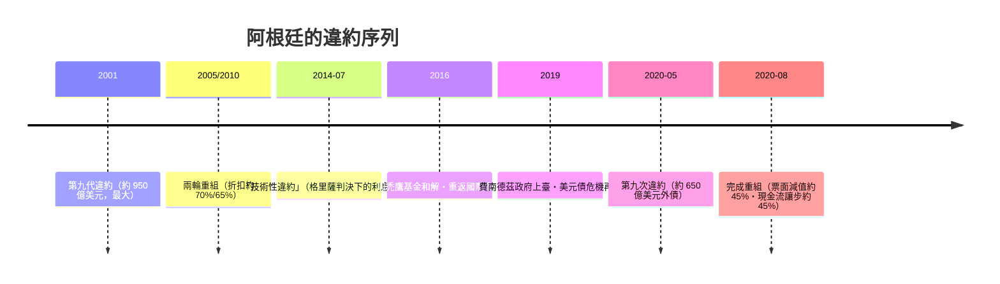

# 第五篇 第十章 第二節：禿鷹基金與 2020 年第九次違約——阿根廷的循環詛咒

> 2001 年違約後，一部分**拒絕參與 2005 年重組的債券持有人**在紐約法院追殺阿根廷 15 年——其中以對沖基金 **NML Capital（ Elliott Management 旗下）**最著名。2012 年的紐約判決把「**禿鷹基金（vulture funds）**」四個字寫進全球主權債務史。而阿根廷自己，則在 2014、2020 年再次違約——**本世紀第一個四度違約的國家**。

## 一、禿鷹基金的玩法

**操作模式**：

1. **低價掃貨**：以面值兩三折買入「拒絕重組」的舊債券（2001 年前發行的）；
2. **拒絕重組**：不參與 2005／2010 年兩輪換債，主張全額償付＋利息；
3. **司法執行**：在紐約、倫敦法院起訴，扣押阿根廷海外資產（海軍軍艦「自由號」2012 年在迦納被扣、總統專機險遭扣押、央行資產被追索）；
4. **關鍵判決**：2012 年紐約南區法院法官**托馬斯·格里薩（Thomas Griesa）**裁定——阿根廷若向重組債權人付息，**必須同時全額支付「拒絕者」**（ pari passu 平等條款的激進解釋）；2014 年最高法院拒絕受理，判決生效——**阿根廷被自己的「未來權利條款」卡死**（重組債券多含紐約法管轄條款，法院可以跨境執行）。

2016 年 2 月，馬克里新政府與「拒絕者」**和解，支付約 46.5 億美元**——**一場十五年的司法圍獵以債權人勝利告終**。

## 二、制度後果：主權債合同的進化

格里薩判決震動整個主權債市場——**「條款設計」成為新的戰場**：

| 進化 | 內容 |
|---|---|
| **集體行動條款（CACs）** | 2003 年起 IMF 倡議、2014 年後新興市場債券普遍納入：**多數債權人同意的重組對全體有效**（堵住「拒絕者」的挾持） |
| 雙分支 CAC（two-limb） | 2014 年烏克蘭首用；2020 年阿根廷採用——先全體表決、再逐系列表決 |
| IMF 條款改革討論 | 「主權債務重組機制（SDRM）」2001–03 倡議失敗——**契約解決方案戰勝了法定解決方案** |

**主權債從「信用問題」變成「法律工程問題」**——這是《會計的故事》與本書的交會點：違約的終局由**合同文本**決定（參見 3.2 熱那亞帳簿的法律地位一節的同一邏輯：**記錄與契約的設計決定權力的執行方式**）。

## 三、2014–2020：第九次違約

- **結構沒變**：財政赤字、比索高估、外債美元化、政治週期性擴張——**2001 的劇本重演**；
- **不同的是工具**：2020 年重組靠雙分支 CAC 在數月內完成（對比 2005 年拖了三年）——**合同進化明顯降低了「拒絕者」的破壞力**；
- **通膨常態化**：2020s 阿根廷年通膨在兩位數至三位數之間徘徊，央行隔夜利率成為全球最高之一——**1.2 羅馬的「貨幣稀釋」以現代形式重演**。

## 四、啟示

1. **違約循環的根是政治經濟循環**：擴張→赤字→借債→外部衝擊→違約→緊縮→政治反彈→再擴張——**沒有制度改革，重組只是倒帶重播**。
2. **債權人已經學會了法律戰**：從 19 世紀的砲艦（5.2）到 2010s 的紐約聯邦法院——**執行武力升級為執行條款**。
3. **集體行動條款是「憲政」的縮影**：多數決＋保護少數的公平補償——主權債務市場用合同演化回答了「如何重組而不崩壞」的問題。

---

*第十一章：冰島與希臘——參見 [11.1 冰島](11.1-冰島.md)*