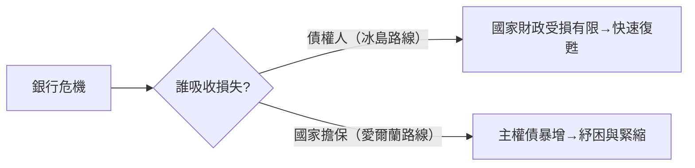

# 第五篇 第十一章 第一節：冰島——讓銀行倒下的「小國奇蹟」

> 2008 年 10 月，全球金融危機蔓延。冰島——人口約 32 萬的北大西洋小國——做出與眾不同的選擇：**讓三大銀行倒下、保護本國存款人、對外國債權人「不買單」**。克朗貶值一半、股市停牌、IMF 五十年來首次救助西方發達國家——但冰島在 2011 年後率先復甦。「**讓銀行死、讓國家活**」成為 2008 年危機最銳利的對照組。

## 一、前因：32 萬人與十倍於 GDP 的銀行

2003–2007 年，冰島完成了一場瘋狂的金融化：

- **三大銀行（Glitnir、Kaupthing、Landsbanki）私有化後急速擴張**：2007 年資產合計約為冰島 GDP 的 **10 倍**（部分估算更高）——靠歐洲貨幣市場短期借貸滾動；
- **Icesave 網路存款**：Landsbanki 以高利率在英國、荷蘭吸收數十萬散戶存款——**外國存款人成為冰島的隱形債主**；
- **克朗的完美風暴**：小型開放經濟＋外幣負債＋本幣缺乏流動性——2008 年 9 月雷曼倒閉後，貨幣市場關閉，三大銀行**無法再融**。

## 二、選擇：誰來買單？

冰島的答案分三條線：

### 1. 銀行：破產清算（10 月 6–9 日）

- 國會緊急立法，**把三大銀行的本國業務轉入新設「國有銀行」**，舊銀行（含外國債權）進入清算；
- **本國存款全額保護，外國債權人（含 Icesave 存款）按清算分攤損失**——銀行死了，國家的資產負債表被切割乾淨。

### 2. 貨幣：克朗自由落體＋資本管制

- 克朗兌歐元 2008 年內貶值約一半；央行把利率一度升至 18%；
- 實施**資本管制**（延續至 2017 年）——**小國放棄資本自由，換取體系存續**（與 1998 俄羅斯、2013 賽普勒斯同一工具箱）。

### 3. 政府與人民：緊縮＋公投拒絕

- 政府 2008 年 11 月接受 **IMF 約 21 億美元（連同北歐鄰國共約 46 億）**計畫——IMF 首次救助發達經濟體；
- **Icesave 公投**：政府與英荷談定賠償方案（約 38 億歐元，人均逾 1 萬歐元），**2010、2011 兩度被全民公投否決**（逾九成反對）——「**銀行的債不是人民的債**」成為國民共識；
- 英荷最終從**倒閉銀行的清算財產**中受償大部分；英國還動用反恐法凍結冰島資產（2008，外交風波）。
- 另一面：**2009–2011 年冰島也經歷了劇烈緊縮**（貨幣大幅貶值、失業翻倍、政府更迭、多位銀行高管被刑事定罪——全球罕見的銀行家入獄），並非「無痛奇蹟」。

## 三、對照組：為什麼冰島「敢」

| 冰島 | 愛爾蘭（同期對照） |
|---|---|
| 銀行債權人大量是**外國人** | 銀行債權人同樣大量是外國人 |
| 銀行 **破產清算**，損失由債權人吸收 | 2008 年**政府擔保並接管銀行債務**（英國施壓下）；人均銀行紓困負擔居歐洲之冠 |
| 2011 年後復甦，2017 年解除資本管制 | 2010 年被迫接受歐盟/IMF 紓困，緊縮多年 |

愛爾蘭的教訓：**把銀行債轉為主權債，等於把「銀行破產」升級為「國家破產」**——這正是希臘危機（11.2）的核心糾結。

## 四、啟示

1. **「銀行的債≠國家的債」可以被制度化**：清算機制＋存款人保護的分層設計，是 2008 年最重要的正面遺產（後來的歐盟「銀行復甦與處置指令 BRRD」與 bail-in 即由此而來）。
2. **公投是一種財政武器**：拒絕 Icesave 的兩次公投證明——**民主國家的債務承擔需要社會同意**（對照阿根廷 10.1 的街頭政治，冰島用的是票箱）。
3. **小國可以說不**：冰島敢於違背英荷與歐盟意願，靠的是「**沒有更多可失去**」＋北歐制度韌性——主權債務談判從來是實力的函數。

---

*下一節：希臘——歐元區的存亡考驗——參見 [11.2 希臘債務危機](11.2-希臘債務危機.md)*