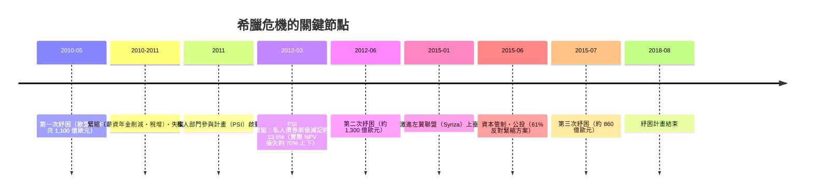

# 第五篇 第十一章 第二節：希臘債務危機——歐元區的存亡考驗

> 2009 年 10 月，希臘新政府披露：**前政府虛報財政赤字**——實際赤字不是公布的 3.7%，而是近 13%（後修訂至 15% 上下）。2010 年 4 月，希臘請求救助；2012 年完成史上最大主權重組之一（約 1,000 億歐元面值減記）；2015 年，「**Grexit（希臘退出歐元）**」一詞震動全球。希臘危機的核心難題：**一個不能貶值貨幣、又不能輕易違約的國家，如何破產？**

## 一、前因：進入歐元的代價與紅利

- **2001 年加入歐元區**：希臘借到「德國級」的低利率——主權利差從百分之一二十縮到與德國債接近；**借錢從未如此便宜**；
- **結構性弱點**：逃稅文化（影子經濟龐大）、公部門臃腫、養老金慷慨、統計造假（2004 年揭露 1997–2003 年赤字被重述）；
- **2009 年危機開關**：全球金融危機使再融資斷裂＋赤字真相曝光——**希臘 10 年期國債利差從約 1 個百分點飆至 2011–12 年的 30 個百分點以上**。

## 二、救助、緊縮與重組（2010–2012）

- **PSI（2012）**：史上最大的主權債「**有秩序重組**」——約 200 家機構（銀行、保險、對沖基金）接受換新債；因為大部分希臘債由**歐洲銀行持有**，重組等於**讓歐洲金融業分擔損失**（對照 1982 拉美：銀行先獲保護、十年後才減記——這次快了些）；
- **緊縮的社會代價**：2010–2016 年希臘 GDP 萎縮約四分之一，失業率峰值約 27%（青年失業逾五成），薪資年金大幅削減——**和平時期發達國家最深的一場衰退**；
- **2015 年公投**：齊普拉斯政府要求選民否決債權人方案（61% 反對），一週後卻接受**條件更嚴的第三次紓困**——**民主授權與市場現實的殘酷落差**。

## 三、歐元區的設計缺陷被攤開

希臘危機暴露了 1999 年歐元誕生時的制度空洞：

1. **無主權破產程序**：歐元區國家用共同貨幣，**不能貶值**（貨幣發行局化，見 10.1 阿根廷的「硬匯率＋軟財政」同構）；歐盟條約又**明文排除救助義務**（不救助條款）——崩潰時只能事後發明工具；
2. **銀行與主權的死亡螺旋（doom loop）**：歐洲銀行大量持有本國政府債→政府危機打擊銀行→政府須救銀行→主權債更糟（愛爾蘭、西班牙、義大利、葡萄牙——「**歐豬五國 PIIGS**」全中）；
3. **貨幣聯盟無財政聯盟**：沒有共同預算與轉移支付——德國（承 6.2：通膨創傷文化）堅持「紀律優先」，南歐承受緊縮——**歐元區的政治撕裂至今未癒**。

## 四、後果

- **希臘**：2018 年退出紓困；債務/GDP 仍在高位，但大部分債權已轉為**官方（歐元區國家與 IMF）長期低息**債務——延展至數十年後償還，**「官方化」使違約風險被時間稀釋**；
- **歐元區制度升級**：歐洲穩定機制 ESM（2012 常設紓困基金）、銀行聯盟（單一監管 SSM 2014、處置機制 SRM＋bail-in）、ECB 的「**不惜一切代價**」（德拉吉 2012 年 7 月名言）與 OMT 工具——**貨幣聯盟補上了部分安全網**；
- **政治遺產**：民粹政黨在南北歐同時崛起；「歐洲民主 vs 財政紀律」成為常設辯論（2015 希臘公投與 2020s 的債務共同化之爭）。

---

*第十二章：斯里蘭卡與現代債務陷阱——參見 [12.1 斯里蘭卡破產](12.1-斯里蘭卡破產.md)*