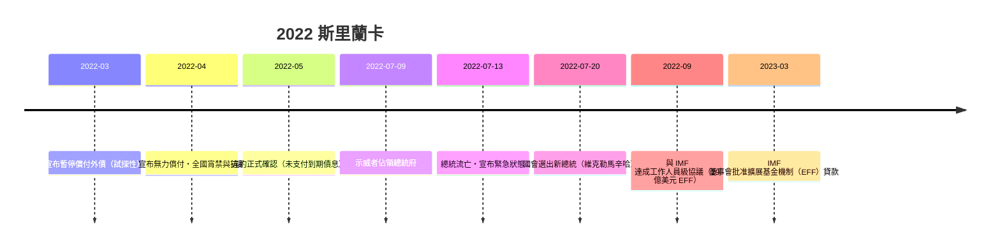

# 第五篇 第十二章 第一節：2022 年斯里蘭卡破產——總統府被佔領的國家

> 2022 年 7 月 9 日，可倫坡。數十萬示威者**衝入總統府**，總統**拉賈帕克薩（Gotabaya Rajapaksa）**由海軍艦艇接走流亡；7 月 13 日，總理辦公室聲明：國家已無力償付外債——**斯里蘭卡成為 2020 年代第一個「實質破產」的國家**。燃料、藥品、糧食全面短缺，加油站排隊數公里。這是一場「**多重危機疊加**」的教科書案例。

## 一、前因：四把火同時燒

### 1. 債務結構：三重舉債

- **中國基礎設施貸款**：漢班托塔港（Hambantota，中國進出口銀行貸款）、機場與公路群——2017 年該港因無力償付而**以 99 年租約交由中國招商局港口控股**（「**債務陷阱外交**」一詞由此案例廣為流傳；學界對「陷阱」的程度有爭論，但**借基建、抵押戰略資產**的模式已被標記）；
- **國際主權債券（ISB）**：2007 年後大量發行美元債，2022 年到期高峰；
- **IMF 與亞銀貸款**：2019 年前後經常帳赤字持續、外匯存底被吸乾。

### 2. 減稅與農業政策的自殘（2019–2021）

- 2019 年底**大規模減稅**（VAT 大幅調降）→財政收入驟減→評等下調→**外部融資關閉**；
- 2021 年 4 月，政府**突然全面禁用化學肥料**（推動「有機農業」）→**稻米與茶葉產量暴跌**——出口支柱（茶）收入崩塌，還要進口糧食——**政策實驗以農業崩潰收場，2021 年底被迫撤回**。

### 3. 外部衝擊（2020–2022）

- **疫情**：旅遊收入（重要外匯來源）歸零；
- **2022 年俄烏戰爭**：油價、化肥、小麥價格飆升——**進口帳單暴增**；
- 海外僑匯（另一大外匯來源）流向黑市——**外匯存底枯竭**（2022 年中可用存底一度不足 20 億美元，而月度進口需求數倍於此）。

### 4. 貨幣與通膨的死亡螺旋

- 央行印鈔支撐赤字→**2022 年通膨逾 60%**（食品通膨更高）→盧比貶值逾八成→進口更貴——**1.1 羅馬式的稀釋循環在 21 世紀重演**。

## 二、崩潰的時間線

## 三、重整與「多重債權人」的新難題

斯里蘭卡的債權結構是 21 世紀的縮影：**巴黎俱樂部（官方）＋中國官方與政策銀行＋國際債券持有人**——

- **「債權人協調」成為關鍵**：IMF 撥款前提是**「融資保證」（financing assurances）**——所有主要債權人須承諾共同分擔；
- **中國的角色**：透過「進出口銀行＋國家開發銀行」雙軌貸款，中國官方債權的**透明度與協調機制**成為談判焦點；2023 年中國以「進出口銀行」身分提出覆蓋承諾，IMF 計畫才得以上路——**21 世紀主權債務治理的第一場「多方債權人談判」大測試**；
- 國內：2023–24 年在 IMF 條件下加稅、調整電價、重整銀行——代價由已經赤貧的社會承擔。

## 四、啟示

1. **主權破產的觸發器可以是「政策自殘＋外部衝擊」的複合**：減稅＋化肥禁令＋疫情＋油價——**任何單一因素都不致命，疊加即是毀滅**。
2. **戰略基建抵押是新的危機形態**：港口換租約（漢班托塔）顯示——**抵押品不再是未來現金流，而是主權資產本身**（對照 3.2 腓力二世抵押白銀船隊的升級版）。
3. **IMF 計畫的關鍵卡點從「本國改革」變成「債權人協調」**：中國債權進入體系後，**「誰先讓步」成為 2020 年代主權債務治理的核心難題**（贊比亞 2020、迦納 2022 相繼陷入同類僵局）。

---

*最後一節：現代國家破產的新面貌——參見 [12.2 債務陷阱與新面貌](12.2-現代債務陷阱.md)*