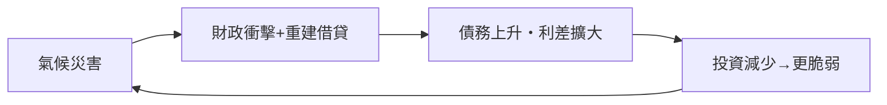

# 第五篇 第十二章 第二節：現代國家破產的新面貌——氣候、地緣政治與債務陷阱

> 從羅馬的銀幣稀釋到斯里蘭卡的總統府被佔領，本書走過兩千三百年。最後一節不講單一事件，而是梳理 2020 年代主權債務的**新形態**：氣候災害成為違約誘因、地緣政治成為貸款條件、以及「債務陷阱」的實證圖像。

## 一、氣候債務：災害與違約的新鏈條

小島與脆弱國家的破產路徑已經改變：

- **颶風直接觸發違約**：2017 年，**多明尼加、聖馬丁**在颶風後動用「**颶風條款**」暫停償付（主權債合約內建的災害暫緩條款——**「氣候契約」的先例**）；
- **貝里斯（2021）、巴貝多（2018/2022）**：以「氣候抗災債務條款＋自然保護換債」進行重組——**債換自然（debt-for-nature）**：債權人折價換債，省下的資金用於海洋保護（塞席爾 2015、貝里斯 2021 的案例）；
- 經濟學論證：**氣候脆弱國家的借貸成本包含「氣候溢價」**——未受災就先還災害預期，形成惡性循環。

## 二、地緣政治債務：誰借錢，誰定規則

### 1. 中國債權的崛起

- 2000 年代起，中國（政策性銀行＋國有商業銀行）成為發展中國家最大官方雙邊債權人之一；
- 特徵：**資源與基建抵押、保密條款、平行貸款結構**（經濟學家 Horn、Reinhart、Trebesch 的跨國研究揭露大量隱藏債務）；
- 「**債務陷阱外交**」的辯論：漢班托塔港案例（12.1）成為象徵；實證研究顯示中國**並未刻意以奪取資產為策略**，但其貸款的**不透明與抵押結構**客觀上造成談判劣勢——問題在**治理真空**而非陰謀。

### 2. 制度競爭

- **巴黎俱樂部**（1956 起，西方官方債權人）vs **中國的雙邊談判**——2020 年代，贊比亞、斯里蘭卡、迦納的重組因「**債權人協調**」遲滯數年；
- **G20 共同框架（2020）**：嘗試把中國納入多邊重組——執行仍緩慢；
- **制裁武器化**：2022 年俄烏戰爭後，俄羅斯外債被制裁與支付障礙夾擊——**債務的「可支付性」第一次由地緣政治直接決定**。

## 三、2020 年代的違約群像

| 國家 | 年份 | 標記 |
|---|---|---|
| 阿根廷 | 2020 | 第九次違約（10.2） |
| 贊比亞 | 2020 | 首個疫情期違約・中國債權協調樣板 |
| 黎巴嫩 | 2020 | 「歐元債首違約」＋銀行體系崩潰＋貨幣貶值 95% 以上 |
| 斯里蘭卡 | 2022 | 多重危機複合（12.1） |
| 迦納 | 2022 | 官方與商業債全面重組 |
| 埃塞俄比亞、馬拉威等 | 2023– | 共同框架排隊中 |

**疫後的違約潮未達 1980s 規模，但「官方債權人多元化」使每次重組更慢、更政治化。**

## 四、給讀者的終局思辨

回顧全書，主權破產的劇本其實只有幾種，但組合無窮：

1. **稀釋**：讓錢變薄（羅馬 1.1、元朝 2.2、威瑪 6.1、阿根廷 10.2 的通膨）；
2. **重組**：改期限與利率（西班牙 3.2、漢密爾頓 5.1、希臘 11.2）；
3. **違約**：停止支付（拉美 5.2、1982 8.1、俄羅斯 9.2、阿根廷 10.1）；
4. **轉嫁**：把損失塞給銀行（愛爾蘭 11.1 的反例）或債權人（冰島 11.1、布雷迪 8.1）；
5. **執行**：用砲艦、法院或 IMF 條件逼償（5.2、10.2、8.2）。

而跨越兩千年的穩定結論只有兩條：

- **破產從來不是會計事件，而是政治事件**——誰承擔損失，取決於權力結構（帝國議會、熱那亞銀行家、IMF 理事會、街頭人群、選票箱）；
- **信用是制度，不是資源**——西班牙的金銀（3.1）、蘇聯的領土（9.1）、委內瑞拉的石油、斯里蘭卡的港口都救不了財政紀律的缺席。**漢密爾頓四件套（承認債務、專門收入流、央行、市場監督）至今仍是重建信用的唯一已證路徑。**

---

*全書完。回到 [README 目錄](README.md)*