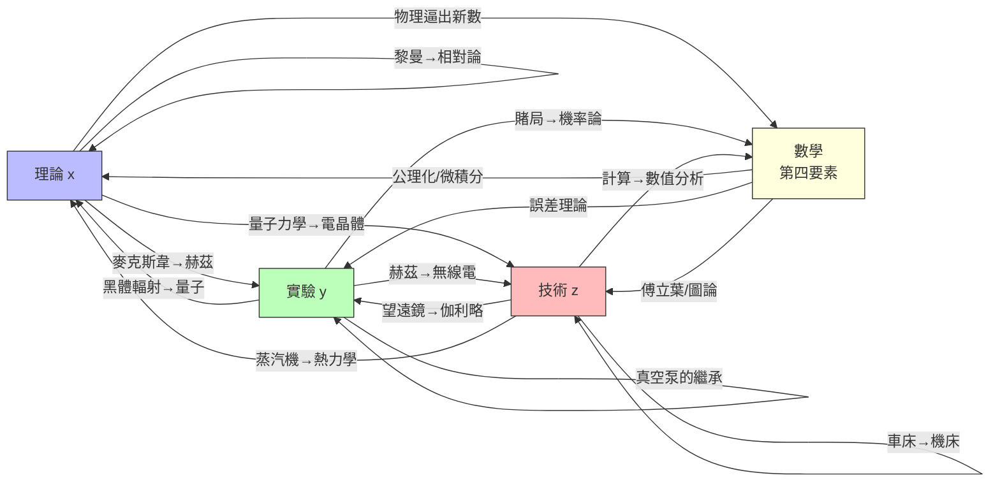

# 第一章 導論：問題的反轉與循環結構

## 1.3 金觀濤循環結構：理論—實驗—技術的九通道

### 框架：三環、九條通道、一個第四要素

前兩節確立了問題的反轉與兩大學術傳統的證詞。現在拆解本書的核心解釋框架：金觀濤的循環結構（完整表述見 [../../科技史/科技發展史/README.md](../../科技史/科技發展史/README.md)）。

近代科學之前的人類知識活動，可分解為三個環節：

- **理論 $x$ **：對「為什麼」的系統性回答，提出有待驗證的假設；
- **實驗 $y$ **：受控條件下的檢驗，對「到底是不是」的裁決；
- **技術 $z$ **：把知識物化為工具與器物，回答「能拿來做什麼」。古代文明不缺其中任何一環——中國有陰陽五行論（理論）、有精巧觀測（準實驗）、有領先全球的技術；希臘有歐幾里得與阿基米德。**缺的是三環之間的通道。** 金觀濤的關鍵洞見是：促進關係是完整的有向圖—— $a \Rightarrow b$ ， $a, b \in \{x, y, z\}$ ，**包括 $a = b$ 的自我促進**——共 $3 \times 3 = 9$ 條通道：

| 通道 | 含義 | 典型案例 |
|------|------|----------|
| 理論⇒實驗 | 理論預言該測什麼 | 麥克斯韋預言電磁波→赫茲去測 |
| 理論⇒技術 | 理論直接物化為發明 | 量子力學→電晶體 |
| 理論⇒理論 | 一個理論成為另一個的工具 | 黎曼幾何→廣義相對論 |
| 實驗⇒理論 | 異常數據逼出新理論 | 黑體輻射→量子假說 |
| 實驗⇒技術 | 實驗發現變成產業 | 赫茲實驗→無線電 |
| 實驗⇒實驗 | 儀器與方法的繼承 | 真空泵→一切低壓實驗 |
| 技術⇒實驗 | 新工具開出新實驗 | 望遠鏡→伽利略天文學 |
| 技術⇒理論 | 技術需求倒逼理論更新 | 蒸汽機極限→熱力學 |
| 技術⇒技術 | 製造機器的機器 | 莫茲利車床→機床工業 |

而貫穿全部九條通道的第四要素是**數學**：它與三環同樣雙向促進（數學⇒理論：歐幾里得→牛頓；數學⇒實驗：最小平方法讓數據成為證據；理論⇒數學：熱傳導逼出傅立葉級數；實驗⇒數學：賭局催生機率論）。古代世界不是沒有數學，但數學與工匠的器物互不往來——斐波那契 1202 年把阿拉伯數字帶進歐洲商業，正是通道開始接通的信號。

### 反面證據：有技術、無迴路的古代

九通道框架的力量，在於它能精確診斷古代偉大成就為何「後繼無人」。**中國火藥（1044）**。北宋《武經總要》已記載三種定型火藥配方，是煉丹術士數百年試錯的副產品。但火藥的推進力來自化學反應產氣膨脹——理解它需要燃燒理論、氣體定律與化學計量，這些要到拉瓦錫才完成。火藥七百年間被工匠持續改良，卻始終是「技術⇒技術」的孤鏈：沒有理論預言新配方該往哪裡找。詳見 [../../科技史/科技發展史/1044-火藥.md](../../科技史/科技發展史/1044-火藥.md)。

**水運儀象台（1090）**。蘇頌主持建造的天文鐘塔高約十二米，以水輪驅動、擒縱機構控速，集渾儀、渾象與報時裝置於一體，是機械工程與天文觀測的雙料巔峰。但它完成於汴京、毀於靖康之變；南渡後試圖重建，蘇頌之子連圖紙都讀不全。原因不在工匠失傳，而在**知識存在於一人一器的尺度**：沒有可批量複製的文獻讓異地工匠比對改進。詳見 [../../科技史/科技發展史/1090-水運儀象台.md](../../科技史/科技發展史/1090-水運儀象台.md)。

**畢昇活字（1040s）**。沈括《夢溪筆談》記載的泥活字比古騰堡早四百年。但活字印刷的經濟性取決於大規模出版需求與標準化字模工業；在出版市場分散的宋代，活字只是「技術⇒技術」鏈上的一次孤峰，未被迴路放大。

**希臘的阿基米德（前250）**。他是古代世界唯一一次「理論俯身解釋機械」：用歐幾里得式證明處理槓桿與浮體。但這次俯身沒有後繼者——普魯塔克記載，希臘人視機械為「不體面的傭人之術」。理論⇒技術的通道只在阿基米德身上打開過一次，隨即關閉。詳見 [../../科技史/科技發展史/-0250-阿基米德與機械.md](../../科技史/科技發展史/-0250-阿基米德與機械.md)。

診斷結論：**古代的困境不是沒有知識，而是沒有迴路**。技術孤行的結果是線性累積——火藥七百年只從鞭炮進步到火銃；而迴路一旦閉合，就是指數加速——印刷術到牛頓只用二百三十七年。

### 迴路點火：四件工具如何扣合三環

十六、十七世紀的歐洲，四件看似平凡的技術把三環扣死了。

**印刷術（1450）——知識成為可比對、可批判的公共財**。古騰堡之前的知識以抄本傳播，每抄一次就變異一次，批評無從下手。印刷術使同一文本的千份拷貝**逐字相同**：哥白尼的假說與托勒密的體系可以並排放在書桌上逐條對照；伽利略的觀測報告可以在布拉格與倫敦被重複檢驗。可比對導致可批判，可批判使「錯誤能被及時清除」——這是迴路自我糾錯的最低配置。詳見 [../../科技史/科技發展史/1450-古騰堡印刷術.md](../../科技史/科技發展史/1450-古騰堡印刷術.md)。

**望遠鏡與顯微鏡——技術造出新實驗**。荷蘭工匠的玩具鏡片，到伽利略手裡變成「技術⇒實驗」的典範：木星衛星、金星相位是任何亞里士多德體系都無法吸納的異常數據，直接逼出理論重構（實驗⇒理論）；虎克與列文虎克的顯微鏡則開出微觀新大陸。感官被技術延伸之日，就是舊理論的解釋壟斷破產之時。

**真空泵——「為了檢驗假設而造儀器」的典範**。托里拆利與波以耳不是先有儀器再找用途，而是**為了裁決「自然厭惡真空」這一命題而專門造出真空泵**——實驗作為獨立環節的成人禮。馬德堡半球與日後一切氣體實驗繼承同一套方法（實驗⇒實驗）；「真空可以做功」的知識，六十年後直接催生紐科門與瓦特（理論⇒技術）。

**機械鐘（1280）——精確計時成為一切實驗的底座**。伽利略的斜面實驗、惠更斯的擺鐘、日後的航海經線儀，全部依賴歐洲在 1280 年前後意外成熟的擒縱技術。沒有可複製的時間基準，受控實驗根本無法定義。詳見 [../../科技史/科技發展史/1280-機械鐘.md](../../科技史/科技發展史/1280-機械鐘.md)。

四件工具合起來，使「提出假設→設計儀器→實驗檢驗→修正理論→技術應用」首次閉合運轉；皇家學會（1660）與科學期刊再把迴路**制度化**——這也是李約瑟問題的供給側答案。

### 為何迴路指數加速：一個正反饋模型

迴路與孤鏈的差別可以用最簡的動力學表達。設理論存量為 $x(t)$ 、實驗能力為 $y(t)$ 、技術存量為 $z(t)$ 。孤鏈系統（如古代中國的火藥）只有線性自項：

$$
\frac{dz}{dt} = a\,z
$$

解為 $z(t) = z_0 e^{at}$ ——緩慢累積，任何中斷都造成不可恢復的損失。

迴路系統中，每一環的增長率與**其他環的存量成正比**：理論越多，能設計的實驗越多；實驗越多，能催生的技術越多；技術越多，能支撐的理論越多。取最簡的兩環耦合：

$$
\frac{dy}{dt} = k\,x\,y
$$

當 $x$ 近似常數時是馬爾薩斯式指數增長；當 $x = c\,y$ ，則 $\frac{dy}{dt} = k\,c\,y^2$ ，解為

$$
y(t) = \frac{y_0}{1 - k\,c\,y_0\,(t - t_0)}
$$

在 $t = t_0 + \frac{1}{k\,c\,y_0}$ 處**發散**——這就是「奇點」式加速的數學本質：迴路增益不是相加而是相乘。歷史上「等待時間縮短」的序列（哥白尼等了六十年才有驗證；麥克斯韋等了二十三年；廣義相對論只等了四年）正是 $k\,c$ 不斷增大的經驗證據。九條通道全部打通之日，就是每一個 $p_i$ 被迴路本身推高之時——串聯鏈一旦啟動，就開始自我加長。

### 完整的有向圖

九條通道加六條數學通道，構成**每一節點都有入度與出度的完備有向圖**。古代文明是圖上的孤立節點；近代科學是圖的整體閉合：工業革命不是一項發明的故事，而是這張圖與資本、煤、議會、識字人口在 1760 年代英格蘭的**複合收斂**。

> **參照**：火藥 [../../科技史/科技發展史/1044-火藥.md](../../科技史/科技發展史/1044-火藥.md)、水運儀象台 [../../科技史/科技發展史/1090-水運儀象台.md](../../科技史/科技發展史/1090-水運儀象台.md)、印刷術 [../../科技史/科技發展史/1450-古騰堡印刷術.md](../../科技史/科技發展史/1450-古騰堡印刷術.md)、機械鐘 [../../科技史/科技發展史/1280-機械鐘.md](../../科技史/科技發展史/1280-機械鐘.md)。
