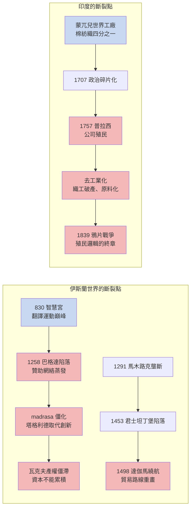

# 第二章之二 反事實檢驗：為何不是伊斯蘭與印度——智慧宮之後的斷裂與殖民地化

## 摘要：兩個「曾經領先」的文明

如果北宋的中國是「有零件沒引擎」，那麼伊斯蘭世界是「引擎曾經點火卻在半途熄火」，而印度則是「工廠已經開動，卻被人從外部勒令關閉」。這兩個案例比中國更殘酷地揭示了工業革命的反事實：領先不是護身符，起點的優勢若沒有制度的迴路與政治的屏障，終將在歷史的斷裂點上歸零——甚至變成負數。

## 一、伊斯蘭的黃金時代：曾經離科學最近的文明

830 年，阿拔斯王朝的哈里發馬蒙在巴格達建立智慧宮，發動了一場以國家力量驅動的大翻譯運動：歐幾里得、托勒密、阿基米德、亞里士多德被譯成阿拉伯文，希臘的公理化傳統、波斯的行政技術、印度的數碼與天文表在此匯流，見 [../../世界史/世界發展史/0830-智慧宮翻譯運動.md]。此後四百年，伊斯蘭世界在數學、光學、醫學上站上人類之巔：花拉子米的《代數學》給了整門學科名字，伊本·海賽姆的《光學書》以受控實驗駁斥古希臘的視線發射說，是中世紀最接近近代實驗方法的著作；伊本·西那的《醫典》統治歐洲醫學教科書市場六百年。

用金觀濤的循環結構檢驗：伊斯蘭世界擁有「理論⇒理論」（希臘遺產的傳承與深化），局部擁有「實驗⇒理論」（海賽姆的光學），數學更是興盛。它缺的是什麼？**缺的是理論與技術之間的迴路，以及讓迴路制度化的社會結構**。智慧宮是宮廷的附屬品——哈里發的個人嗜好，而非社會的自我組織。學者靠贊助人的恩寵過活，一次王朝更迭，一個贊助人的死亡，就可能讓整個研究傳統斷流。對照歐洲：皇家學會、大學、出版商、專利法庭構成了一張不依賴任何單一贊助人的網絡。伊斯蘭的科學是垂直的，歐洲的科學是網狀的——垂直的結構一斷即死，網狀的結構斷一線而全網尚存。

## 二、1258 巴格達陷落與 madrasa 的僵化

斷裂點首先來自外部。1258 年蒙古人攻陷巴格達，屠城、毀書，相傳底格里斯河的墨水染黑江水。智慧宮的物質載體與贊助網絡一夜之間蒸發。雖然蒙古統治者很快皈依伊斯蘭並恢復贊助，但知識的重心已永久轉移，黃金時代的自信再也沒有回來。

更致命的是內部的制度化反噬。伊斯蘭的高等教育被 madrasa（宗教學院）壟斷，其課程以古蘭經學、法學、聖訓為核心；「比達」（創新）在教法語彙中帶有貶義，「塔格利德」（盲從權威）成為學術美德。十二世紀安薩里對哲學的批判之後，邏輯與自然哲學被逐步邊緣化。當歐洲的大學在十三世紀把亞里士多德收編為理性訓練的教材時，伊斯蘭的學院正在把希臘遺產封存為異教的古董。**同樣的希臘遺產，歐洲把它變成了武器，伊斯蘭把它變成了文物。**教育的方向盤，就此鎖死了兩個文明的岔路。

## 三、瓦克夫：產權的僵滯與資本的牢籠

經濟制度上的斷裂更隱蔽也更深刻。伊斯蘭世界最具特色的制度「瓦克夫」（waqf，宗教捐献信托）允許個人把財產永久捐給宗教慈善用途——清真寺、學院、水井、驛站。它固然提供了歐洲教會式的公共品供給，但有三個致命缺陷：

1. **不可變更**：瓦克夫條款一經設立永不可改，資產無法依市場變化重新配置；
2. **避稅與反公地**：家族為逃避政府沒收，紛紛把商業資產「瓦克夫化」，名為公益實為保產，資本於是被凍結在低效用途上；
3. **無法人地位**：瓦克夫不是法人，不能起訴、不能簽約、不能累積為公司。

對照歐洲：股份公司（1602 荷蘭東印度公司）賦予資本永續生命與法人地位，銀行與證券市場讓資本自由流動、快速聚散。長期而論，制度經濟學家如 Timur Kuran 的結論是：瓦克夫使伊斯蘭世界**資本龐大而不能累積，財富豐厚而不能集中**——每一次積累的企圖都被「不可變更」的產權結構重新打散。沒有可累積的資本組織，就沒有大規模的工業投資；沒有工業投資，「技術⇒技術」的自我複製便失去載體。

## 四、香料壟斷的崩塌：1291 到 1498 的帝國更替

貿易層面的斷裂點同樣清晰。1291 年起，馬木路克王朝控制紅海通道，與威尼斯結盟壟斷東方香料進口歐洲的陸海聯運，坐收暴利近兩個世紀，見 [../../世界史/商業貿易史/1291-馬木路克香料壟斷.md]。壟斷者的宿命是：它沒有動力改良，只有動力守關。1453 年鄂圖曼攻陷君士坦丁堡，陸權格局再次洗牌，西方被逼入絕境，見 [../../世界史/歐亞交界史/1453-君士坦丁堡陷落與陸權轉移.md]——而絕境正是歐洲大航海的起跑線。1498 年達伽馬繞過好望角直航印度，用炮艦擊潰馬木路克與古吉拉特的艦隊，把壟斷者的關卡整個繞成了廢墟，見 [../../世界史/商業貿易史/1498-達伽馬直航印度.md]。

這是一次教科書級的「壟斷悖論」：靠關卡收租的文明不會去造繞過關卡的船。世界的貿易路線被重畫，地中海東部從樞紐淪為邊陲，亞歷山卓的香料倉庫變成博物館。伊斯蘭世界不是被殖民打敗的——在殖民之前，它已經在知識迴路、資本組織與貿易路線三條戰線上被自己打敗。

## 五、印度：世界工廠的噩夢反轉

印度的案例呈現另一種反事實結構：**它不是沒有工業化，而是被強力去工業化**。

蒙兀兒帝國時代（十六至十七世紀），印度棉紡織品是真正的「世界工廠」：精細的平紋細布、印花布遠銷歐洲、非洲、東南亞，佔全球紡織品貿易的四分之一；孟加拉、古吉拉特擁有龐大而成熟的織工社群與商業網絡。十八世紀初，蒙兀兒帝國的 GDP 約佔全球四分之一。歐洲人最初來到印度洋，是來**買印度貨**的——英國人用美洲白銀購買印度棉布，再運到東南亞換香料。從純經濟角度看，印度擁有工業革命的勞動分工、產業集群、龐大內需與出口市場，樣樣不缺。

缺的依舊是結構性的三樣：**政治碎片化、制度鎖死與技術迴路**。蒙兀兒帝國在奧朗則布死後（1707）迅速碎裂為馬拉塔、錫克、納瓦布諸侯混戰；印度的商業資本同樣困於種姓與行會的分割，未能形成歐洲式的法人公司與金融市場；而織工的技藝再精，也從未與一個以數學為語言、以實驗為方法的知識階層相遇——沒有「理論⇒技術」的通道，紡織技術只能停留在手工極限。

## 六、1757 普拉西：去工業化的開端

1757 年普拉西戰役，東印度公司以陰謀與少數兵力擊敗孟加拉納瓦布，取得孟加拉的稅收權——一家公司從此統治人類最富庶的行省。此後一百年，殖民邏輯系統性地反轉了印度的產業結構：

- **貿易特權化**：公司以零關稅向印度傾銷英國機器棉布，印度織工則在英國被課以重關稅——市場是單向的；
- **稅收抽血**：孟加拉土地稅收被用於支付公司「購買」印度貨物的費用，印度的儲蓄被直接轉移為英國的工業資本；
- **工匠消滅**：失去市場與稅負雙重擠壓的織工大批破產，返鄉務農——手工業城市衰落，印度從製造業出口國退化為棉花與鴉片的原料產地。

經濟史家把這一過程稱為「去工業化」（de-industrialization）：到 1900 年，印度製造業在全球產出的份額從四分之一跌落到不足百分之二。1839 年鴉片戰爭則是這條邏輯的殘酷終章：英國用印度種的鴉片平衡對華貿易逆差，再用炮艦強迫中國接受毒品貿易——兩個最古老的文明，在同一艘英國炮艦面前，驗證了同一個命題，見 [../../世界史/商業貿易史/1839-鴉片戰爭.md]。

## 七、結案陳詞

伊斯蘭與印度的教訓互為鏡像。伊斯蘭證明：**沒有制度化的知識迴路，翻譯來的科學只是寄生的花朵**——贊助人一死、城牆一破、學院一僵，四百年的領先即歸於塵土；瓦克夫則證明，沒有可累積的資本組織，商業繁榮永遠長不出工業。印度證明：**沒有政治屏障的「世界工廠」，只是殖民者的獵場**——市場、技藝與內應俱全，卻在炮艦與單向關稅面前被剝去工業外衣，反過來淪為他人工業革命的原棉產地與毒品種植園。

歐洲之所以是答案，不是因為它更聰明或更勤勞，而是因為它同時擁有了三件別人先後失去的東西：知識的迴路、可累積的資本組織、以及——最冷酷的一件——把這兩樣東西用炮艦護送到世界每個港口的政治力量。下一節，我們看四個「差一點」就成功的候選者，以及那個唯一自學成功補課的學生：日本。

---

**延伸閱讀**：[../../世界史/世界發展史/0830-智慧宮翻譯運動.md]、[../../世界史/歐亞交界史/1453-君士坦丁堡陷落與陸權轉移.md]、[../../世界史/商業貿易史/1291-馬木路克香料壟斷.md]、[../../世界史/商業貿易史/1498-達伽馬直航印度.md]、[../../世界史/商業貿易史/1839-鴉片戰爭.md]
