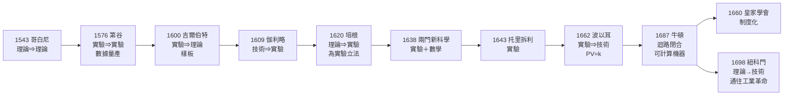

# 第三章第二節 科學革命的迴路閉合：培根立法、伽利略實驗、牛頓綜合

## 引子：一次一百四十四年的接力

1517 年的印刷品證明權威可以挑戰；但「挑戰權威」離「生產可靠知識」還有距離。這一節講 1543 到 1687 年之間一場一百四十四年的接力：哥白尼起跑，第谷、吉爾伯特、伽利略、培根、托里拆利、波以耳一棒接一棒，牛頓衝線——**「理論—實驗—技術」三環第一次閉合成自我加速的迴路**（框架見 [../../科技史/科技發展史/README.md]）。

古代文明並非沒有知識：希臘有阿基米德、中國有蘇頌、阿拉伯有智慧宮。但它們的共同點是三環各自孤立——理論不屑解釋器物，實驗尚未成為受控檢驗，技術只能靠工匠試錯。

## 第一棒：1543 哥白尼——理論先行，等實驗來審

哥白尼《天體運行論》的結論（地球繞日）在當時**沒有任何新的觀測證據**。他用的是托勒密同樣的數據，只是換了數學安排：以日心替代地心，行星逆行從十七個本輪簡化為少數幾個圓——一個純粹因「美感與簡潔」而提出的理論。這是極特殊的**理論⇒理論**事件：一個數學重構預先宣布「數據應該長成什麼樣」，然後**等實驗來審**。哥白尼自己等不到——開普勒用第谷的數據替他等到（1609），伽利略用望遠鏡替他等到（1610，金星相位），牛頓用引力數學替他等到（1687）。「理論可以領先，但不能離線太久」——哥白尼離線了六十六年，而**理論不是對權威的註疏，而是可以被未來數據檢驗的假設**。參見 [../../科技史/科技發展史/1543-哥白尼日心說.md]。

## 第二棒：1576 第谷——數據的量產，第一座科研機構

第谷·布拉赫在丹麥汶島建造的烏拉尼堡，是人類第一座專職「生產數據」的機構：巨型象限儀、渾天儀、赤道儀，二十餘年連續觀測，精度達一角分——比此前千年的星表精確一個數量級。這裡有兩件前所未有的事：一是**觀測成為常設職業**，不再是零星的神學附屬活動；二是**數據成為可移交的資產**——第谷臨終把全部觀測手稿交給開普勒，開普勒用這批數據逼出橢圓定律。這是**實驗⇒實驗**（儀器與方法繼承）與**實驗⇒理論**（火星軌道比圓扁了八弧分的異常數據逼出新理論）的範本。沒有第谷的數據量產，就沒有開普勒的橢圓；沒有橢圓，牛頓的引力就失去了解釋對象。參見 [../../科技史/科技發展史/1576-第谷天文台.md]。

## 第三棒：1600 吉爾伯特——實驗方法的樣板

在方法論被正式寫下之前，伊麗莎白時代的御醫吉爾伯特已經示範了它的樣子。《論磁》研究磁石，不引經據典，而是做實驗：磁球模型、磁傾角測量、隔物吸引、加熱退磁——用**受控、可重複**的操作，一條一條駁倒古人的說法。

培根讚美過這本書，伽利略引用過它。它的重要性不在結論（地磁論有對有錯），而在**樣板**：第一次有一位學者用整本書示範「實驗可以裁決理論」——比培根的立法早了二十年。參見 [../../科技史/科技發展史/1600-吉爾伯特磁學.md]。

## 第四棒：1609 伽利略——技術造出新實驗，新實驗造出新天文學

1608 年荷蘭工匠磨出望遠鏡，1609 年伽利略把它指向天空——**技術⇒實驗**的教科書案例：新工具讓原本不可能的觀測得以進行。木星有四顆衛星（天不是一切繞地球）、金星有完整相位（行星繞太陽）、月亮有環形山（天體不完美）、太陽有黑子並移動（太陽自轉）。

注意因果方向：**這些發現沒有一條來自理論推演，全部來自把商品化的技術當成實驗儀器**——技術造出實驗，實驗產出理論必須吞下的異常數據。這正是迴路開始自轉的標誌。參見 [../../科技史/科技發展史/1609-伽利略望遠鏡.md]。

## 第五棒：1620 培根——為實驗立法

方法論被自發使用，與被明文立法，是兩回事。培根《新工具》幹的就是立法的事：
- **歸納法**：從事實表（出現表、不出現表、程度表）逐步上升，反對從公理到公理的演繹獨斷；
- **假象說**：系統列出四類認知偏誤（種族、洞穴、市場、劇場），要求先清洗心智再談知識；
- **知識就是力量**：知識的目的不是沉思而是改造自然——這句話把「理論」與「技術」的聯姻寫進了科學的憲章。

培根本人不是實驗家（他因雪填雞腹的防腐實驗受寒而死），但他寫下的法條塑造了此後三百年的科學自我理解。這是**理論⇒實驗**通道上的立法：先規定「什麼算數」，再讓大家去測。參見 [../../科技史/科技發展史/1620-培根新工具.md]。

## 第六棒：1638《兩門新科學》——受控實驗＋數學＝近代物理

伽利略晚年被軟禁，把畢生力學寫成《兩門新科學》。斜面實驗是科學史上最重要的實驗設計之一：

- **受控**：用斜面「稀釋」重力，把太快測不了的落體減速到可計時；
- **量化與數學化**：用水鐘量時間，以「相同時間走過距離比 1:3:5:7…」表達，結論寫成 $s \propto t^2$ ——自然律第一次以定量公式出現。

這就是近代物理的誕生公式：**受控實驗＋數學表達。**缺實驗是思辨，缺數學是經驗。參見 [../../科技史/科技發展史/1638-兩門新科學.md]。

## 第七、八棒：1643 托里拆利、1662 波以耳——為檢驗假設而造儀器

亞里士多德說「自然厭惡真空」，這句話統治了兩千年。托里拆利不與之辯論，直接造一根玻璃管：一端封閉、灌滿水銀、倒插水銀槽——水銀柱停在七十六厘米，管頂留出一段真空。**假設（大氣壓）被一個儀器裁決了。**

波以耳把實驗推向定量：他用（助手虎克改進的）真空泵做受控實驗，測出氣體體積與壓力成反比：

$$PV = k$$

注意迴路結構：真空泵是**技術**（為檢驗假設而造的儀器）， $PV=k$ 是**實驗定律**，它逼出的粒子論與熱學問題，正是紐科門蒸汽機（1698）「用蒸汽佔據真空」的**理論**基礎——「實驗⇒實驗」與「實驗⇒技術」的直接證據。參見 [../../科技史/科技發展史/1643-托里拆利大氣壓.md] 與 [../../科技史/科技發展史/1662-波以耳定律.md]。

## 終點：1687 牛頓——迴路閉合，太陽系成為可計算機器

《自然哲學的數學原理》做了一次史無前例的綜合，把一百四十四年的每一棒全部收編：歐幾里得的**公理化方法**（理論⇒理論，從三條運動定律演繹一切）；開普勒的**橢圓**（實驗⇒理論的產物，由平方反比定律數學推出，軌道從經驗曲線變成定理）；伽利略的**落體**（受控實驗的結果，與月球墜向地球的運動統一為同一條定律）；**微積分**（理論⇒數學，力學問題逼出新數學，數學又成為理論的引擎）。

核心範式可以用兩個式子表達。第二定律：

$$\vec{F} = m\vec{a}$$

萬有引力：

$$F = G\frac{m_1 m_2}{r^2}$$

把兩式聯立，給定初始位置與速度，太陽系所有行星在所有時刻的位置就成為**可計算的**。哈雷用之預言彗星 1758 年回歸（它果然回來了），勒維耶更用紙筆算出海王星（1846）。**自然第一次成為一台按方程運轉的機器。**

這就是「迴路閉合」的精確含義：理論（定律）預言該測什麼，實驗（觀測、擺鐘）檢驗預言，異常逼出新理論；技術（望遠鏡、鐘錶、蒸汽機）既造實驗工具，又承接理論的物化。三環九通道全部打通，迴路從此無法停下。參見 [../../科技史/科技發展史/1687-牛頓原理.md]。

## 制度化：1660 皇家學會與「Nullius in verba」

迴路若只靠個人，會隨天才的死亡而熄火。1660 年成立的倫敦皇家學會把它變成制度：每週公開演示實驗、實驗報告登入《哲學學報》出版、任何宣稱必須經同行見證與複現。學會的銘言一語道破：

> **Nullius in verba**——「不隨任何人的空話」，一切以親眼驗證為準。

這句拉丁文是對亞里士多德權威的正式廢除。加上 1666 年的法國科學院與各國學會、期刊，知識生產第一次擁有**常設機構、出版管道與糾錯程序**——迴路從個人手藝升級為社會制度。這是下一節「知識如何變成財產與資本」的序曲。

## 事件鏈總覽

## 結語：閉合之後，再也停不下來

回頭看這一百四十四年，最驚人的不是任何單項成就，而是**接力本身**：沒有一位主角活到全劇終，但每一棒都準確交給下一棒——因為印刷術讓每個人的成果成為下一個人的起點。

古代文明千年不變，是因為知識是點；歐洲兩百年起飛，是因為知識成了環。**迴路一旦閉合，進步就從偶然變成必然。**接下來的問題是：這個迴路如何獲得燃料——知識如何變成可交易的財產？這是專利制度與皇家學會經濟學的故事。

> 延伸閱讀：[../../科技史/科技發展史/1609-開普勒行星定律.md]、[../../科技史/科技發展史/1698-紐科門蒸汽機.md]、[../../科技史/科技發展史/1665-虎克顯微圖譜.md]
