# 第三章第三節 專利與皇家學會：把知識變成可交易財產、把迴路制度化

## 引子：迴路需要燃料

上一節講到，1687 年「理論—實驗—技術」迴路閉合（見 [../../科技史/科技發展史/README.md]）。但自我加速的迴路不能只靠好奇心驅動：實驗要花錢、儀器要工錢。若知識一經公開就人人可用，理性人就把知識藏為祖傳秘方——中國「傳子不傳女」的工藝保密正是此困境的長期解。歐洲找到另一條路：**用法律把知識變成財產**——專利制度解決知識的外部性，皇家學會與「有用知識」文化把知識生產組織化、資本化。

## 一、1474 威尼斯：第一部成文專利法

威尼斯是十五世紀歐洲的技術與商業之都：穆拉諾玻璃、阿爾杜斯的出版帝國、兵工廠的早期流水線。城市與工匠長期互動，形成慣例：**外來技術人才若帶來「本地沒有的新奇技藝」，可獲十年左右的獨占特許**。1474 年 3 月 19 日，元老院把慣例寫成成文法，史稱第一部專利法，條文精神以現代語言重述：

1. **新穎性**：必須是「本城此前未曾見過的精巧發明」；
2. **可操作**：必須「可供使用與實作」——空談的理論拿不到保護；
3. **十年獨占**：未經同意仿製者賠償百杜卡特並銷毀仿品；
4. **不損公益**：國家保留基於公共利益限制專利的權力。

這四條至今仍是專利法的骨架（新穎性、實用性、期限、強制授權）。威尼斯的洞見在於：**技術是會走動的**——不給保障，發明者就帶著手藝去別的城市；給他十年壟斷，他就把秘密帶來公開。專利制度本質上是一場城市之間的「技術招商競賽」。參見 [../../世界史/工業革命史/1474-威尼斯專利法.md]。

## 二、1624 英國壟斷法：公開換壟斷，十四年之約

英國走過一段彎路。都鐸與斯圖亞特王朝把「特許專利」當成斂財工具：連食鹽、撲克牌等尋常商品也被封為「壟斷專利」賣給寵臣，怨聲載道。1621 年國會彈劾大法官培根（《新工具》的作者——他因收賄倒台，但他在專利問題上的見識被寫進了法律），1624 年國會通過《壟斷法》（Statute of Monopolies，前身為 1623 年立法程序，亦見 [../../世界史/世界發展史/1623-獨占法與專利.md]）。

核心條款第三節規定：**一般性商業壟斷一律無效，但「真正且首要的發明者」可就其新製法獲得最長十四年的專利獨占。**兩個劃時代的設計：

1. **從「君恩」變「法權」**：符合法定條件即應獲得，可訴、可審、可執行；
2. **確立「公開換壟斷」**：發明者獨占十四年，換取發明內容向全社會公開，期滿後任何人皆可自由實施。

「公開換壟斷」同時解決了知識藏起來（社會損失）與公開被白拿（發明者損失）兩難：**短期給你壟斷租，長期換來公共領域的擴張。**十四年接近兩個「學藝週期」，讓徒弟出師、讓改良發生。參見 [../../世界史/工業革命史/1624-壟斷法與專利制度.md]。

## 三、專利的經濟功能：把外部性內部化

知識有一個惱人的性質：**外部性**——發明者的新方法外溢給所有競爭者，抄襲成本幾乎為零，私人報酬遠低於社會總收益。專利的本質就是把它**內部化**：法律賦予排他權，使社會收益的一塊變成私人收益。

### 專利長度與創新激勵的簡化模型

設一項發明的研發成本為 $C$ ，成功後每年為社會創造價值 $V$ 。無專利時，模仿者即刻湧入、利潤歸零，預期私人收益 $R \approx 0 < C$ ，**沒有人會投資**。有專利時，發明者在保護期 $T$ 內每年獲利 $\pi$ （ $0 < \pi \le V$ ），期滿後進入公共領域。投資條件是貼現後收益大於成本：

$$\int_0^T \pi \, e^{-rt}\, dt = \frac{\pi}{r}\left(1 - e^{-rT}\right) \ge C$$

其中 $r$ 為利率。解出臨界專利長度：

$$T^* = -\frac{1}{r}\ln\!\left(1 - \frac{rC}{\pi}\right)$$

這個式子透露三件事：

1. ** $C$ 越大，所需專利越長**——製藥業的專利期因此長於小工具；
2. ** $\pi$ 越大（市場越能支付壟斷價），所需專利越短**——市場本身就是激勵；
3. ** $T$ 並非越長越好**：保護期內社會以壟斷價使用發明（每年效率損失 $\approx V-\pi$ ），過長的 $T$ 使靜態損失超過動態激勵。1624 年的十四年，意外落在合理區間。

專利還有第二重功能：**強制公開**。沒有專利，發明以秘方存在，發明者一死知識常隨之湮滅；有專利，每份說明書都是永久存檔的技術文獻，後人可站在上面改良——**專利文獻庫是史上第一個可檢索的技術資料庫。**

## 四、案例：1769 瓦特專利——知識、資本與迴路的會師

瓦特的故事是專利制度價值的完美展示。1765 年，格拉斯哥儀器匠瓦特在修理紐科門蒸汽機模型時想通關鍵缺陷：氣缸每個衝程都要注冷水降溫、再重新加熱，八成熱量浪費在反覆加熱氣缸本身。他的解法——**分離冷凝器**（冷凝移到氣缸之外，氣缸永保高溫）——是純粹的熱學洞察（布萊克稍後以潛熱理論提供學理解釋，見 [../../科技史/科技發展史/1761-布萊克潛熱.md]）。

但瓦特是個窮儀器匠，且他的發明**一眼就會被抄**。1769 年他取得「減少火力機蒸汽與燃料消耗之方法」的專利（1775 年獲國會延長至 1800 年）。專利在手，他才能與伯明罕製造商波爾頓（Matthew Boulton）達成改變世界的合夥：**波爾頓出資本、工廠與市場，瓦特出專利與技術**，按省下的燃料費抽三分之一分成。

沒有專利，這個合夥不可能發生：波爾頓投入巨額資本（差點破產），卻無法阻止他人抄襲——他投資的對象必須是**可執行的財產權**。1770–80 年代模仿者層出不窮，瓦特的專利訴訟連勝保住了壟斷利潤，使公司能把利潤再投入製造精度（默多克的鏗床）與動力改良（行星齒輪、離心調速器）。到 1800 年專利到期時，英國已裝機數百台引擎。

**一紙專利，串起了理論（熱學）、實驗（模型試驗）、技術（鏗床精度）、資本（波爾頓的錢）與市場（礦場訂單）**——迴路第一次以公司形式運轉。參見 [../../世界史/工業革命史/1769-瓦特蒸汽機.md]、[../../科技史/科技發展史/1769-瓦特冷凝器.md]。

## 五、皇家學會與科學院：知識生產的組織化

專利解決了知識的**財產**問題，皇家學會解決了知識的**生產組織**問題。1660 年成立的倫敦皇家學會把迴路變成常設機構：

- **公開演示實驗**：每週聚會，虎克以「實驗管理員」身分當眾做實驗——知識的生產過程成為公共見證；
- **《哲學學報》（1665）**：世界第一份科學期刊，建立「發表—審閱—回應」的優先權與糾錯機制，學者的報酬部分轉為**聲譽**；
- **集體儀器與資料庫**：學會收藏儀器、儲存觀測紀錄，任何會員可取用。

法國走得更集中：1666 年科爾貝創立法國科學院，院士領王室薪俸、受政府派遣——「科學」第一次成為國家公務。英國模式是自願結社＋市場，法國模式是國家供養＋任務導向；兩種制度在兩百年間互相競爭與滲透，共同把「知識生產」變成有組織的職業。

### 「有用知識」文化：工業啟蒙

經濟史家莫基爾（Joel Mokyr）把十七、十八世紀英國的思想氣氛命名為**工業啟蒙**：「有用知識」（useful knowledge）文化——知識的價值以「能否改造生產」衡量，學者與工匠的鴻溝被制度性填平：

- 皇家學會早期會員名單裡，煉金術士、儀器匠、商人與貴族並列；
- 月光社（Lunar Society）把瓦特、波爾頓、化學家普利斯特里、陶瓷家韋奇伍德放進同一張餐桌——**理論與工匠的社交網絡，就是技術擴散的高速公路**；
- 講座、咖啡館、機械師學院讓科學知識下沉到工匠階層。

這種文化的經濟意義：它讓迴路的**界面**有了人——既讀得懂牛頓、又握得住銼刀的中間人。中國明清的士人不屑匠藝、匠人讀不懂經義，迴路接口始終缺位；英國的工業啟蒙補上了它。

## 六、總圖：知識→財產→資本→再投資的飛輪

```mermaid
graph TD
    A[知識生產<br>理論-實驗-技術迴路] -->|公開換壟斷| B[知識成為財產<br>1474威尼斯/1624英國]
    B -->|可抵押、可合夥| C[資本進入<br>波爾頓投資瓦特]
    C -->|工廠、市場| D[技術規模化<br>蒸汽機量產]
    D -->|壟斷利潤| E[利潤再投資<br>改良與新發明]
    E -->|資助實驗室| A
    F[皇家學會 1660<br>期刊與聲譽制度] -->|降低交易成本| B
    G[有用知識文化<br>學者×工匠] -->|提供接口| A
    G -->|孵化發明| C
```

這個飛輪的每個箭頭都對應歷史實例：A→B 是瓦特 1769 年申請專利；B→C 是 1775 年波爾頓入夥；C→D 是索霍工廠量產；D→E 是省燃料分成的利潤；E→A 是利潤養出的改良與贊助。

## 結語：制度的迴路

本書至此給出「工業革命為何出現在歐洲」的三條互補證詞：**印刷術點火、科學革命閉合、專利與學會供能（知識成為財產、迴路獲得資本）**。三者缺一不可：沒有點火，迴路轉不起來；沒有閉合，知識不成系統；沒有財產權與組織，迴路沒有燃料。

值得注意的是：專利法與皇家學會都不是「科學」，而是**制度**——人為設計的遊戲規則。工業革命不只屬於天才與機器，也屬於法學家與組織者。下冊將看到這個制度迴路如何繼續演化——從英格蘭銀行的國債（1694）到專利訴訟判例法，金融與法律為加速器加上二檔。

> 延伸閱讀：[../../世界史/世界發展史/1790-美國專利法.md]、[../../世界史/工業革命史/1694-英格蘭銀行與國債.md]、[../../世界史/世界發展史/1710-安妮法令.md]（版權：知識財產化的另一翼）
