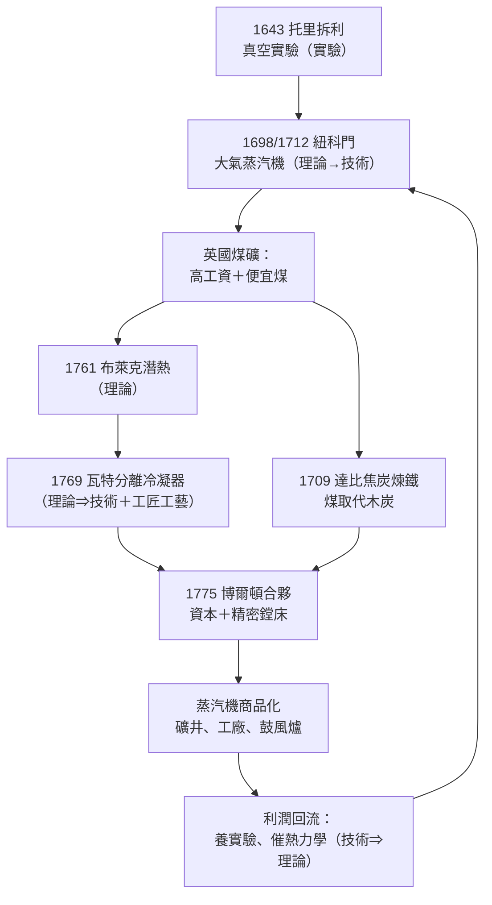

# 第五章之一：從紐科門到瓦特——真空知識、布萊克潛熱與工匠工藝的合體

## 引言：一場跨越半世紀的「合體」

工業革命的心臟是蒸汽機，而蒸汽機的誕生，並不是某個天才靈光一閃的產物，而是一場跨越一百二十年的接力：1643 年托里拆利用一根玻璃管證明真空存在；1698 年紐科門把這個實驗室裡的知識變成礦井裡的抽水機；1761 年布萊克用實驗測出潛熱；1769 年瓦特把潛熱理論注入蒸汽機，造出分離冷凝器。這條鏈條完整展示了金觀濤所說的「理論—實驗—技術」循環結構：科學知識第一次驅動了大工業，而大工業又回頭養育了科學。參見 [../../科技史/科技發展史/README.md]。

## 第一幕：1643，真空的誕生

自古希臘以來，「自然厭惡真空」（horror vacui）是亞里士多德體系的教條：自然界不容許真空存在，抽水機之所以能抽水，是因為「自然」不讓真空出現。這個說法在礦井淺處尚可自圓其說，但礦工們早就發現：無論用多好的泵，抽水高度超過約十公尺就再也抽不上來——教條解釋不了這個「異常」。

1643 年，伽利略的學生托里拆利在佛羅倫斯做了一根玻璃管實驗：把注滿水銀的玻璃管倒插進水銀槽，水銀柱下降，但停在約七十六公分處——比十公尺的水柱按密度比例正好相當。他的結論石破天驚：**支撐水銀柱的不是「自然的厭惡」，而是大氣本身的重量；管頂那段空無一物的空間，就是真空。**

這個實驗的意義遠超氣象學。它證明：

1. 真空可以被人工製造，宇宙並不「厭惡」它；
2. 大氣壓是一個可測量的物理量；
3. 壓力差可以做功——這正是七十年後蒸汽機的全部原理。

托里拆利實驗屬於循環結構中的「實驗⇒實驗」通道：真空泵的儀器與方法被波以耳繼承（1662 年波以耳定律），再被一切低壓實驗繼承下去。詳見 [../../科技史/科技發展史/1643-托里拆利大氣壓.md]。

## 第二幕：1698–1712，紐科門把真空變成機器

知識要變成產業，中間隔著一道鴻溝：誰需要真空？誰願意為它付錢？答案是英國的煤礦主。

十八世紀初，英國煤鐵業面臨致命瓶頸：淺層煤藏枯竭，礦井越挖越深，地下水湧入的速度超過人力與馬力抽排的能力。一個礦井往往需要五百匹馬日夜拉動水車——馬要吃草、要休息、要佔地方，成本高到讓深層開採無利可圖。

鐵匠托馬斯·紐科門（Thomas Newcomen）在 1712 年造出了第一台實用的「大氣蒸汽機」（較早的薩弗里蒸汽泵專利是 1698 年）：鍋爐把蒸汽送進汽缸，再向汽缸噴冷水，蒸汽凝結、缸內形成近似真空，外部大氣壓就把活塞壓下去——**做功的確實是「大氣」，蒸汽只負責製造真空**。這是托里拆利實驗的直系後裔：實驗室裡的知識第一次被物化為驅動大工業的機器。

紐科門蒸汽機結構簡單、笨重、熱效率極低（不到 1%），但它不挑燃料——煤礦自己產煤，劣質碎煤等於免費。於是整個英國煤田迅速佈滿了紐科門機：到 1760 年代，據估有上百台在運轉，每台可頂替幾十匹馬。這是**科學知識第一次驅動大工業**。詳見 [../../科技史/科技發展史/1698-紐科門蒸汽機.md]、[../../世界史/工業革命史/1712-紐科門大氣蒸汽機.md]。

## 第三幕：1761，布萊克的潛熱——理論⇒技術的經典通道

紐科門機最大的浪費在哪裡？每個衝程都要先用蒸汽加熱整個汽缸，再噴冷水把汽缸連蒸汽一起冷卻；下一個衝程又得重新把厚重的汽缸壁燒熱。大量熱量消耗在反覆加熱又冷卻金屬本身，而不是做功。

格拉斯哥大學的化學教授約瑟夫·布萊克（Joseph Black）在 1761 年前後以精密定量實驗發現了**潛熱**：物質相變時吸收或釋放的熱量並不表現為溫度變化——冰在融化成水時溫度停在零度，水在沸騰成汽時停在百度，但熱量仍在源源不斷地被吸入。水變成蒸汽所需吸收的潛熱，是同量水升高一度所需熱量的五百多倍。

這條理論知識對蒸汽機的含義是決定性的：**蒸汽在冷凝時會釋放巨大的潛熱**。如果蒸汽與冷水直接混合冷凝，這些潛熱就白白浪費了，還把汽缸一起冷掉。理論明確指出了改良方向——詳見 [../../科技史/科技發展史/1761-布萊克潛熱.md]。這是循環結構中「理論⇒技術」通道的教科書級案例：一項熱學理論直接物化為一項工程發明。

## 第四幕：1769，瓦特的分離冷凝器

在格拉斯哥修理一台紐科門機模型時，格拉斯哥的儀器匠詹姆斯·瓦特（James Watt）發現它的耗煤量遠超比例。他自述曾在公園散步時靈光乍現：「既然蒸汽是有彈性的物質，它會自動衝進真空；若在汽缸之外另接一個容器，保持冷卻，蒸汽就會自己跑進去冷凝——汽缸便可以永遠保持熱的！」

這就是**分離冷凝器**：汽缸絕熱保溫，冷凝在另一個獨立的冷凝器中進行。結果是熱效率提升三到四倍，耗煤量降到原來的四分之一以下。理想熱機的效率可以用卡諾後來給出的公式表達：

$$\eta = 1 - \frac{T_c}{T_h}$$

其中 $T_h$ 是熱源（蒸汽）溫度、 $T_c$ 是冷源（冷凝器）溫度。瓦特的發明，用現代語言說，就是在不做功的環節上減少熱損失，把可用溫差盡量保留給做功衝程——他憑直覺走在熱力學理論前面六十年（卡諾 1824 年才建立熱機理論，見 [../../科技史/科技發展史/1824-卡諾熱機理論.md]），而理論藍圖的起點正是布萊克的潛熱。瓦特本人師事布萊克，兩人在格拉斯哥過從甚密——理論家與工匠的這層私人友誼，就是「理論⇒技術」通道具體而微的樣貌。詳見 [../../科技史/科技發展史/1769-瓦特冷凝器.md]、[../../世界史/工業革命史/1769-瓦特蒸汽機.md]。

## 第五幕：Allen 的誘發式創新——為什麼是英國

同樣的紐科門機，在英國是賺錢機器，在法國卻近乎玩具。經濟史家羅伯特·艾倫（Robert Allen）對此給出著名解釋：**誘發式創新（induced innovation）**——技術的方向由相對要素價格決定。

十八世紀的英國有兩個突出的價格特徵：

1. **全世界最高的工資**：商業帝國、都市化與高技能勞動市場把英國工資推到歐洲之首；
2. **全世界最便宜的能源**：煤田就在身邊，倫敦到紐卡斯爾的海運使煤價低廉。

機器是什麼？機器就是「用資本與能源替代勞動」的手段。當勞動貴、能源便宜時，機器最划算；當勞動便宜、能源貴時，機器是賠本貨。紐科門機省下的是幾百匹馬和數十名抽水工，燒掉的是不值錢的碎煤——這筆帳在英國算得過來，在法國（工資較低、煤價較高）就算不過來。同樣的技術在不同要素價格下有完全不同的命運，這就是「工業革命為何出現在歐洲、且在歐洲偏偏出現在英國」的經濟學核心答案。

高工資還有第二重效果：它養育了高技能工匠階層。瓦特是儀器匠，他的關鍵合作者威爾金森的鏜床能加工出精密汽缸——昂貴的人力投資在精密製造上獲得回報，這只有高工資經濟才養得起。

## 第六幕：1709，達比的焦炭——解除燃料瓶頸

蒸汽機解決了礦井的水，焦炭煉鐵則解決了鐵的燃料。傳統煉鐵用木炭，一座冶鐵廠一年吃掉數千畝森林；英國的森林早已砍伐殆盡，鐵產量長期停滯，甚至依賴從瑞典、俄國進口生鐵。

1709 年，亞伯拉罕·達比（Abraham Darby）在什羅普郡的科爾布魯克代爾成功地用**焦炭**（把煤乾餾去硫去雜質）取代木炭煉鐵。煤取代木炭，等於把英國的燃料基礎從有限的生物能源切換到幾乎無限的礦物能源——能源瓶頸就此解除。此後蒸汽鼓風（1780 年代）進一步降低焦炭消耗，英國鐵產量在十八世紀末到十九世紀初暴增數十倍。煤、鐵、蒸汽從此結成互相餵養的鐵三角：蒸汽機燒煤、抽礦井水、鼓風煉鐵；鐵又造出更好的蒸汽機。詳見 [../../世界史/工業革命史/1709-達比焦炭煉鐵.md]。

## 第七幕：科學→工匠→資本的協作

瓦特的發明若停在圖紙上，工業革命就要改寫。1765 到 1775 年間，瓦特屢屢因缺乏資金與加工能力而瀕臨放棄。拯救他的是伯明翰的玩具製造商兼工廠主馬修·博爾頓（Matthew Boulton），他對瓦特說過一句名言：「我不只為三個郡製造產品，我為全世界製造。」博爾頓買下瓦特的專利份額，投入鉅資建廠，並借助威爾金森的精密鏜床解決了汽缸加工難題。1776 年第一批商用瓦特機上線，蒸汽機從此成為可販賣的商品——博爾頓—瓦特公司向礦場收取「省下的燃料費」作為專利授權金，這是一種天才的商業模式：**發明者的收益直接掛鉤於機器的效率改進**。

這張圖的最後一環尤其重要：蒸汽機賺了錢，錢養了實驗室與工程改良，工程改良提出的問題（蒸汽機效率有沒有極限？）最終逼出了卡諾與熱力學——**技術⇒理論**通道閉合，循環結構從此無法停下。

## 結語：合體的三種要素

瓦特蒸汽機常被講成一個工匠的天才故事，但真相是三種要素的合體：**實驗科學**（托里拆利、布萊克）提供了「為什麼」，**工匠工藝**（紐科門、瓦特、威爾金森）提供了「怎麼做」，**資本與市場**（煤礦主、博爾頓）提供了「為誰做」。任缺其一，紐科門機就永遠停在礦井口，瓦特機就永遠停在修理檯上。這個「科學—工匠—資本」的三方合體，是英國複合收斂的第一個支柱；接下來兩節我們將看到另外兩根支柱：金融革命（第五章之二）與棉紡織業的機械化（第五章之三）。

**延伸閱讀**：[../../科技史/科技發展史/1643-托里拆利大氣壓.md]、[../../科技史/科技發展史/1698-紐科門蒸汽機.md]、[../../科技史/科技發展史/1761-布萊克潛熱.md]、[../../科技史/科技發展史/1769-瓦特冷凝器.md]、[../../世界史/工業革命史/1709-達比焦炭煉鐵.md]、[../../世界史/工業革命史/1712-紐科門大氣蒸汽機.md]、[../../世界史/工業革命史/1769-瓦特蒸汽機.md]
