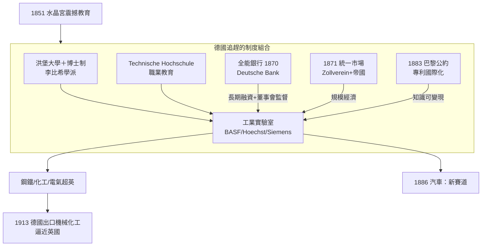

# 6.2 德國追趕：全能銀行、化工與電氣的第二工業革命

## 一、1851水晶宮：一場震撼教育

1851年5月，倫敦海德公園。一座由三千三百根鑄鐵柱與三十萬塊玻璃搭成的「水晶宮」在陽光下閃耀，裡面陳列著各國送來的十萬件展品——蒸汽機、機床、紡織機、電報機。這是阿爾伯特親王（Prince Albert）策劃的第一屆萬國博覽會，也是大英帝國工業霸權的加冕典禮（見[../../世界史/工業革命史/1851-水晶宮萬國博覽會.md]、[../../世界史/世界發展史/1851-萬國博覽會.md]）。

六百萬參觀者中，有一批來自德意志諸邦的官員、學者與企業家。他們站在英國的機床與火車頭面前，感受到的不是讚嘆，而是羞辱與清醒。來自埃森的克魯伯（Alfred Krupp）親自參觀後，把英國鋼鐵工藝的每一個細節帶回魯爾區；普魯士的觀察報告則直白寫道：德國的差距不在某項技術，而在**將科學、教育與生產組織起來的整體制度**。水晶宮因此成為德國「追趕計畫」的起點——英國展示的是果實，德國決定模仿的是果樹。

## 二、德國模式：把實驗室嵌入工廠

英國工業革命的組織形態是「工匠＋工廠」：瓦特、阿克萊特們靠經驗試錯。德國的代際優勢在於發明了全新的迴路組織——**工業實驗室**，讓「理論—實驗—技術」的循環直接在企業內部閉合。

其制度三件套：

1. **洪堡大學改革與博士培養**：1810年洪堡創立柏林大學，確立「教學與研究統一」原則，大學不再是傳授既有知識的學院，而是**生產新知識的工廠**。博士生制度讓「在教授指導下做出原創研究」成為標準產品線，化學、物理學者被像技師一樣批量培養。
2. **李比希學派與有機化學**：吉森大學的李比希創立了現代意義上的研究實驗室與研究群體（學派），他的學生霍夫曼（A. W. Hofmann）等人把有機化學變成精密的分子工程學。英國化學家柏琴1856年偶然合成出紫色染料「苯胺紫」，但英國的工匠傳統不知如何將其產業化；德國的巴斯夫（BASF）、赫斯特（Hoechst）卻以實驗室＋工廠一體的模式，把合成染料做成出口帝國——**英國發現，德國收割**，成為此後半世紀的固定劇本。
3. **技術教育體系**：各邦建立的理工學院（Technische Hochschule）培養工程師，與大學博士、職業學校（後來的雙軌制）形成從博士到技師的完整人才金字塔。普魯士1763年已有的義務教育傳統（見[../../世界史/世界發展史/1763-普魯士義務教育.md]）提供了識字勞動力的底座。

再加上1856年貝塞麥轉爐引發的煉鋼革命迅速被德國引進消化（見[../../科技史/科技發展史/1856-貝塞麥轉爐.md]），魯爾區的鋼鐵、化學、電氣三大產業在世紀末全面超越英國。

## 三、全能銀行：資本的組織創新

光有實驗室不夠，重化工業需要空前規模的長期資本。英國的商人銀行擅長為貿易與政府融資，對工業長期放貸興趣寥寥；英國企業多靠自身留存利潤滾動成長。德國則發明了**全能銀行（Universal Bank）**：1870年德意志銀行（Deutsche Bank）成立，此後貼現銀行、沙夫豪森等信貸銀行（Kreditbank）把商業銀行、投資銀行、董事會監督三種功能熔於一身（見[../../世界史/工業革命史/1870-全能銀行與德國追趕.md]）。

全能銀行不只放款，還持股、派駐董事、參與重組——它把「資本供給」與「公司治理」綁定，使資本敢於湧向回收週期長達十年的化工廠與電廠。這是迴路組織形態的第二項代際優勢：**英國用市場分散風險，德國用銀行集中押注**。在追趕階段，集中押注的後發者跑得更快。

## 四、統一市場、專利國際化與汽車

追趕還需要規模。1871年德意志帝國成立，此前數十年關稅同盟（Zollverein）已把諸邦碎片化市場熔成單一市場，鐵路網再把它物理縫合——統一市場＋鐵路整合，是德國版的「全國市場紅利」。

制度層面，1883年的《保護工業產權巴黎公約》確立專利的跨國國民待遇原則，德國企業第一次可以放心地在海外布局專利、在國內以專利護城河養育研發（見[../../世界史/工業革命史/1883-巴黎公約.md]）。知識產權的國際化，等於把「理論—實驗—技術」迴路的產出變成可全球變現的資產，進一步放大了工業實驗室的投資報酬率。

到1886年，本茨（Carl Benz）與戴姆勒（Gottlieb Daimler）分別造出以內燃機驅動的汽車——熱力學理論（卡諾→奧托四衝程，見[../../科技史/科技發展史/1876-奧托四衝程.md]）經德國工程師之手物化為新產業，德國不僅追平英國，還開出了英國版圖上沒有的新賽道（見[../../世界史/工業革命史/1886-汽車誕生.md]、[../../科技史/科技發展史/1885-賓士汽車.md]）。

## 五、內生增長的簡化式

德國模式可以用一句簡化的內生增長邏輯概括：知識投入決定技術進步率，技術進步率決定人均產出的長期增長。

$$
\dot{A} = \delta \cdot R\!\&\!D, \qquad g_Y \approx g_A = \delta \cdot s_R \cdot \theta
$$

其中 $\dot{A}$ 是技術水準的增長， $R\&D$ 是研發投入， $s_R$ 是投入研發的人力與資本份額， $\theta$ 是研發的生產率， $\delta$ 是知識轉化係數。英國的 $s_R$ 靠工匠的零散改良，德國則以制度（大學＋實驗室＋技術學院）系統性拉高 $s_R$ 與 $\theta$ ——**後發者的超車，本質是提高迴路的轉速參數**。

## 六、制度組合圖

## 七、小結：代際優勢的第一定律

德國的追趕告訴我們：霸權交替從不是「更努力」的結果，而是**迴路組織形態的升級**。英國的組織形態（工匠＋工廠＋商人銀行）在第一代技術（紡織、蒸汽）中是優勢；但在第二代技術（化學、電氣、鋼鐵）中，德國的組織形態（科學實驗室＋大學＋全能銀行）具有結構性的生產率優勢。然而，歷史的弔詭在於：德國的實驗室模式也將被另一種更「量產」的組織形態超越——管理。下一節，鏡頭轉向美國。

## 延伸閱讀

- [../../世界史/工業革命史/1856-貝塞麥煉鋼法.md]：鋼鐵時代的技術引爆
- [../../世界史/世界發展史/1866-參謀本部與鐵路動員.md]：德國將鐵路組織化的軍事面向
- [../../科技史/科技發展史/1865-麥克斯韋方程組.md]：電氣工業背後的理論革命
