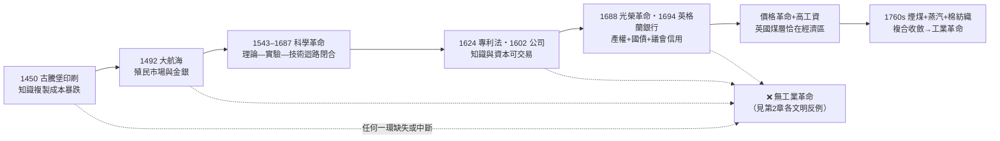
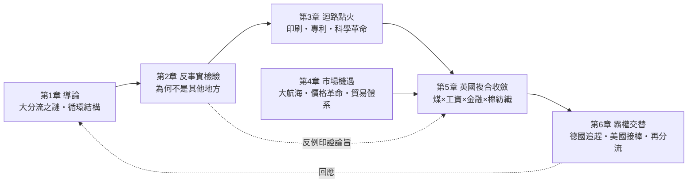
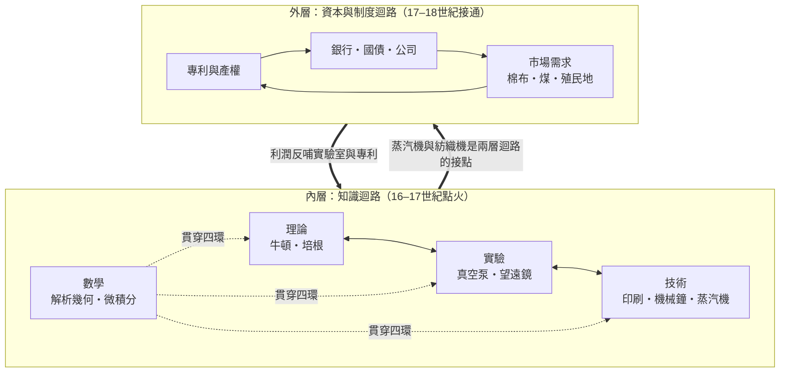
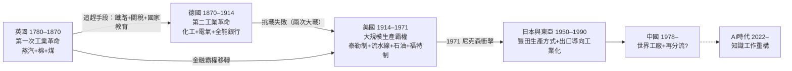

# 工業革命為何出現在歐洲

> Why the Industrial Revolution Happened in Europe
> ——煤、市場、制度與「理論—實驗—技術」循環的複合革命

李約瑟曾問：科學與工業革命為何發生在歐洲而非長期領先的中國？彭慕蘭（Kenneth Pomeranz）的《大分流》則追問：英格蘭與江南在十八世紀的差距，究竟是「內因」還是「偶然」？

但金觀濤指出：**李約瑟問題問錯了方向**。「為何中國沒有發生科學革命／工業革命」是一個消極的問題——它預設了革命是文明的常態，中國只是「缺少」了什麼；然而縱觀人類數千年文明史，工業革命只發生過**一次**，它才是極端罕見的例外。正確的問法應該反轉過來：**「為何工業革命只發生在歐洲？」**——即去尋找歐洲那一連串特殊的、缺一不可的事件與體制，如何湊巧地串聯成鏈。本書即以這個反轉後的問題為綱。

本書採用金觀濤的循環結構論作為核心分析框架（見探案庫 [科技發展史](../../科技史/科技發展史/README.md)）：**科學革命的本質，是「理論—實驗—技術」三者形成自我完成的正反饋迴路，任兩環之間都有促進通道（九通道），並以數學為貫穿其中的第四要素**。古代文明有技術、有理論、有觀測，但三者各自孤立、不成循環——中國的火藥與水運儀象台、希臘的阿基米德皆然。歐洲在十六、十七世紀把迴路點火，十八世紀再把迴路接入**市場與資本**（專利、公司、銀行、殖民地需求），工業革命遂不可逆。

**本書核心論旨**：工業革命 = 「知識迴路（理論⇄實驗⇄技術＋數學）× 市場規模（大航海、殖民貿易）× 制度基礎設施（專利、金融、公司、產權）× 地理稟賦（煤層與高工資）」在英國的一次複合收斂。缺一環，革命不發生。而第2章的反事實檢驗——逐一檢視中國、伊斯蘭、印度、鄂圖曼、俄羅斯、荷蘭與威尼斯為何「差一點」——正是本論旨最好的證據。

## 目錄

* 第1章-導論：問題的反轉與循環結構
    * [1.1-金觀濤的反轉：為何「只」發生在歐洲——一連串特殊事件與體制的串聯](../../科技史/科技發展史/README.md)（否定「常態論」：革命是一次性例外，須逐環追索其充要條件）
    * [1.2-李約瑟問題與大分流辯論](../../世界史/世界發展史/1769-瓦特蒸汽機.md)（含：江南與英格蘭的比較框架）
    * [1.3-金觀濤循環結構：理論—實驗—技術的九通道](../../科技史/科技發展史/1450-古騰堡印刷術.md)（框架總論：古代技術孤行 vs 近代迴路點火）
* 第2章-反事實檢驗：為何工業革命沒有發生在其他地方（反轉問題的消極面驗證）
    * [2.1-為何不是中國：技術孤行的千年與明清天花板](../../科技史/科技發展史/1044-火藥.md)、[1090-水運儀象台](../../科技史/科技發展史/1090-水運儀象台.md)、[1368-明初海禁](../../世界史/商業貿易史/1368-明初海禁.md)、[1684-清朝開海](../../世界史/商業貿易史/1684-清朝開海.md)
    * [2.2-為何不是伊斯蘭與印度：智慧宮之後的斷裂與殖民地化](../../世界史/世界發展史/0830-智慧宮翻譯運動.md)、[1453-君士坦丁堡陷落](../../世界史/歐亞交界史/1453-君士坦丁堡陷落與陸權轉移.md)、[1291-馬木路克香料壟斷](../../世界史/商業貿易史/1291-馬木路克香料壟斷.md)、[1839-鴉片戰爭](../../世界史/商業貿易史/1839-鴉片戰爭.md)
    * [2.3-為何不是鄂圖曼、俄羅斯、荷蘭與威尼斯：四個「差一點」的故事](../../世界史/歐亞交界史/1839-坦志麥特改革.md)、[1722-彼得大帝官秩表](../../世界史/歐亞交界史/1722-彼得大帝官秩表.md)、[1585-安特衛普陷落](../../世界史/大航海時代/1585-安特衛普陷落.md)、[1780-第四次英荷戰爭與VOC之亡](../../世界史/大航海時代/1780-第四次英荷戰爭與VOC之亡.md)、[1853-黑船事件](../../世界史/世界發展史/1853-黑船事件.md)、[1868-明治維新](../../世界史/世界發展史/1868-明治維新.md)
* 第3章-迴路點火：印刷、專利與科學革命（1450–1687）
    * [3.1-從畢昇到古騰堡：知識複製成本暴跌與迴路的點火器](../../科技史/科技發展史/1450-古騰堡印刷術.md)、[1045-畢昇活字](../../世界史/世界發展史/1045-畢昇活字.md)
    * [3.2-科學革命的迴路閉合：培根立法、伽利略實驗、牛頓綜合](../../科技史/科技發展史/1620-培根新工具.md)、[1638-兩門新科學](../../科技史/科技發展史/1638-兩門新科學.md)、[1687-牛頓原理](../../科技史/科技發展史/1687-牛頓原理.md)
    * [3.3-專利與皇家學會：把知識變成可交易財產、把迴路制度化](../../世界史/工業革命史/1624-壟斷法與專利制度.md)、[1474-威尼斯專利法](../../世界史/工業革命史/1474-威尼斯專利法.md)
* 第4章-市場的機遇：大航海、價格革命與貿易體系
    * [4.1-哥倫布大交換與波托西銀礦：需求的爆炸](../../世界史/大航海時代/1492-哥倫布與大交換.md)、[1545-波托西銀礦與價格革命](../../世界史/世界發展史/1545-波托西銀礦與價格革命.md)
    * [4.2-特許公司與三角貿易：組織遠洋資本](../../世界史/大航海時代/1600-英國東印度公司.md)、[1602-荷蘭東印度公司](../../世界史/大航海時代/1602-荷蘭東印度公司.md)、[1663-三角貿易](../../世界史/商業貿易史/1663-三角貿易.md)
    * [4.3-航海法案與廣州體系：保護主義下的棉紡織飢渴](../../世界史/大航海時代/1651-航海法案與大西洋體系.md)、[1757-廣州一口通商](../../世界史/商業貿易史/1757-廣州一口通商.md)
* 第5章-英國的複合收斂：煤、工資、金融與棉紡織
    * [5.1-從紐科門到瓦特：真空知識、布萊克潛熱與工匠工藝的合體](../../科技史/科技發展史/1698-紐科門蒸汽機.md)、[1761-布萊克潛熱](../../科技史/科技發展史/1761-布萊克潛熱.md)、[1769-瓦特冷凝器](../../科技史/科技發展史/1769-瓦特冷凝器.md)、[1709-達比焦炭煉鐵](../../世界史/工業革命史/1709-達比焦炭煉鐵.md)
    * [5.2-金融革命：英格蘭銀行、國債與光榮革命](../../世界史/工業革命史/1694-英格蘭銀行與國債.md)、[1688-光榮革命與貿易體制](../../世界史/大航海時代/1688-光榮革命與貿易體制.md)
    * [5.3-珍妮紡紗機、莫茲利車床與工廠制度：棉紡織作為主導部門](../../科技史/科技發展史/1764-珍妮紡紗機.md)、[1797-莫茲利車床](../../科技史/科技發展史/1797-莫茲利車床.md)、[1494-複式簿記](../../世界史/工業革命史/1494-複式簿記.md)、[1833-工廠法與勞工](../../世界史/工業革命史/1833-工廠法與勞工.md)
* 第6章-霸權交替：德國追趕、美國接棒與迴路升級
    * [6.1-鐵路、電報與卡諾熱機：技術反哺理論的雙迴路大加速](../../世界史/工業革命史/1825-鐵路時代開啟.md)、[1844-電報革命](../../世界史/工業革命史/1844-電報革命.md)、[1824-卡諾熱機理論](../../科技史/科技發展史/1824-卡諾熱機理論.md)、[1789-拉瓦錫定量革命](../../科技史/科技發展史/1789-拉瓦錫定量革命.md)
    * [6.2-德國追趕：全能銀行、化工與電氣的第二工業革命](../../世界史/工業革命史/1870-全能銀行與德國追趕.md)、[1851-水晶宮萬國博覽會](../../世界史/工業革命史/1851-水晶宮萬國博覽會.md)、[1886-汽車誕生](../../世界史/工業革命史/1886-汽車誕生.md)、[1883-巴黎公約](../../世界史/工業革命史/1883-巴黎公約.md)
    * [6.3-美國接棒：泰勒制、福特流水線與大規模生產取代英國霸權](../../世界史/工業革命史/1913-福特流水線.md)、[1911-泰勒科學管理](../../世界史/工業革命史/1911-泰勒科學管理.md)、[1859-石油時代開啟](../../世界史/工業革命史/1859-石油時代開啟.md)、[1944-布雷頓森林體系](../../世界史/工業革命史/1944-布雷頓森林體系.md)、[1947-GATT](../../世界史/工業革命史/1947-GATT.md)
    * [6.4-尾聲：兩百年後的再分流——日本追趕、中國崛起與AI時代](../../世界史/世界發展史/1868-明治維新.md)、[1978-改革開放](../../世界史/世界發展史/1978-改革開放.md)、[1987-台積電與代工模式](../../世界史/世界發展史/1987-台積電與代工模式.md)、[2022-ChatGPT與知識工作](../../世界史/世界發展史/2022-ChatGPT與知識工作.md)

## 問題的反轉：工業革命是「一連串特殊事件與體制」的串聯

若革命是文明的常態，每個成熟文明都該各自發生一次；但史實是：**數千年、數十個文明，只發生過一次**。這逼出金觀濤式的方法論轉向——不問「中國缺什麼」（消極歸因），而問「歐洲多了哪些缺一不可的環節」（積極歸因）。工業革命因此不應被理解為任何單一原因（煤、科學、資本主義、新教、地理）的產物，而是一條**特殊事件的因果鏈**：每一環本身都是低機率事件，串起來之後，革命才從「可能」變成「必然」。

這條鏈的每一環都有對照組（詳第2章）：印刷術中國有（畢昇）卻未成點火器；大航海中國有（鄭和）卻自我中止；科學儀器中國有（水運儀象台）卻後繼無人；股份公司與金融革命荷蘭先有卻缺本國規模與煤；專利制度威尼斯先有卻隨城邦衰落而斷。**歐洲的「特殊」不在任何單一發明或制度，而在於：競爭性國家體系讓這些環節無法被單一帝國的穩定偏好中止，鏈條一旦在任一邦國點燃，就會跨越邊界自我複製。**這正是「為何只發生在歐洲」的結構性答案。

## 全書因果結構

## 核心分析框架：理論—實驗—技術循環 × 市場資本

工業革命發生在歐洲的關鍵，可以拆成兩層循環的耦合：內層是金觀濤式的知識迴路，外層是資本與市場迴路。

### 九通道在工業革命中的體現

| 通道 | 工業革命中的關鍵案例 | 引用 |
| --- | --- | --- |
| 理論⇒技術 | 布萊克潛熱（1761）→ 瓦特分離冷凝器（1769） | [1769-瓦特冷凝器](../../科技史/科技發展史/1769-瓦特冷凝器.md) |
| 技術⇒理論 | 蒸汽機效率極限 → 卡諾熱機理論（1824）→熱力學 | [1824-卡諾熱機理論](../../科技史/科技發展史/1824-卡諾熱機理論.md) |
| 技術⇒實驗 | 印刷術（1450）讓知識可比對、可重複驗證 | [1450-古騰堡印刷術](../../科技史/科技發展史/1450-古騰堡印刷術.md) |
| 實驗⇒技術 | 托里拆利真空實驗（1643）→ 紐科門蒸汽機（1698） | [1698-紐科門蒸汽機](../../科技史/科技發展史/1698-紐科門蒸汽機.md) |
| 技術⇒技術 | 莫茲利車床（1797）：製造機器的機器 | [1797-莫茲利車床](../../科技史/科技發展史/1797-莫茲利車床.md) |
| 實驗⇒理論 | 拉瓦錫定量革命（1789）：天平摧毀燃素說 | [1789-拉瓦錫定量革命](../../科技史/科技發展史/1789-拉瓦錫定量革命.md) |
| 數學⇒技術 | 斐波那契阿拉伯數字＋複式簿記（1202/1494）→ 商業革命 | [1494-複式簿記](../../世界史/工業革命史/1494-複式簿記.md) |

## 後續：工業化如何接力——從英國到美國的霸權交替

工業革命不是終點而是起點。迴路一旦接通市場，就會沿著「教育—實驗室—銀行—工廠」的通道向後進國家擴散，而每一次擴散都伴隨一次霸權交替：**後發者以更新的迴路組織形態（工業實驗室、科學管理、量產體系）超越先行者**。

| 階段 | 主導者 | 迴路組織創新 | 關鍵制度 | 引用 |
| --- | --- | --- | --- | --- |
| 第一次工業革命 | 英國 | 工廠制＋工匠經驗 | 專利、英格蘭銀行 | [1769 瓦特](../../科技史/科技發展史/1769-瓦特冷凝器.md) |
| 第二工業革命 | 德國 | **工業實驗室**（BASF、西門子）＋全能銀行 | 專利國際化（巴黎公約）、職業教育 | [1870 全能銀行](../../世界史/工業革命史/1870-全能銀行與德國追趕.md)、[1883 巴黎公約](../../世界史/工業革命史/1883-巴黎公約.md) |
| 大規模生產 | 美國 | **泰勒制＋福特流水線**：發明的工廠化、管理的科學化 | 有限公司、證券市場、布雷頓森林 | [1913 福特流水線](../../世界史/工業革命史/1913-福特流水線.md)、[1911 泰勒](../../世界史/工業革命史/1911-泰勒科學管理.md) |
| 精益生產 | 日本 | 豐田生產方式＋承包網絡 | 通產省產業政策 | [1868 明治維新](../../世界史/世界發展史/1868-明治維新.md) |
| 世界工廠與AI | 中國／美國 | 平台經濟＋深度學習迴路 | 入世、代工模式 | [1978 改革開放](../../世界史/世界發展史/1978-改革開放.md)、[2022 ChatGPT](../../世界史/世界發展史/2022-ChatGPT與知識工作.md) |

**推論**：霸權交替的規律不是資源或人口，而是**迴路組織形態的代際優勢**——德國用實驗室打敗英國的工匠，美國用管理打敗德國的實驗室，日本用流程改善逼近美國的量產，而下一輪（AI 迴路）的裁判權仍待定。這正是第2章反事實檢驗的延伸命題：工業革命可以移植，但**移植者必須同時移植「迴路＋資本＋制度」三件套，缺一即成俄羅斯式的追趕而不轉化**。

## 第2章反事實檢驗：各文明「缺哪一環」總表

| 文明/地區 | 有什麼 | 缺什麼 | 命運 | 節 |
| --- | --- | --- | --- | --- |
| 中國 | 火藥、活字、儀象台、江南市場、煤 | 迴路不成；科舉導向經典；海禁與一口通商壓縮刺激；低工資無節能誘因 | 1840 年被炮艦打開 | 2.1 |
| 伊斯蘭（阿拔斯→鄂圖曼） | 智慧宮、代數、光學、御道商網 | 蒙古/鄂圖曼衝擊後制度化僵化；香料壟斷被繞過；瓦克夫產權僵滯 | 1498 年後商路轉向、淪為邊陲 | 2.2 |
| 印度（蒙兀兒） | 棉紡織世界工廠、龐大內需 | 政治碎片化；公司殖民取代主權工業化 | 1757 普拉西後去工業化 | 2.2 |
| 鄂圖曼 | 陸權帝國、米利特自治 | 坦志麥特改革太遲；教產產權阻礙資本累積 | 歐洲藥物化市場 | 2.3 |
| 俄羅斯 | 彼得大帝強制西化 | 官秩表國家吸收創新；農奴制壓抑勞動市場 | 追趕而不轉化 | 2.3 |
| 荷蘭/威尼斯 | 金融革命、股份公司、專利、殖民 | 本土太小、缺煤、勞動力昂貴但資本外流 | 被英國以規模碾壓（VOC 之亡） | 2.3 |
| 日本（對照組） | 明治維新：唯一非西方成功者 | ——證明迴路＋制度可以後天移植 | 黑船之後半世紀完成工業化 | 2.3 |

## 六重驅動力對照表

| 驅動力 | 關鍵要素 | 代表史料（本探案庫） |
| --- | --- | --- |
| 科技 | 印刷、蒸汽機、紡織機、機床 | 1450 古騰堡、1769 瓦特、1797 莫茲利 |
| 經濟 | 高工資、煤炭稟賦、價格革命、棉織品市場 | 1545 波托西、1764 珍妮紡紗機 |
| 制度 | 專利、公司、銀行、國債、產權 | 1624 壟斷法、1602 東印度公司、1694 英格蘭銀行 |
| 文化 | 識字率、實用知識文化、培根《新工具》 | 1620 培根、1455 印刷革命 |
| 政治 | 光榮革命、議會主權、貿易保護 | 1688 光榮革命、1651 航海法案 |
| 思想 | 科學革命、理性化、進步觀念 | 1687 牛頓、1776 國富論 |

## 引用說明

本書直接引用探案庫三處史料：

- `歷史探案/科技史/科技發展史/`——科學技術事件 wiki（含金觀濤循環結構年表）
- `歷史探案/世界史/工業革命史`、`大航海時代`、`商業貿易史`、`世界發展史`、`歐亞交界史`——制度與經濟個案

連結為相對路徑 `../../科技史/...` 與 `../../世界史/...`。
