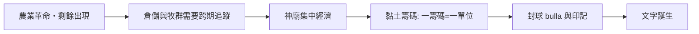

# 第一篇 第一章 第一節：黏土籌碼——會計比文字更早誕生

> 約公元前 8000 年起，在今天的伊拉克、敘利亞與土耳其一帶（美索不達米亞至黎凡特），人們開始用各種形狀的小黏土塊記錄「有多少隻羊、多少袋穀物」。這些小東西被考古學者丹尼絲·施曼特-貝瑟拉（Denise Schmandt-Besserat）命名為「**黏土籌碼（tokens）**」。她的結論震撼學界：**記帳的衝動，早於文字數千年**。

## 一、前因：農業革命製造了「記帳的剛需」

人類採集狩獵數十萬年，並不需要會計——群體小、資源即取即用。但新石器革命（約前 9000 年起）改變了一切：

1. **穀物可以儲存**：剩餘（surplus）第一次存在，於是「倉庫裡到底還剩多少」成為新問題。
2. **牧群可以繁衍**：羊群是活著的資產，會生小羊、會被狼吃掉——需要跨年追蹤。
3. **陌生人交易增加**：村莊之間以物易物、延後交付（「先付大麥，秋天交羊」），產生信用的雛形。
4. **神廟經濟出現**：蘇美神廟集中管理收成、分配口糧——大型組織需要系統性記錄。

## 二、籌碼系統如何運作

施曼特-貝瑟拉在伊朗、伊拉克等地統計了上萬枚籌碼，歸納出規則：

- **形狀即語意**：圓錐體＝小量穀物、球體＝大量穀物、卵形＝油、圓盤＝牲畜。形狀約有數十種，對應不同商品。
- **數量即數字**：同形籌碼放幾枚，就代表幾個單位。
- **跨期契約**：籌碼封入中空的黏土球（**bulla**）並加印封印，就成了「合約」——誰也不能偷換。這是最早的「防竄改簽章」。

## 三、關鍵的技術躍遷：從立體到平面

約公元前 3500–3100 年（蘇美的烏魯克時期），發生了一個天才式的簡化：

> 在**封球的外表面壓印籌碼的形狀**，讓人不必打破球就能知道內容物。

一旦「形狀」被壓印在平面上，人們很快發現：**根本不需要裡面再放籌碼了**。平面符號＋楔形刻痕的組合，就是**楔形文字的起點**。換句話說：

> **文字是會計的副產品。**人類第一批被寫下的符號，多半是收支清單，而非詩歌或法律。

## 四、制度學啟示

- **技術決定記錄形態**：立體籌碼→壓印→平面符號，每次載體升級都放大了可管理的經濟規模——與後世莎草紙（第 2 章）、印刷術（第 4 章）、雲端（第 10 章）完全同構。
- **防偽即信任工程**：封球＋印記解決「口說無憑」，是審計獨立性的原始形態。
- **抽象數字誕生**：當「三隻羊」與「三袋大麥」共用了同一個記數符號，「數」才從「物」中解放——這是數學與經濟的共同起點。

---

*下一節：人類史上第一位留下姓名的個人，是一位記帳員——參見 [1.2 庫辛](01.2-庫辛與楔形文字.md)*