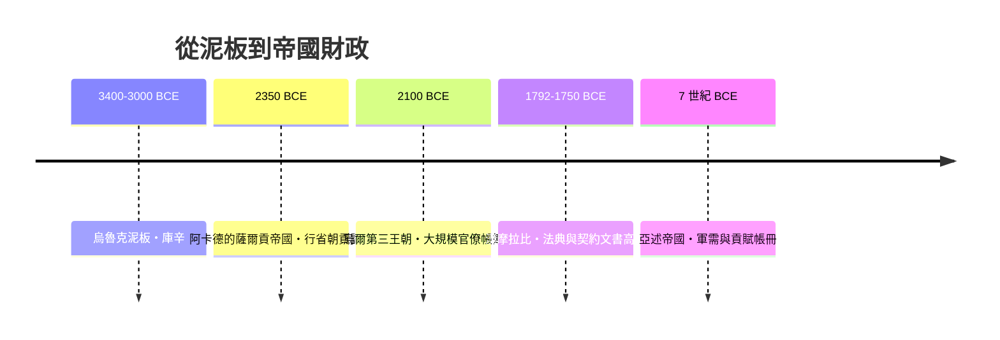

# 第一篇 第一章 第二節：庫辛與楔形文字——史上第一個留名的人是記帳員

> 烏魯克出土的一塊約公元前 3400–3000 年的泥板上，寫著一個句子式的記錄：**「29,086 大麥——庫辛（Kushim）經手。」**（正確讀序依學者解讀，多譯為「29,086 大麥・庫辛」）。這被許多學者視為**人類史上最早附有個人姓名的書面記錄之一**——而這個人不是國王，是一名會計。

## 一、庫辛是誰

《人類大歷史》作者哈拉瑞把這條泥板故事化為「史上第一個留名者是會計」。學界對 Kushim 一詞的解讀仍有討論（可能為人名、職稱或職務群體名稱），但該泥板的性質無疑是**行政記帳文書**：大量大麥的清點與經手責任。

烏魯克（Uruk）此時已是數萬人的城市：神廟、職業分工、長程貿易。泥板書記（scribes）在神廟行政體系中任職——**會計與行政，就是人類最早的白領職業**。

## 二、書記官學校：人類最早的職業教育

蘇美語稱書記官為 *dub-sar*（「泥板書寫者」）。培養他們的學校叫 **edubba**（「泥板屋」），在公元前 3 千紀後半成熟：

| 項目 | 內容 |
|---|---|
| 招生 | 多為富家子弟（俗稱「泥板屋之子」） |
| 課程 | 從基本楔形符號、姓名表、專業詞表，到契約、會計文書實務 |
| 教法 | 臨摹＋背誦＋抄寫大量範例（含「學生抱怨功課」的趣味文本） |
| 出路 | 神廟、王宮、私人商號的帳房與行政 |

這意味著：**會計職業的誕生，伴隨著第一批「教育產業」與「職業階層」**——知識（讀寫＋算術）直接轉化為稀缺的行政權力。

## 三、會計文書的類型：三千年前的「記帳軟體清單」

烏魯克之後的美索不達米亞，發展出一整套標準化文書（與今天的帳簿體系驚人地同構）：

- **清單（list）**：庫存與收成盤點 → 盤點表
- **收付記錄（receipts / expenditures）**：誰交了什麼、誰領了什麼 → 日記帳
- **配給名冊（ration lists）**：工人按身分配給口糧 → 薪資表
- **契約**：買賣、貸款、雇傭、婚姻財產 → 法律會計文件
- **封印與見證人**：每筆交易有印記與數名見證 → 簽章＋審計痕跡

古巴比倫時期更出現**複式手法的雛形**：同一筆交易在「給方」與「受方」各留記錄（對應交易雙方），並以封印核對——「核對兩邊一致」的核數思想已經萌芽。

## 四、前因後果：記帳如何支撐帝國

烏爾第三王朝（約前 2100 年）留下的成千上萬塊行政泥板顯示：國家規模的徵稅、軍糧、工資，**全部仰賴會計文書的標準化**。沒有記帳，就沒有帝國——這個命題將在波斯的「萬王之王」、羅馬的國庫、乃至現代國家的預算制度中一再重演。

## 五、留給後世的兩條規則

1. **記錄產生問責（accountability 的字源即 counting）**：寫下「庫辛經手」，責任就有了名字。今天企業內控的「經辦人簽名」，與這塊泥板的精神完全相同。
2. **數量大到無法心算，制度就會自己長出來**：烏魯克的行政壓力逼出文字與數字；兩千年後的威尼斯商人將逼出複式記帳（第 3–4 章）；五百年後的矽谷將逼出區塊鏈（第 10 章）。

---

*第二篇移師尼羅河：法老怎麼查倉庫、雅典怎麼查官員——參見 [2.1 埃及的審計官](02.1-埃及的審計官.md)*