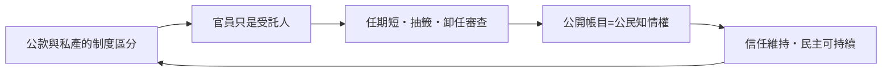

# 第一篇 第二章 第二節：雅典的公共財政——民主制度如何把「查帳」變成公民權利

> 約公元前 5 世紀的雅典，每年有多達約 1,400 名公民擔任各種財政職務——而每一名卸任官員，都必須經過一套公開的帳目審查。**在雅典，「審計」不是行政程序，而是民主的呼吸方式。**

## 一、前因：城邦把「公共錢包」發明出來

古希臘城邦的政治實驗，強制創造了一個新事物：**公共財產與私人財產的制度性區分**。

- 提秀斯傳說與梭倫改革（前 594 年）之後，雅典逐步確立按財產課稅、按財產分級的秩序。
- 希波戰爭（前 490–479 年）後，提洛同盟的貢金（phoros）入庫雅典——公共資金規模暴漲，監督需求也暴漲。
- 伯里克里時代用公款修建帕德嫩神廟、發放陪審津貼——**公款花在哪，公民大會就要問到哪**。

## 二、雅典的財政制度組件

| 機構／職務 | 職能 |
|---|---|
| 財政官（tamiai） | 分管國庫、神廟財產、軍費等，任期一年 |
| 收款員（kolakretai）與賣官收稅者 | 收入端管理 |
| 十將軍與委員會 | 提出預算與用款提案 |
| 公民大會（Ekklesia） | 決定大額支出與特別課稅 |

官員任期短（一年）、大量職務以抽籤產生、並設**連任限制與離任結算**——制度設計的目的就是防止財政權力沉積。

## 三、卸任審查（euthynai）：古代最完整的審計程序

每一位卸任官員都要經過 **euthynai（「清算／結算」）**：

1. **提交帳冊**：任期內所有收支交由專責審查官（logistai，帳目稽核官）核對。
2. **十位辯護人（synegoroi）與十位控告人（katagoroi）**：任何人都可以在公開聽證中對該官員的帳目提出控告或為其辯護。
3. **疑案送法庭**：由陪審法庭（多達數百人）裁決；被判盜用公款者面臨重罰乃至沒收財產。
4. **通過後才能離任**：結清之前，官員不得出國、不得處分財產——離任審查具有強制力。

亞里士多德《雅典政制》記載了這套程序的細節。值得強調：**審查是公開的、可由任何公民發動的**——這是「全民監督公共資金」的制度化，比現代審計制度的「公眾利益」理念早了兩千三百年。

## 四、著名案例：與帕德嫩有關的審計戰

公元前 438/437 年，雅典對**帕德嫩神廟工程**（菲迪亞斯主持）進行卸任清查；雕刻家菲迪亞斯本人也被控貪污黃金與象牙（後世史料對細節有出入，但審查與控告確有其事）。更著名的政治衝擊是：**修神廟的公款該不該花**本身成為議題——斯巴達盟邦抗議雅典挪用提洛同盟貢金裝飾自家城市，修昔底德記錄了雅典政治家在公民大會上為此辯護。**公共資金的正當性爭論，第一次成為帝國政治的核心。**

## 五、啟示：審計與民主互為條件

- **沒有審計的民主會被貪腐掏空，沒有民主的審計只是帝王的家奴核數。**雅典證明了兩者互為條件。
- 這條「公共資金必須向公眾交代」的原則，將在兩千年後的英國以「國家審計署（1786）」、在美國以 GAO（1921）的形式重演；而上市公司「向股東交代」的審計（第 5–7 章），則是它的私部門版本。

---

*第二篇：熱那亞與威尼斯的商人將改寫一切——參見 [3.1 威尼斯商人的算盤](03.1-威尼斯商人的算盤.md)*