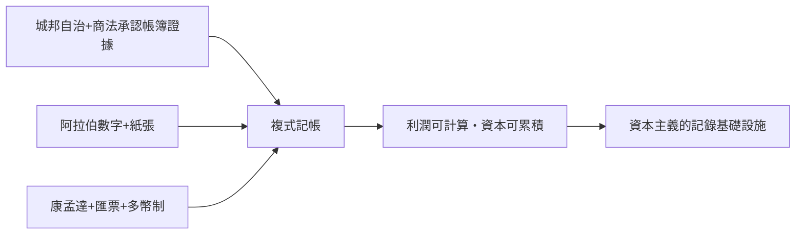

# 第二篇 第三章 第一節：威尼斯商人的算盤——跨境貿易逼出來的記帳革命

> 13–14 世紀的地中海，是一台巨大的商業實驗機。威尼斯、熱那亞、佛羅倫斯的商人，面對前現代世界最複雜的難題：**錢在海上漂、合夥人分處兩地、貨幣有幾十種**——單式記帳撐不住了。複式記帳（double-entry bookkeeping），是這台實驗機的產物。

## 一、前因：三大結構條件

### 1. 政治條件：城邦自治與商法

義大利城邦（威尼斯、熱那亞、比薩、佛羅倫斯）名義上臣屬於帝國或教廷，實際上高度自治。它們自訂商法、設商事法庭：

- 熱那亞約 1157 年起發行長期公債（compere），是中世紀最早的政府融資實驗之一。
- 商事法庭允許以**帳簿作為證據**——這是會計記錄獲得法律地位的關鍵一步（帳本不只是備忘，而是呈堂證供）。

### 2. 技術條件：算術與書寫工具

- 1202 年，比薩的**斐波那契（Leonardo Fibonacci）**出版《計算之書》（Liber Abaci），把印度-阿拉伯數字與計算方法介紹給歐洲商界。零、進位、直式計算——複式記帳的數學地基到位。
- 紙張經阿拉伯世界傳入義大利，使商人可以廉價地逐筆記帳；羊皮紙太貴，本來就難以「每筆都記」。

### 3. 組織條件：合夥與海上融資

- **康孟達（commenda）**：一方出資不參與航行、一方出力航行，利潤分成——投資人與經營人分離的早期形態。**委託人要看清受託人的帳**，正是審計需求。
- **匯票（lettera di cambio）與海上貸款**：資金可以不靠運送實體貨幣跨城移轉——必須在帳上同時追蹤「外幣應收」「本幣應付」與匯率損益。

## 二、單式記帳的天花板

中世紀商人原本的記法是**單式**：一本流水，只記「我收到什麼、我付出什麼」外加備忘。問題：

- 一筆交易的兩個面向（我賣給你麥子，你欠我錢）無法對應；
- 合夥人各自的資本、共同利潤、每人應分，攪在一起；
- 現金、存貨、應收、應付、匯兌損益相互滲漏，**帳不平也查不出錯在哪**。

商業規模越大，錯帳與舞弊的代價越高——記帳方法必須升級。

## 三、過渡形態：帳戶、對應、平衡

13 世紀的商人逐步摸索出三個關鍵觀念：

1. **分戶**：每個往來對象、每類財物各設一頁——「帳戶」誕生。
2. **對應記錄**：這一頁記「張三欠我」，另一頁記「我的債權增加」——一筆交易寫兩處。
3. **定期結算**：一年（或一航次）結束，各帳戶相抵，算出損益——「結帳」誕生。

再加上「借（debit）／貸（credit）」的符號約定，與「**每筆交易兩邊金額相等**」的鐵律，複式記帳的所有零件齊備——只差有人把它寫成教材。而在那之前，義大利人已在實務中默默使用它：現存最早的複式記帳實例，是熱那亞的城邦財政帳簿（1340 年）——下一節的主題。

---

*下一節：1340 年的熱那亞城邦帳簿——已知最早的複式記帳實例——參見 [3.2 熱那亞城邦帳簿](03.2-熱那亞城邦帳簿.md)*