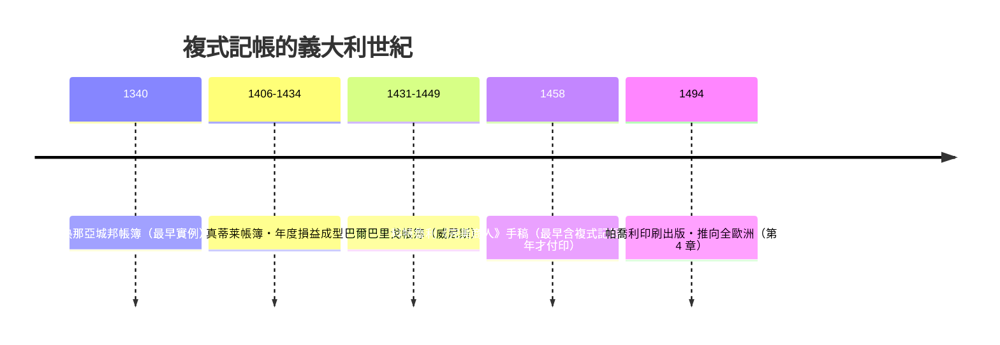

# 第二篇 第三章 第二節：熱那亞城邦帳簿（1340）——已知最早的複式記帳實例

> 1340 年，熱那亞。負責城邦財政的「massari（財務官）」帳簿中，出現了學界公認**最早完整使用複式記帳的實例**：每筆交易分錄兩處、借貸對應、兩邊金額相等。主持這套記錄的，是熱那亞的財務官們（1340 年度的帳冊通常歸功於該年度的財務官，其中常被提及的名字是**喬瓦尼·迪·內洛諾（Giovanni di Nolondo）**）。

## 一、它記的是「政府」的帳，不是商人的帳

一件常被忽略的事實：最早的複式記帳實例出現在**公共財政**帳冊裡。熱那亞此時已：

- 發行長期公債（compere），需要對大量債權人登記付息；
- 治理海外領地，收支跨海；
- 以「承保人（comperisto）」制度把戰爭與開發成本債券化。

政府債務人多、帳戶多、結算週期長——**只有複式結構才整理得動**。這再次驗證本書母題：制度壓力逼出記帳技術（烏魯克 1.2、埃及 2.1、熱那亞 3.2，之後是 1934 年的 SEC 7.2）。

## 二、1340 帳簿的技術特徵

| 特徵 | 內容 | 現代對應 |
|---|---|---|
| 兩處記錄 | 每筆交易在兩個帳戶各記一行 | 分錄 |
| 對應註明 | 標註「見某頁某帳戶」 | 對應帳戶（cross-reference） |
| 金額相等 | 借方合計＝貸方合計 | 借貸平衡 |
| 定期結算 | 年度結出損益與餘額 | 結帳 |

從熱那亞往後看，複式記帳在 14 世紀後半–15 世紀的義大利商人手中快速精緻化：威尼斯商人**多納塔·真蒂莱（Donato Gentile）**的帳簿（1406–1434，學者 Frederigo Melis 研究）已含年度損益與資本核對；**安德烈亞·巴爾巴里戈（Andrea Barbarigo）**（1431–1449，經學者 Raymond de Roover 等整理研究）的帳冊被視為威尼斯商人複式記帳的教科書級樣本。

## 三、法律與信任的配套

熱那亞與威尼斯的配套制度，使帳簿成為可信的社會基礎設施：

- **帳簿的證據力**：商事法庭承認商人帳冊為證據；帳簿須按規定格式連續記載，否則無效。
- **公證與見證**：大額契約附公證文書，帳冊記錄與公證相互印證。
- **城邦債券登記**：公債的利息與轉讓由官方登記冊管理——「中央登記制」的雛形（與 10.1 區塊鏈的「去中央登記」形成對照）。

## 四、後果：複式記帳＝資本主義的作業系統

歷史學者（如 Werner Sombart 的著名命題）指出：**沒有複式記帳，就難以想像資本主義**。原因不是玄學，而是功能：

1. **利潤變成可計算的量**：收入與成本分戶歸集，資本報酬第一次能被精確操縱。
2. **企業成為獨立主體**：帳戶把「商人個人」與「企業資本」區分——法人概念（見 5.1 東印度公司）有了記錄基礎。
3. **責任可稽核**：受託人（管家、船長、合夥人）的忠實義務有了客觀核對標準——**審計從「道德譴責」變成「技術核對」**。
4. **信用可放大**：銀行敢於放款，因為借款人的資產負債看得見。

---

*下一節：一位數學家兼修士，把這套商人秘術寫成印刷書——參見 [4.1 帕喬利](04.1-帕喬利.md)*