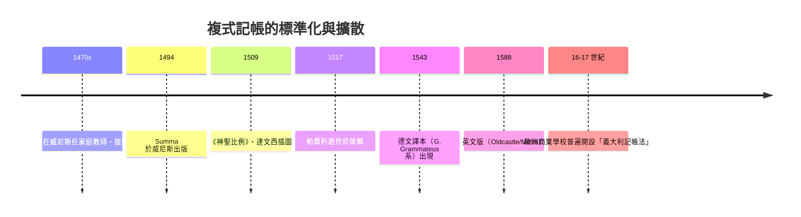

# 第二篇 第四章 第一節：盧卡·帕喬利與《算術、幾何、比例總論》（1494）——現代會計之父

> 1494 年 11 月，威尼斯。聖方濟各會修士、數學家**盧卡·帕喬利（Luca Pacioli, 約 1445–1517）**出版巨著《算術、幾何、比例總論》（Summa de arithmetica, geometria, proportioni et proportionalità）。書中一節「**計算與記錄詳論（Particularis de computis et scripturis）**」首次以印刷品系統講解複式記帳。帕喬利由此被後世尊為「**會計之父**」。

## 一、前因：一位「行走的大學」

帕喬利的人生本身就是一張文藝復興的人脈圖：

1. **少年學徒**：生於托斯卡納的聖塞波爾克羅小鎮，在富商 Folco de Belfolci 家中當學徒，從帳房裡接觸商業算術——**他的第一間會計教室是帳房**。
2. **數學家養成**：跟隨名師學數學，1470 年前後前往威尼斯，擔任富商 Antonio de Rompiasi 三個兒子的家庭教師，同時修習商業實務——他在威尼斯的帳房裡親眼看過複式記帳的實作。
3. **大學教授**：先後在佩魯賈、那不勒斯、羅馬、比薩、博隆尼亞、佛羅倫斯、威尼斯講授數學——用義大利方言（而非拉丁文）授課，把「算術」變成公民知識。
4. **與達文西同住**：1496 年起應盧多維科·斯福爾扎之邀赴米蘭，與列奧納多·達文西同住宮廷；他教達文西數學，達文西為他 1509 年的另一部著作《神聖比例》（De divina proportione）繪製幾何插圖——**「會計之父」與文藝復興全才互為師友**。

## 二、Summa 的第 36 章：把商人秘術變成標準教材

帕喬利聲明他沒有發明複式記帳（「威尼斯人在實務上早已使用」），他的功績是**整理、命名、系統化、印刷傳播**。他描述的方法包含現代會計的完整骨架：

| 帕喬利的三本帳 | 功能 | 現代對應 |
|---|---|---|
| 備忘簿（memoriale） | 逐筆隨手記 | 原始憑證／日記草稿 |
| 日記帳（giornale） | 按分錄格式整理 | 日記簿 |
| 分類帳（quaderno） | 分戶歸集 | 總分類帳 |

並提出至今仍在的鐵律與實務：

- **「沒有日記帳，就沒有分類帳」**——先分錄，後過帳；
- **借貸平衡**：「分類帳兩邊總和必須相等」，不等即有錯——試算平衡的發明；
- 每筆分錄註明日期、對方、貨幣與條件；數字用阿拉伯數字；
- **年度結帳**：結出損益、核對資本，舊帳轉新帳；
- 甚至提到**盤點存貨、驗證帳實**（監盤的雛形）。

一個流傳甚廣的趣聞：帕喬利也最早討論了「複式記帳的道德意涵」——他引述（轉述其師的告誡）說：商人應及時結帳，因為「**帳目不清，友誼與誠信都會潰散**」。誠信與核對並列，是會計倫理最早的表述之一。

## 三、印刷術：為什麼是 1494 而不是 1458

科特魯利的《完美商人》1458 年就寫好複式記帳（手稿），卻拖到 1573 年才出版——差別就在**古騰堡印刷術（1450 年代）與威尼斯印刷產業**。1494 年的威尼斯是歐洲印刷中心，Summa 立刻成為暢銷工具書；此後一個世紀，德國（Wolfgang Schweicker, 1549）、荷蘭、英國（Hugh Oldcastle / John Mellis, 1588）相繼翻譯改寫——**複式記帳以「教科書—商業學校—行會」的路徑制度化**。

## 四、身後：從修士到「會計之父」

- Summa 同書也首次整理了**雙記法（double-entry）以外的複式資產**：代數記號（他用「co」表未知數，是「方程式」教育的先聲）與魔方陣等，是文藝復興數學的綜合讀本。
- 1870 年代起，義大利與英語世界的會計史家開始尊他為「會計之父」；1994 年 Summa 出版五百週年時，全球會計專業大規模紀念。
- 他的一生示範了本書的反覆主題：**「記錄方法」的標準化，往往由教育者而非發明者完成**——發明在帳房（3.2），傳播在課堂。

---

*下一節：這套方法的社會效果——資本、公司與審計的誕生——參見 [4.2 複式記帳的世界征服](04.2-複式記帳的世界征服.md)*