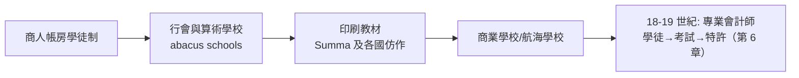

# 第二篇 第四章 第二節：複式記帳的世界征服——從美第奇帳房到資本主義的作業系統

> 1494 年之後的一個世紀，複式記帳從威尼斯的帳房走向阿姆斯特丹的交易所、倫敦的關棧、里斯本的船務所。本節看它的擴散路徑，以及一個大辯論：**是資本主義發明了複式記帳，還是複式記帳發明了資本主義？**

## 一、更早的證據：美第奇與曼努奇

帕喬利之前，複式記帳已是義大利商人的實務：

- **阿馬蒂諾·曼努奇（Amatino Manucci）**：1299–1300 年間，一位為法國普羅旺斯經商的佛羅倫斯人，留下被史家 Raymond de Roover 認定為**最早完整複式帳冊**的私人帳簿（1900 年代由 de Roover 從檔案中重現）。比熱那亞城邦帳簿更早，只是遲至 20 世紀才被學界確認。
- **美第奇家族**：科西莫·德·美第奇（1389–1464）統治下的美第奇銀行，其分號帳冊（如 1397 年設立的總行與羅馬、布魯日、倫敦分號）由史家 Raymond de Roover 於 20 世紀整理出版，顯示**分行制＋複式帳＋母行稽核**的管理架構：分號經理每年報帳，母行有權查核——跨國銀行的內控原型。
- **Giovannino Farolfi & Company**（尼姆分號，1299–1300）：法國尼姆的一家佛羅倫斯商行帳冊，包含**已知最早的完整年度損益與資本核對**（經學者 A. C. Littleton 與 B. S. Yamey 等研究）。

## 二、擴散的地圖：跟著商路與戰爭走

| 路徑 | 載體 | 例證 |
|---|---|---|
| 義大利→德意志 | 漢薩與南德商行、富格爾家族 | 富格爾（Fugger）16 世紀的複式簿記（Matthäus Schwarz 為其建帳，1516–） |
| 義大利→低地國 | 安特衛普交易所（1531） | 荷蘭文教材（Jan Ympyn Christoffels, 1543） |
| 低地國→英倫 | 清教徒商人與東印度公司 | John Mellis（1588）改編 Oldcastle |
| 葡西→海外帝國 | 帝國財政與船務 | 王室財政帳冊、馬尼拉大帆船貿易記錄 |

特別值得注意的是**新教倫理與複式記帳的結合**：韋伯筆下的清教徒商人視勤勉記帳為天職的自我檢驗——班傑明·富蘭克林在《窮理查年鑑》甚至把「勤於記帳」與「守護美德」並列（他自幼學的就是蘇格蘭式簿記）。**會計從技術變成倫理實踐。**

## 三、大辯論：誰發明了誰？

20 世紀會計史與經濟史的一場經典論戰：

| 立場 | 代表 | 論點 |
|---|---|---|
| 「複式記帳造就資本主義」 | Werner Sombart（1902《近代資本主義》） | 唯有複式記帳使「資本」「利潤」「企業」成為可計算的客體 |
| 「是商業需求造就記帳」 | B. S. Yamey（1949 起的系列論文） | 中世紀商人先有業務壓力，記帳是回應而非原因；早期商人甚至不用複式也能累積資本 |
| 中間派 | Geoffrey Hosking 等 | 複式記帳是「信用社會的基礎設施」——不決定資本主義發生，但決定其**規模上限** |

現代綜合結論大致是：**記帳技術是資本主義的必要條件而非充分條件**——它放大了商業組織的規模（同一邏輯：烏魯克泥板放大了神廟經濟、莎草紙放大了帝國）。

## 四、會計教育的誕生

複式記帳的傳播依賴一條教育產業鏈：

義大利的「算術學校（botteghe d'abaco）」是中產階級男孩的必經之路（達文西少年時也上過類似課程學計算）；「學會記帳」成為文藝復興城市的識字定義。**當一種記錄方法變成義務教育，它的社會權力就不可逆了。**

---

*第三篇：一家把「永續」寫進帳本的公司，與一場燒掉半個英國的泡沫——參見 [5.1 東印度公司](05.1-東印度公司.md)*