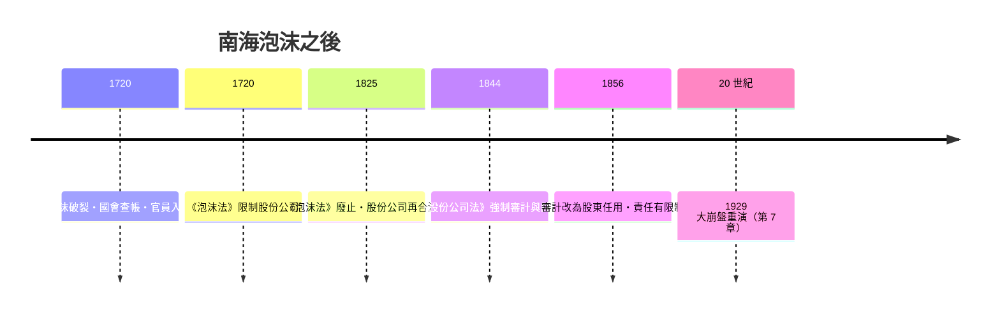

# 第三篇 第五章 第二節：南海泡沫（1720）——財務詐欺與獨立審計的起點

> 1720 年，倫敦。**南海公司（South Sea Company）**股價從年初約 128 鎊漲到 6 月逾 1,000 鎊，再於 9–12 月崩回 150 鎊以下。牛頓虧掉兩萬鎊，留下一句（後世流傳的）名言：「我能計算天體運行，卻無法計算人類的瘋狂。」泡沫破裂後，英國國會通過 1720 年《泡沫法》（Bubble Act）前後的一系列調查，並由**國會指定查帳人士核查公司帳冊**——會計史上，「獨立於經營層的外部查核」第一次成為重大公共事件。

## 一、前因：政府債務＋壟斷特許＝吹氣機

南海公司 1711 年由財政大臣**羅伯特·哈利（Robert Harley）**創立，商業模式是「債轉股」：

1. 政府欠巨額戰爭債務（西班牙王位繼承戰爭）。
2. 債權人把政府公債**換成**南海公司股票，公司向政府收取年金利息。
3. 公司名義上持有南美洲（西班牙殖民地）貿易特許——實際貿易利潤極其有限（受西班牙限制），**賺錢的想像全靠股價**。

1720 年，公司提出第三次債轉股方案，賄賂官員與議員以換取法案通過，並大量放貸給買自家股票的投資人、分批「認購＋分期付款」製造需求——**用金融工程吹大自己的股價**。同期數百個「泡沫公司」聞風上市（內含不可考的荒唐計畫，諸如「從西班牙進口公驢」之類的傳言多見於當時小冊，部分屬訛傳），促成 6 月《泡沫法》管制未經特許的股份公司——反而加速恐慌。

## 二、崩盤與「查帳」

1720 年秋泡沫破裂，全國財富蒸發、許多貴族與平民破產。國會的反應成為會計史的分水嶺：

- **成立國會調查委員會**，調閱南海公司帳冊與現金流記錄。
- 委員會僱用了兩位**會計師查核帳冊**：據會計史研究者（如 Geoffrey Holmes《Augustan England》與後續會計史文獻），受聘者包括**查爾斯·斯內爾（Charles Snell）**等會計師——Snell 常被稱為「英國第一位受聘查核公司帳冊的會計師」之一（具體文獻見 J. R. Edwards 會計史研究）。
- 調查揭露高層受賄，多名官員下台；財政大臣**艾斯勒比（John Aislabie）**被逐出下議院、關進倫敦塔。
- 公司董事的財產部分被沒收償還受損股東——「董事責任」首次成為法律實務。

**這是一次由外部人（國會＋會計師）對經營層帳目的獨立核查**——獨立審計的觀念在災難中誕生。

## 三、後果一：審計職業的種子

1720 年之後的一百年，英國逐步長出會計職業的土壤：

1. **破產清算業務**：1710 年《破產法》之後，破產管理人（assignee）需要專業記帳與查核——18 世紀會計師的主要業務是破產與遺產結算，不是上市公司審計。
2. **1820–1840 年代公司立法**：1844 年《股份公司法》（Companies Act 1844）要求公司註冊、保存帳簿並**接受審計**（審計人由股東任命）；1856 年修法改為可自願任用會計師。
3. **專業組織**：1854 年蘇格蘭愛丁堡會計師獲得皇家特許（見 6.2）——距 Snell 的查帳已 134 年。

## 四、後果二：金融監管的百年震盪

南海泡沫證明了一個會計學的永恆定理：**當資訊（帳）與現實（錢）脫鉤，市場的修正不是溫柔的，而是毀滅性的。**從 1720 到 2001（安隆），每一次重大詐欺之後，審計制度的權力與獨立性都會被迫升級一級。

---

*第六章：蒸氣機響起，成本會計誕生——參見 [6.1 成本會計](06.1-成本會計的誕生.md)*