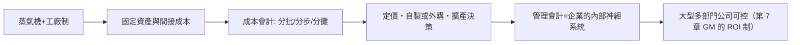

# 第三篇 第六章 第一節：蒸氣機響起——工廠制度與成本會計的誕生

> 1769 年，詹姆士·瓦特改良蒸氣機專利；1780 年代起，英國工廠拔地而起。會計迎來新問題：**在固定資產與大量工人面前，「一匹布的成本」到底是多少？**財務會計回答不了這題——成本會計（cost accounting）因此誕生。

## 一、前因：從「商人的帳」到「工廠的帳」

複式記帳擅長回答「賺了多少」（買賣差價清楚），但工廠的問題不同：

- **固定成本出現**：廠房、機器、燃料、監工——不隨產量變動，卻必須由產品吸收。
- **折舊問題**：機器會老化，其價值如何在各期分攤？（18 世紀尚無標準答案，常以「減值估計」處理）
- **間接費用分攤**：管理、照明、動力如何分到每個產品？
- **長期生產**：從投入原料到售出可跨數月，期間損益怎麼算？

喬賽亞·韋奇伍德（Josiah Wedgwood，陶瓷大王、達爾文的外祖父）是最早的實踐者之一：1772 年經濟蕭條訂單驟減時，他系統性地分析**固定成本與變動成本**，計算每件陶瓷的成本結構，據此決定降價與裁員策略——他在手記中直言自己「像掌管一家企業的司令官」。這是**管理會計用於經營決策**的經典早期案例。

## 二、早期的成本技術：英國與美國

| 技術 | 誰/哪裡 | 內容 |
|---|---|---|
| 分批成本制 | 造船、機械廠（Boulton & Watt 索霍鑄造廠，1790s–1800s） | 每一張訂單歸集直接料、工與分攤費用 |
| 分步成本制 | 紡織、冶鐵、麵粉等連續製程 | 按工序累積成本、計算約當產量 |
| 標準與差異思想的萌芽 | 美國鐵路與軍工（19 世紀中） | 預先訂定單位成本，實際比較——「標準成本」的前身 |
| 鐵路的「營運比率」 | 美國賓州鐵路（1850s–70s） | 營運費用／營業收入，控制長程運輸的成本效率（Alfred Chandler《看得見的手》的重點研究對象） |

**博爾頓與瓦特**的索霍工廠（Soho Manufactory, Birmingham）留下了 1790 年代起豐富的成本記錄：他們計算每台引擎的直接成本、按訂單分攤工廠費用、甚至核算「每小時人工成本率」——工業革命的管理會計，就在這些帳冊裡成長。

## 三、科學管理與標準成本（20 世紀初的集大成）

- **泰勒（F. W. Taylor）科學管理（1911《科學管理原理》）**：以時間動作研究訂出「標準工時」，成本控制從「事後算帳」轉為「事前定標準」。
- **標準成本制**：1910–20 年代由工程師與會計師共同完成（如 G. Charter Harrison 將標準成本系統化應用於工廠）。
- **損益兩平點（break-even）**：1930 年代由工程圖表發展為管理會計標準工具（Walter Rautenstrauch 的損益圖）。

## 四、制度學啟示

- **成本會計使「規模」成為武器**：知道單位成本，才能低價碾壓、才能多工廠複製——帝國式的企業組織（杜邦、通用汽車 1920 年代的投資報酬率控制，見 7.2 脈絡）仰賴它。
- 它也創造了新的道德難題：**折舊年限、費用分攤基準都是「判斷」**——利潤從此不是「自然事實」，而是**會計政策的產物**。這為 20 世紀的 GAAP 戰爭（7.2）埋下伏筆。

---

*下一節：1854 年，會計師拿到皇家特許狀——一個職業的成年禮——參見 [6.2 特許會計師](06.2-特許會計師的誕生.md)*