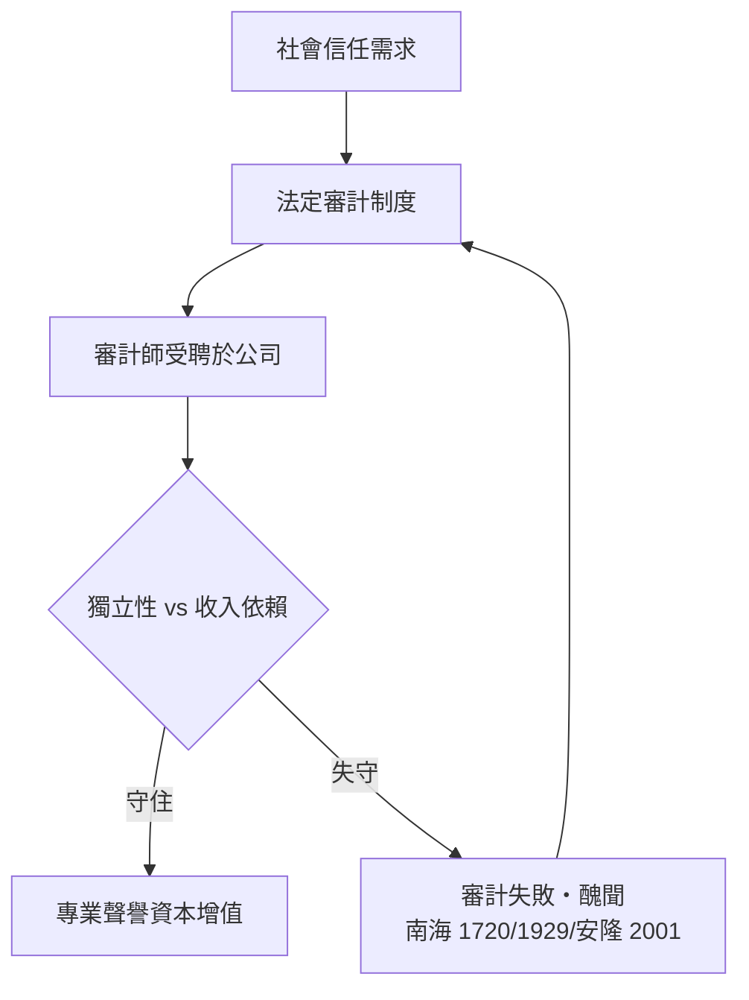

# 第三篇 第六章 第二節：1854 年，皇家特許——會計師職業的成年禮

> 1854 年 5 月，維多利亞女王簽發特許狀，愛丁堡的會計師們成立「**愛丁堡會計師公會（Society of Accountants in Edinburgh）**」，成員獲准使用「**特許會計師（Chartered Accountant, CA）**」頭銜。這是**會計師第一次以法律認可的專業身分存在**——距離南海泡沫的國會查帳（1720），剛好一百三十多年。

## 一、前因：破產與鐵路養出來的職業

19 世紀上半葉蘇格蘭會計師的三大業務來源：

1. **破產與信託管理**：蘇格蘭破產法下，會計師受任為破產管理人（trustee），管理清算財產——這是法律規定的「受託」角色，直接要求專業能力與誠信。
2. **遺產與家族財產管理**：蘇格蘭的「確認遺產（confirmation）」制度，指定會計師為執行人。
3. **鐵路熱潮**：1830–40 年代鐵路公司需要審計人（依 1844 年《股份公司法》及鐵路立法），會計師承接公司審計與籌資鑑價。

業務的共性是：**受公眾信任、替他人管理財產、以自己的專業聲譽作擔保**——這正是「專業（profession）」的定義要素。

## 二、特許狀的內容：把「誠信」寫成制度

愛丁堡公會的請願明言其目的：確保成員具備能力、受倫理約束、使公眾可以信賴其鑑證。特許狀授予：

| 制度要素 | 內容 |
|---|---|
| 考試入會 | 學徒制（契約培訓）＋筆試，非繳費即入 |
| 執業規範 | 倫理守則、業務標準 |
| 紀律權 | 公會可調查並除名會員——**以集體名譽擔保個人** |
| 法定頭銜 | 「CA」受法律保護 |

1855 年格拉斯哥、1867 年亞伯丁相繼取得特許；1880 年三家合併為**蘇格蘭特許會計師協會（ICAS）**。英格蘭跟進：1870 年倫敦會計師公會成立（Icaew 前身，1880 年獲特許）。美國則因 1880 年代英國資本輸入（英國會計師赴美查核鐵路與工業公司）而引入行業，1887 年成立美國公共會計師協會（AICPA 前身）；1896 年紐約州率先立法建立 CPA 執照制度。

## 三、審計的需求升級：1844→1900 年的公司法

特許職業與公司法互相拉動：

- **1844 年《股份公司法》**：註冊、公開、審計（審計人可是股東兼任）。
- **1856 年**：審計可由「會計師或其他人士」擔任——專業頭銜的商業價值確立。
- **1900 年《公司法》**：強制所有股份公司設審計人——審計成為普遍性的法定制度。
- **1948 年《公司法》**：審計人必須是「**合格的專業人士**」——審計市場向特許會計師完全開放，職業壟斷完成。

## 四、專業的兩難：客戶付錢，卻要替公眾把關

獨立審計從誕生起就背著一個結構性矛盾：**費用由受查公司支付，報告卻服務於全體股東與社會。**

這個循環每隔數十年就會被一次醜聞重置——1720（南海）、1890s（英國公司詐欺潮促成 1900 法定審計）、1930s（美國 1933/1934 證券法，見 7.1–7.2）、2000s（安隆，見 9.1）。**審計職業史，就是一部「信任危機—制度補強」的循環史。**

---

*第四篇：1929 年大崩盤與 SEC——參見 [7.1 大崩盤](07.1-大崩盤.md)*