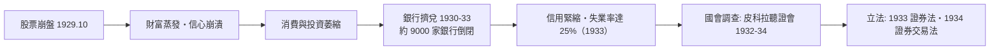

# 第四篇 第七章 第一節：1929 年大崩盤——財務不透明的毀滅性代價

> 1929 年 10 月 24 日（黑色星期四）與 10 月 29 日（黑色星期二），紐約證券交易所崩盤，接著是長達三年的大蕭條。事件對會計史的直接後果：**美國國會在 1933–1934 年立法，把「財務報告必須真實、且必須經獨立審計」寫成聯邦法律。**

## 一、前因：1920 年代的「無審計市場」

要理解崩盤的會計面向，先看當時的美國證券市場有多荒蕪：

| 現象 | 內容 |
|---|---|
| 無強制揭露 | 1920 年代上市公司**沒有法定義務**公布財務報表；許多公司根本不披露 |
| 無統一準則 | 各公司自定會計方法：折舊、庫存、子公司併報，全憑自選 |
| 無審計要求 | 紐約證交所不強制會員公司出具審計報告（直到 1933–34 才被法律改變） |
| 無監管機構 | 聯邦層級沒有證券主管機關；各州「藍天法」力量有限 |
| 集團操縱 | 投資信託、聯屬控股、內線交易、做手（pool operations）橫行 |

銀行家 Charles E. Mitchell（國民城市銀行總裁）等人的交易行為、投資信託的多層槓桿，都是後來參議院調查的重點。**問題的核心：投資人買股票時，根本看不到真實的資產負債表。**

## 二、崩盤與蕭條

1929 年 10 月崩盤本身不等於蕭條（跌價），但連鎖反應把金融系統拖垮：

1932 年起，參議院銀行貨幣委員會主持**皮科拉聽證會（Pecora Hearings）**——由律師**費迪南德·皮科拉（Ferdinand Pecora）**主持，把華爾街的內線交易、逃稅手法、假帳一一件件公開盤問。聽證會的媒體效果直接催生了新法。皮科拉在回憶錄中留下著名的觀察：華爾街「從未缺乏人才，缺的是管束」。

## 三、會計界的自我檢討

1929 年之前，美國會計界並非全然失職——問題是**沒有強制力與統一性**：

- 美國會計師協會（AIA）與聯邦貿易委員會、紐約證交所早在 1920 年代就辯論過「上市公司應否強制審計」。
- 崩盤前幾個月，紐約證交所與 AIA 才協商提高揭露標準——太晚了。
- 1932–34 年，AIA 成立特別委員會，與紐約證交所合作，**雙方在 1933–34 新法生效前主動承諾：上市公司財報必須經獨立會計師審計**（1933 年 NYSE 致會員函要求）。職業界知道：不自我升級，就會被政府接管。

## 四、啟示

- **資訊不透明是系統性風險**：當投資人無法分辨好公司與爛公司，市場會用最粗暴的方式一鍋端（逆向選擇的極端版）。
- **審計從「股東的私人服務」升級為「公共基礎設施」**：財務報告自此有公共利益屬性——這是 1720（5.2）與 2001（9.1）之間的中間節點。
- **災難驅動立法**：這個模式在會計制度史上反覆出現——1720 南海、1929 崩盤、2001 安隆。每次的立法都以「再也不許發生」為名，而每次詐欺都以新形式捲土重來。

---

*下一節：1934 年 SEC 與 GAAP 的誕生——參見 [7.2 SEC 與 GAAP](07.2-SEC與GAAP.md)*