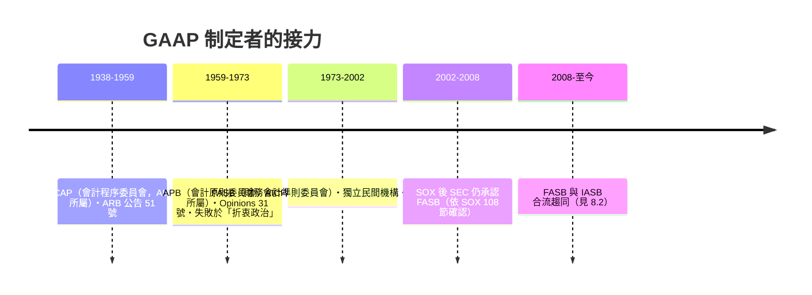

# 第四篇 第七章 第二節：1934 年 SEC 與 GAAP——「一般公認會計原則」的誕生

> 1934 年 6 月 6 日，羅斯福簽署《證券交易法》（Securities Exchange Act of 1934），設立**美國證券交易委員會（SEC）**。法律授權 SEC 制定「會計原則」——但 SEC 做了一個影響至今的決定：**不自己訂準則，而是把制定權委託給民間職業界，並以「與 GAAP（一般公認會計原則）一致」作為法定標準。**

## 一、立法架構：三層防線

| 法律 | 年份 | 核心規定 |
|---|---|---|
| 《證券法》（Securities Act） | 1933 | **發行市場**：公開募集必須註冊（registration statement），揭露經審計財報；虛偽揭露有民事責任 |
| 《證券交易法》 | 1934 | **交易市場**：設 SEC；上市公司持續揭露（年報 10-K、季報 10-Q）；高管對報告簽名負責 |
| SEC 會計系列公告（ASR） | 1930s– | SEC 對會計問題的官方立場（如著名的 ASR No. 4，1938） |

**1938 年 SEC 的 ASR No. 4** 是會計治理的分水嶺：SEC 宣布，財報若遵循「有實質權威支持（substantial authoritative support）」的會計原則即被接受——把制定權交給職業界，SEC 保留否決權。這個「**民間制定＋官方背書**」的雙層架構，運行了七十年（直到 2002 SOX 又調整，見 9.2）。

## 二、GAAP 的制定機構演化

- **CAP/APB 的教訓**：由職業團體兼任、委員兼職、緊急以「多數決意見書」補洞，被學界批評為「消防隊救火式」制定——原則零散、被利益集團各個擊破。
- **FASB 的改革**：1973 年成立，獨立於 AICPA、委員專職支薪、依「充分程序（due process）」公告草案徵求評論——會計準則制定從此像立法程序一樣運轉。
- **著名戰役**：1970s 末 FASB 試圖強制「投資稅貸（ITC）」的會計處理與「遞延稅」準則，遭國會與企業游說反撲——**會計準則從來是政治經濟學**。

## 三、審計的職業版圖也重劃

- **審計報告標準化**：1934 年起審計報告格式統一（「意見書」式）；1939 年 AIA 發布第一號審計程序公告（應對 McKesson & Robbins 庫存與虛構交易詐欺——加入存貨監盤與函證程序，至今仍在）。
- **GAAP 與 GAAS 並行**：財務會計準則（GAAP）管公司怎麼編表；審計準則（GAAS）管會計師怎麼查。
- **「真實公平」vs「公認原則」**：英美兩大傳統分岔——英國審計報告寫「true and fair view」，美國寫「fairly presented in accordance with GAAP」。這兩種語法最終在 IFRS 時代重新交鋒（8.2）。

## 四、理論的成熟：會計成為學科

- **1940 年，Paton 與 Littleton 出版《公司會計準則導論》（An Introduction to Corporate Accounting Standards）**：提出「企業個體、持續經營、計量單位、會計期間、成本歸屬」等基本概念——**會計理論第一次擁有公理化的框架**（呼應第 1 章的「數字從物中解放」）。
- 大學會計學系與博士生培養體系在戰後快速擴張；實證會計研究（1960s–80s，Ball & Brown 1968 起的盈餘與股價關聯研究）使會計成為社會科學的一支。

---

*下一節：1973 年 IASC 成立與 2005 年 IFRS 全球化——參見 [8.1 國際會計準則委員會](08.1-IASC.md)*