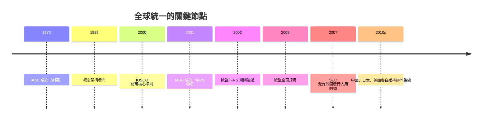

# 第四篇 第八章 第二節：2005 年，歐盟全面採用 IFRS——商業語言的全球統一

> 2005 年 1 月 1 日，**歐盟**約 7,000 家上市公司（合併報表）同步切換到**國際財務報導準則（IFRS）**。一紙法規使全球五分之一以上的股市市值採用同一套會計語言——會計史上的「大統一時刻」。

## 一、前因：歐盟為什麼要放棄自家準則

歐盟原本有自己的路線：1978 年《第四號指令》（年報格式與真實公允原則）、1983 年《第七號指令》（合併報表）。但到 1990 年代，兩個壓力使「自己做」不再划算：

1. **歐洲企業赴美上市潮**：戴姆勒賓士 1993 年成為第一家在紐約證交所上市的德國公司，當年須按 US GAAP 重編——**德國會計制度下 6 億馬克的「利潤」，在 US GAAP 下變成近 10 億馬克的「虧損」**（著名案例，凸顯制度差異）。
2. **統一市場的資本效率**：歐元（1999）啟動後，跨境投資與併購需要可比財報；各國自行修法太慢。

2000 年，歐盟執委會發布策略文件（通稱 Lamfalussy 架構的一部分），決定**直接引入 IASB 的準則**，並於 2002 年 7 月通過《IFRS 規則（Regulation (EC) No 1606/2002）》：**上市公司合併財務報表自 2005 年 1 月 1 日起強制採用 IFRS**（允許非上市公司與個別報表延後）。

## 二、歐盟的機制設計： endorsed 與 carve-out

歐盟不能直接讓「倫敦的私人機構」立法管歐洲公司，於是發明了**認可機制（endorsement）**：

1. **技術專家組織（EFRAG）**評估每號 IFRS；
2. **會計監管委員會（ARC）**（各國代表）表決認可；
3. 經歐盟程序納入法規，成為「EU-IFRS」。

並留下兩個著名的「**carve-out（切出條款）**」（2008 年金融危機時對 IAS 39 金融工具準則的部分排除）——**歐盟保留主權的否決權**。這顯示：全球標準不是取代立法權，而是「標準制定者＋法域認可」的雙層結構（與 7.2 的「SEC 背書 FASB」同構）。

## 三、全球地圖：IFRS 的擴散

| 地區 | 採用方式 |
|---|---|
| 歐盟（2005） | 強制（合併報表） |
| 澳洲（2005）、香港、新加坡、南非、巴西（2010） | 全面或近似全面強制 |
| 加拿大（2011）、韓國（2011） | 強制轉換 |
| 日本 | 自願採用（2010 起，逐年增加的上市公司清單） |
| 美國 | **未採用**——外國公司可依 IFRS 申報（2007 年 SEC 解除調節表要求），本國公司仍用 US GAAP |
| 中國 | 自定「企業會計準則（CAS）」，與 IFRS 持續趨同但未等同 |
| 台灣 | 2013 年起分階段採用（TIFRS，後改稱 EAS/IFRSs 併行架構） |

**美國的例外**是最大懸案：SEC 2007 年允許外國私募發行人用 IFRS；2008 年發布「路線圖」討論本國公司轉換；2010–2014 年後立場降溫，宣布「繼續支持趨同但維持 US GAAP」——全球會計語言統一至今仍是「**雙方言並存**」。

## 四、IFRS 的內容特徵：原則導向

IFRS 自我標榜「**原則基礎（principles-based）**」：給出目標與原則，較少「亮線規則」（bright-line rules）；US GAAP 則被視為「規則基礎」、細則浩繁。學理上：

- 原則導向要求編表者與審計者**更多判斷**——彈性大，但也更依賴誠信與監管；
- 規則導向可核對性強，但易被「**形式合規、實質繞過**」（安隆的 SPE 正是鑽規則漏洞的經典，見 9.1）。

兩者之間的張力，是 21 世紀會計準則制定的核心難題——FASB 與 IASB 自 2002 年《諾沃克協議》（Norwalk Agreement）起持續**趨同**（收入認列 IFRS 15 / ASC 606、租賃 IFRS 16 / ASC 842 等共同準則），但金融工具、減損等仍存分歧。

---

*第五篇：2001 年，一家「明星公司」塌陷，一間百年事務所陪葬——參見 [9.1 安隆案](09.1-安隆案.md)*