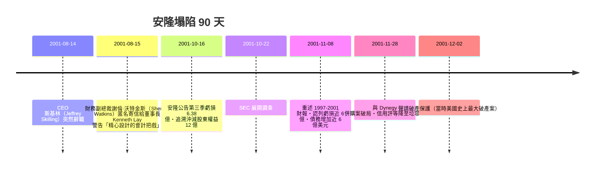

# 第五篇 第九章 第一節：安隆案（2001）——世紀財務詐欺與安達信的解體

> 2001 年 12 月 2 日，休士頓。曾為全美第七大公司、連續六年獲《財星》「最有創新精神企業」的**安隆（Enron）**聲請破產。數月後，替它查帳 16 年、成立近 90 年的「五大」會計師事務所之一**安達信（Arthur Andersen）**被判妨礙司法而失去執照、宣告解體。**一家公司與一家事務所同時塌陷**——這是會計史上最昂貴的失敗。

## 一、前因：造假的三件工具

安隆的詐欺不是簡單的「做假帳」，而是一組**會計工程的疊加**：

### 1. 特殊目的個體（SPE）與表外負債

- 安隆設立數以千計的 SPE（如著名的 **LJM1、LJM2、Raptor 系列**），由 CFO 安德魯·法斯托（Andrew Fastow）主導。
- 憑「3% 外部權益」的形式規則，SPE 可**不併入**安隆報表——負債藏到表外。
- SPE 之間互相擔保、循環交易：安隆把資產「賣」給 SPE 做出獲利，SPE 的錢實際來自安隆的股票質押。

### 2. 市值會計（mark-to-market）用於長期合約

- 1990 年代安隆轉型能源交易商，SEC 豁准其對長期能源合約採「市值會計」：**簽約當天就把未來十幾年的預估利潤一次認列**。
- 模型參數（未來電價、成交量）可自由調整——「利潤」成為模型的產物。1990 年代末安隆帳面獲利高速成長，現金流卻持續為負。

### 3. 高管利益衝突

- 法斯托管理 SPE 卻領取數千萬美元「管理費」；
- CFO 以 SPE 對沖自家公司資產——**自己跟自己對賭**。

## 二、崩塌的時間線

## 三、安達信的毀滅：審計獨立性的全面崩潰

安達信的問題不只是「沒查出來」，而是**結構性地不能查**：

- **顧問費大於審計費**：2000 年安達信自安隆收取約 5,200 萬美元（審計約 2,500 萬＋非審計服務約 2,700 萬）——查帳人是被查者的顧問與系統商。
- **休士頓分所的客戶依賴**：安隆是分所最大客戶，合夥人生涯與客戶深度綁定。
- **銷毀文件（2001 年 10 月下旬）**：內部通知依文件政策銷毀相關工作底稿——2002 年 6 月被聯邦大陪審團以**妨礙司法**起訴（2005 年美國最高法院因陪審團指示不當撤銷定罪，但為時已晚：客戶早已出走，公司已解體）。
- 同期的**世界通訊（WorldCom）案**（2002 年 6 月爆發，安達信也是其審計師；虛增費用資本化約 38 億美元、總計約 110 億美元虛報）把「五大」變「四大」。

## 四、代價與啟示

- 安隆員工退休金（大量配置安隆股票）血本無歸；四名高管定罪（Lay 判決後死亡、Skilling 服刑至 2019 年獲減刑釋放、Fastow 服刑）。
- 市場教訓：**當利潤來自模型而非現金，先看現金流量表**；「表外」三個字應自動觸發懷疑。
- 審計職業教訓：**非審計服務與客戶依賴，會使獨立性在不知不覺中死掉**——這正是 SOX（9.2）立法的直接靶心。

---

*下一節：2002 年《薩班斯-奧克斯利法案》——參見 [9.2 薩班斯法案](09.2-薩班斯法案.md)*