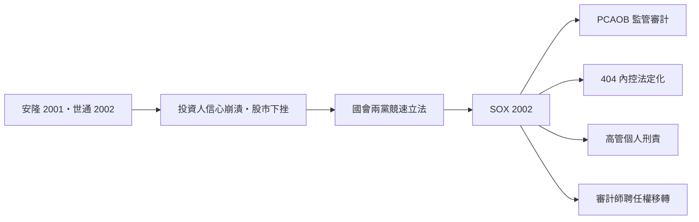

# 第五篇 第九章 第二節：2002 年《薩班斯-奧克斯利法案》——重塑企業內控與審計監管

> 2002 年 7 月 30 日，布希總統簽署《薩班斯-奧克斯利法案》（Sarbanes-Oxley Act, SOX）。法案以兩位發起人命名：民主黨參議員**保羅·薩班斯（Paul Sarbanes）**與共和黨眾議員**麥克·奧克斯利（Michael Oxley）**。從起草到簽署只花了約半年——**會計監管史上最快的重構**。

## 一、法案的核心改動

### 1. 設立 PCAOB：審計業的「警察」

- **公眾公司會計監督委員會（PCAOB）**成立：註冊管理所有查上市公司的會計師事務所、制定審計準則、**每年（大型事務所）輪番檢查、可開罰、可吊銷註冊**。
- 這終結了 1934 年以來（見 7.2）「審計自律」的百年傳統——**外部審計第一次有了專責政府監管者**。

### 2. 內控強制：著名的「302 條款」與「404 條款」

- **第 302 條**：CEO 與 CFO 必須**親自簽署**季報年報，聲明報告真實且內控有效——虛偽簽署最高刑責 20 年（與詐欺同級）。
- **第 404 條**：管理層每年評估並揭露**財務報告內部控制**，審計師須對此出具意見（404(b)）——內控從「建議最佳實務」變成「法定審計標的」。
- **第 802 條**：銷毀審計工作底稿入刑——直接回應安達信事件。
- **第 906 條**：簽署虛偽財報，罰金最高 500 萬美元、刑期最高 20 年。

### 3. 獨立性重劃

- 禁止對審計客戶提供多類非審計服務（簿記、財務資訊系統設計、內部審計外包、精算、管理等）。
- 審計合夥人**五年輪替**（主要與覆核合夥人）。
- 組成審計委員會（全部由獨立董事組成）並由其聘任審計師——**把審計師的聘任權從管理層手中移走**（回應 9.1 的結構性矛盾）。

## 二、前因的因果鏈

## 三、後果：成本、外溢與批評

- **遵循成本**：大型公司 404 條款初年動輒數百萬至上千萬美元；中小企業與外國公司抱怨「**SOX 稅**」——2006 年起 SEC 對小公司與外國發行人放寬 404(b) 適用；不少外國企業改選倫敦 AIM 上市，避開 SOX 適用。
- **治理實效**：學界實證研究整體顯示，內控缺陷揭露增加、盈餘管理下降、審計品質（PCAOB 檢查懲處機制）改善；但因果強度仍有爭論。
- **全球擴散**：日本 2006 年《金融商品交易法》（J-SOX）、歐盟 2006 年「8 號指令修訂」先後引入類似內控與審計監管——**美國的危機立法再次成為全球模板**（與 1934 年 SEC 同一條路徑）。
- **PCAOB 的長程角色**：2000 年代查安達信後繼者；2010 年代起推動跨國檢查（對中國審計機關的檢查僵局成為中美審計監管戰核心，2022 年達成檢查協議）；2024 年起發布「品質管理」新準則。

## 四、制度學定位

SOX 完成了 1934 年未竟之事：**把「審計由誰監督」這個後設問題制度化**。

| 層級 | 制度 | 誕生年份 |
|---|---|---|
| 公司帳 | GAAP/IFRS | 1930s / 2005 |
| 查帳者 | 獨立審計＋審計準則 | 1854 / 1930s |
| **查「查帳者」** | **PCAOB** | **2002** |
| 查「公司治理」 | 審計委員會（法定） | 2002 |

三千年來，會計制度的每一次升級都是「**在上一層之上再架一層核對**」（泥板→封印→複式→審計→監管）。SOX 是這條遞歸的當代頂點——而下一節的區塊鏈與 AI，則是對「**需不需要那一層『人』**」的挑戰。

---

*第十章：比特幣、三式記帳與 AI——參見 [10.1 區塊鏈](10.1-比特幣與分散式帳本.md)*