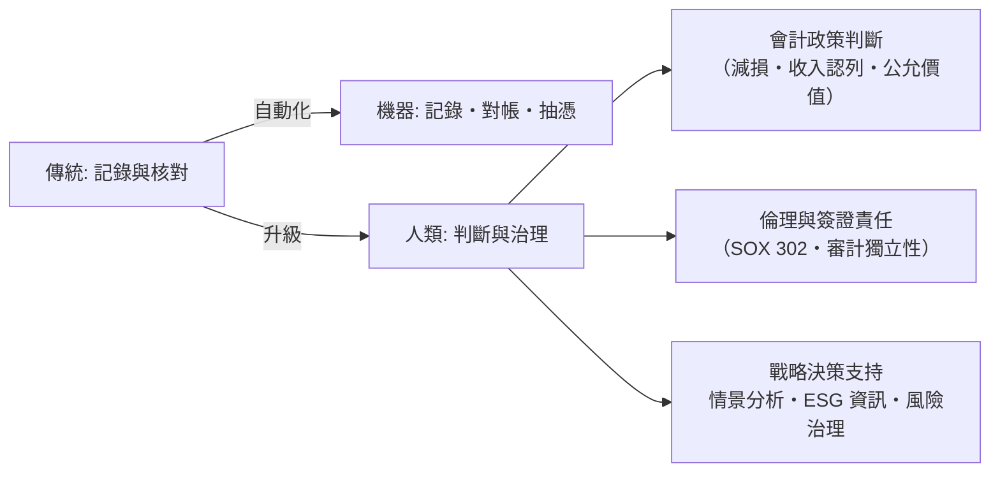

# 第五篇 第十章 第二節：AI 與自動化時代——會計師從「記錄者」到「戰略決策者」

> 2016 年 3 月，四大的德勤（Deloitte）發表報告預測：100 個會計工作項目中，95% 在 20 年內「高可能性」被自動化影響。同年，IBM 的認知系統 Watson 被導入稅務與審計工作底稿檢索。一場持續至今的轉型展開：**記錄、核對、編表——被機器接管；判斷、倫理、決策——成為人類會計師的新戰場。**

## 一、前因：自動化早已進行四十年

會計的自動化不是從 AI 開始的：

| 階段 | 年代 | 技術 | 效果 |
|---|---|---|---|
| 電算化 | 1960s–80s | 大型機、總帳套裝軟體 | 過帳自動化 |
| 個人電腦與試算表 | 1979 VisiCalc → Excel（1985） | 報表模型平民化 | 分析師時代 |
| ERP | 1990s（SAP R/3、Oracle） | 交易—總帳一體 | 「記帳」與「業務」合流 |
| 雲端與 RPA | 2010s | 機器人流程自動化、光學辨識 | 憑證輸入、對帳自動化 |
| 智慧自動化 | 2016– | 機器學習、NLP、生成式 AI | 抽憑、底稿撰寫、異常偵測 |

關鍵的結構變化：**ERP 使每一筆業務交易自動產生會計分錄**——會計師從「編分錄的人」變成「設計與稽核分錄規則的人」。

## 二、AI 在審計與財務的實際應用（真實案例）

- **異常偵測**：四大（Deloitte 的 Argus、KPMG 的 Clara、PwC 的 Halo/Gl.ai、EY 的 Helix）以機器學習對總帳與日記帳全量掃描，標記異常分錄（週末入帳、尾數規律、罕見科目組合）——**從抽樣審計走向全量審計**。
- **合同與底稿閱讀**：NLP 抽取租賃、收入合約條款，輔助 IFRS 16 / IFRS 15 的判斷。
- **持續審計（continuous auditing）**：系統 24/7 監控控制點，取代年度事後查核。
- **生成式 AI（2023–）**：起草底稿說明、稅務研究摘要、管理層討論與分析初稿——同時帶來「**幻覺與責任**」問題（與法律界 Mata v. Avianca 教訓同源，見《法律設計者的故事》10.3）：輸出必須經專業人員複核並負責。

## 三、會計師的轉型地圖

- **判斷無法外包**：公允價值、預期信用損失（IFRS 9 的前瞻假設）、永續發展資訊的邊界，全是「模型＋判斷」的混合體——機器算得出數字，選不了假設。
- **責任無法外包**：簽證是法律行為（SOX 第 302、906 條），AI 不能替人坐牢。
- **新戰場：永續報導（ESG）**：氣候揭露（ISSB 的 IFRS S1/S2，2023 年發布；歐盟 CSRD 2024 起分階段適用）把「非財務資訊的鑑證」變成會計職業的新版圖——這是 1934 年「向公眾交代」精神的環境版。

## 四、結語：三千年的母題

從烏魯克的黏土籌碼到雲端總帳，會計史的每一章其實都在回答同一個問題：

> **如何讓看不見的資源流動，變成可以被核對、被信任、被問責的記錄？**

- 籌碼與封印（1.1）→ 防偽；
- 複式（3.2）→ 自我檢核；
- 特許與審計（6.2）→ 職業擔保；
- GAAP/IFRS（7.2、8.2）→ 共同語法；
- SOX（9.2）→ 監督監督者；
- 區塊鏈與 AI（10.1、10.2）→ 把核對與判斷重新分配給機器與人。

機器接管了「記錄」，人類保留下「承擔」。**會計師的未來，不在算得更準，而在為無法自動化的判斷負責**——這是庫辛（1.2）在泥板上寫下自己名字的那一刻，就已埋下的職業天職。

---

*全書完。回到 [README 目錄](README.md)*