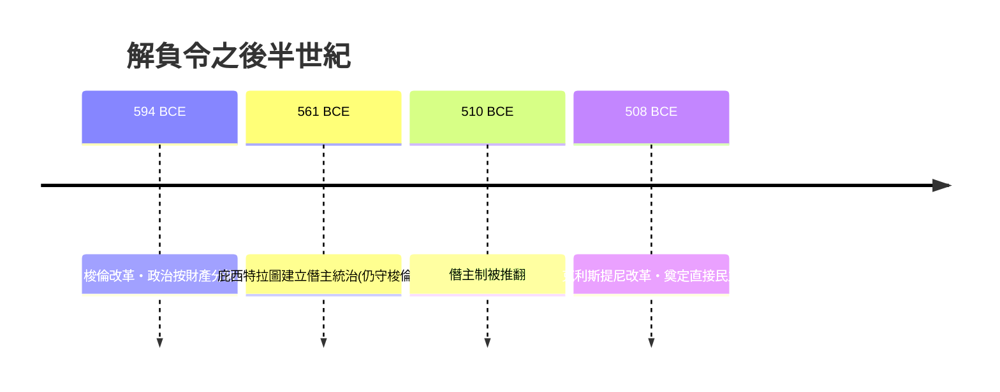

# 第一篇 第一章 第二節：梭倫的解負令——拔除界石、解放債奴的雅典大手術

> 約公元前 594 年，雅典。詩人梭倫（Solon）被城邦各派一致推為執政官（Archon），獲得授權進行憲政改革。他做的第一件事震驚全城：宣告一攬子債務無效，拔除刻在債務人田地上的抵押界石（horoi），並贖回被賣往海外的雅典公民。這場改革古希臘人稱之「**解負令**」（Seisachtheia，「甩掉負擔」）。

## 一、前因：雅典的經濟地雷

雅典在公元前 7 世紀的社會結構，是一座建立在農業信貸上的火藥庫：

1. **土地兼併**：小農歉收即舉債，借貸以「人身上的權利」作擔保——還不出錢，債務人本人與家人淪為債務奴隸。
2. 債務奴隸（debt-bondage）合法化，公民喪失自由。
3. 貴族（Eupatridae）壟斷官職與土地，平民無政治發聲管道。
4. 商品經濟興起，新興工商階層（多半是平民）對血統貴族制日益不滿。

亞里士多德《雅典政制》記載：矛盾激化到「貧者幾乎要拿起武器」。雅典瀕臨內戰（stasis）。

## 二、梭倫的處方：一次做三件事

| 改革 | 具體措施 | 制度意義 |
|---|---|---|
| 解負令 | 廢除以人身為擔保的債務；國家出資贖回被賣到海外的公民 | 清除「公民淪為奴隸」的制度性風險 |
| 財產分級 | 按（農業／商業／現金）財產分四級，任官按級而非血統 | 上層階級的定義從「血統」變「能力」 |
| 政治參與 | 全體公民入公民大會（Ekklesia），設四百人會議與陪審法庭（Heliaia） | 平民第一次有了制度性的投票權與上訴法院 |

梭倫刻意**不沒收土地重新分配**——他自述走的是中間路線：「我給人民足夠的權力，不多也不少。」這使他同時被富人和窮人怨恨，卻也避免了雅典社會的兩極對抗。

## 三、獨特的執行設計：立法者的「自我拘束合約」

梭倫做出一個影響兩千多年立法倫理的決定：**立法完成後，要求全城起誓十年內不改法律，自己也藉機遠走埃及、小亞細亞旅行十年**。他在詩中明言：他不願回來為任何一派解釋或修改法律。

這是史上第一個「制度凍結期」實驗：讓規則有時間自我沉澱，防止立法者本人淪為派系工具。壞處是十年間雅典陷入派系紛爭，最後由親戚庇西特拉圖以僭主（Tyrant）之姿接手——梭倫晚年還公開勸阻這位同族不能毀憲。（庇西特拉圖日後「依梭倫法律統治」，反證了法制的慣性。）

## 四、後果：為雅典民主鋪路

解負令的本質是**一次主權債務重整＋人身權利贖回**：它承認「制度性債務危機」無法靠個別契約解決，必須由政治權威出手改寫清償規則。這套邏輯在兩千年後的銀行紓困、主權債務重整與破產法中不斷重演，千古如一的問題是：**契約自由與社會存續衝突時，法律該站在哪一邊？**

---

*下一節：神明如何被請出法庭、文字如何取而代之——參見 [1.3 從神判到成文法](01.3-從神判到成文法.md)*